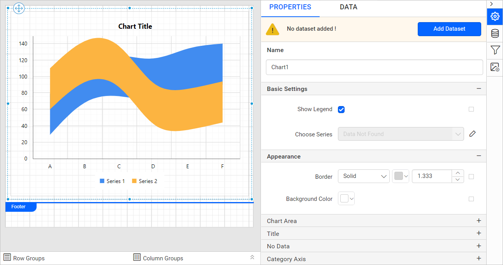
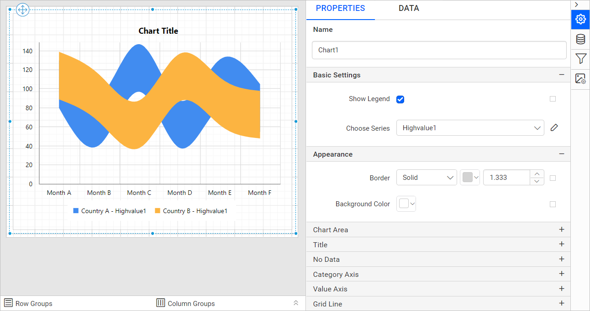
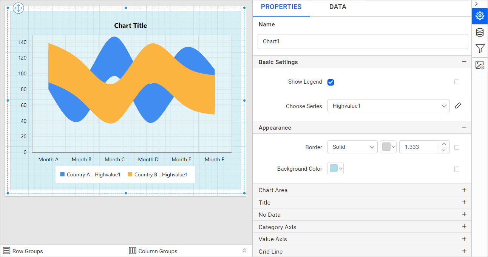
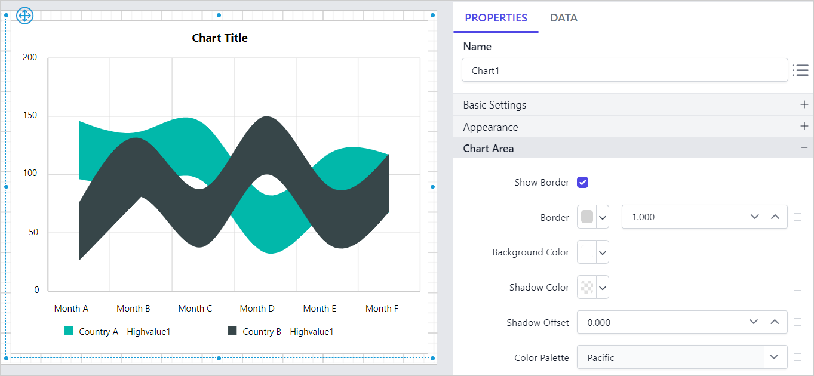
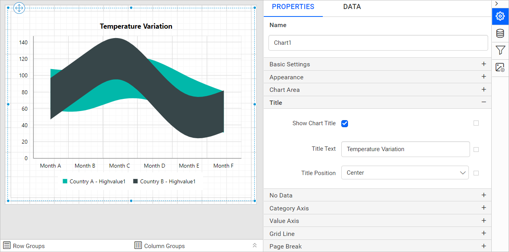

# Smooth range area chart in Bold Reports<sup>®</sup> Web Report Designer

You add a **Smooth Range Area Chart** to a report in the Bold Reports<sup>®</sup> Web Report Designer by dragging it from the item panel. Use it to display a range of data with two Y-values (low and high) per data point, connected by smooth curves. The chart displays information as a range of data by plotting two Y-values (low and high) per data point.

## How do I add a smooth range area chart to the report?

The Bold Reports<sup>®</sup> Web Report Designer lists the smooth range area chart under the `Distribution` category in the item panel.

1. Drag a smooth range area chart from the item panel and drop it into the design area.

   

2. The Web Report Designer renders the smooth range area chart in the design area and lists the chart properties in the properties panel.

   

## How do I create data for the smooth range area chart?

To present data in a Bold Reports<sup>®</sup> smooth range area chart, create a dataset and bind it to the chart data region. This example uses the following JSON data to create the dataset.

```json
[
   {
      points:
      [{Month: 'Jan', Highvalue: 6.1, Lowvalue: 0.7}, {Month: 'Feb', Highvalue: 6.3, Lowvalue: 1.3},
      {Month: 'Mar', Highvalue: 8.5, Lowvalue: 1.9}, {Month: 'Apr', Highvalue: 10.8, Lowvalue: 3.1},
      {Month: 'May', Highvalue: 14.4, Lowvalue: 5.7}, {Month: 'Jun', Highvalue: 16.9, Lowvalue: 8.4},
      {Month: 'Jul', Highvalue: 19.2, Lowvalue: 10.6}, {Month: 'Aug', Highvalue: 16.5, Lowvalue: 10.5},
      {Month: 'Sep', Highvalue: 16.1, Lowvalue: 8.5}, {Month: 'Oct', Highvalue: 12.5, Lowvalue: 6},
      {Month: 'Nov', Highvalue: 6.9, Lowvalue: 1.5}, {Month: 'Dec', Highvalue: 12.1, Lowvalue: 5.1}],
      Country: 'India'
},
   {
      points:
      [{Month: 'Jan', Highvalue: 7.1, Lowvalue: 1.7}, {Month: 'Feb', Highvalue: 7.7, Lowvalue: 1.9},
      {Month: 'Mar', Highvalue: 7.5, Lowvalue: 1.2}, {Month: 'Apr', Highvalue: 9.8, Lowvalue: 2.5},
      {Month: 'May', Highvalue: 11.4, Lowvalue: 4.7}, {Month: 'Jun', Highvalue: 14.4, Lowvalue: 6.4},
      {Month: 'Jul', Highvalue: 17.2, Lowvalue: 9.6}, {Month: 'Aug', Highvalue: 17.9, Lowvalue: 10.7},
      {Month: 'Sep', Highvalue: 15.1, Lowvalue: 7.5}, {Month: 'Oct', Highvalue: 10.5, Lowvalue: 3},
      {Month: 'Nov', Highvalue: 7.9, Lowvalue: 1.2}, {Month: 'Dec', Highvalue: 9.1, Lowvalue: 4.1}],
      Country: 'Germany'
   }
]
```

> Refer to the [Create Data](./../../../manage-data/dataset/create-an-embedded-dataset/) section for more information. This example creates a dataset using [JSON inline data](./../../../manage-data/data-connectors/json-data-source/#inline-data) to design the report.

## How do I assign data to the smooth range area chart?

A Bold Reports<sup>®</sup> **Smooth Range Area Chart** needs a minimum of 2 value elements and 1 column element to display data. Drop the measure or expression field you want to analyze into the `High(s)` or `Low(s)` section. Drop the dimension that categorizes the measure onto the `Column` section. To categorize by a series, also drop the respective dimension onto the `Row(s)` section.

To configure data in a smooth range area chart, follow these steps:

1. Focus on the chart report item placed in the design area.

2. Click the `Properties` icon in the configuration panel to open the property pane, and switch to the `DATA` tab.

   

3. Choose a dataset from the dropdown list, which shows the data available in the report.

   

4. Review the fields. The `Measures` section lists numeric columns and numeric expressions. The `Dimensions` section lists other column types and dimension expressions.

   

5. **Drag and Drop Measure Element**:

   Drag the `Highvalue` or the numeric expression column from the `Measures` section and drop it in the `High(s)` section.

   

   The following image shows the report item design after you add the high value field.

   

   Drag the `Lowvalue` or the numeric expression column from the `Measures` section and drop it in the `Low(s)` section.

   

   The following image shows the report item design after you add the low value field.

   

6. **Aggregate Options**:

   Click the `Settings` icon (highlighted in the following image) to open the aggregation type dropdown list.

   

   Set the aggregation type used to compute the selected column.

   

7. **Drag and Drop Dimension Element**:

   Drag the dimension element from the `Dimensions` section and drop it into the `Column` section. The dimension measures against the numeric column(s) selected in the `High(s)` or `Low(s)` section.

   

   The following image shows the report item design after you add the dimension field.

   

8. **Grouping**:

   Group the added column element with another column by adding the respective dimension element into the `Row(s)` section.

   

   The following image shows the report item design after you add the row grouping.

   

9. **Formatting Column and Row(s) sections**:

   You can also [Filter](./../../../compose-report/filter-data/), [Sort](./../../../compose-report/sort-data/), or [Group](./../../../compose-report/group-data/) the Column or Row(s) sections using expressions.

   For example, this report sorts the `Month` field using the `=Month(cdate("1-" & Fields!Month.Value))` expression.

   

   

   

## How do I format the smooth range area chart?

You format a smooth range area chart in the Bold Reports<sup>®</sup> Web Report Designer through the settings in the `Properties` tab. Use them to get the view you require.

To format a smooth range area chart, follow these steps:

1. Drag and drop the smooth range area chart into the design area and resize it to the required size.
2. Configure the data for the smooth range area chart.
3. Focus on the smooth range area chart and click the `Properties` icon in the configuration panel to open the property pane.

   

The property pane lists the properties available for the report item with their default values.

### Name

The **Name** property gives the smooth range area chart item a unique name in the report.


### Basic Settings

The **Basic Settings** category of the smooth range area chart contains the `Show Legend` and `Choose Series` properties.


#### Show Legend

A legend is text that describes the plotted data in a Bold Reports<sup>®</sup> chart. You can toggle the visibility of the legend in the chart and customize the legend text appearance. To set or reset legend properties, refer to the [Show Legend](./../../../report-items/chart/legend/) property.

#### Choose Series

The `Choose Series` dropdown lists the available series when you add multiple series to the chart. To customize the series appearance, choose the required series name in the dropdown.


Refer to the [Series](./../../../report-items/chart/series/) section to customize each series using the properties panel.

### Appearance

The **Appearance** properties style the smooth range area chart with border style, color, width, and background color in the report design. These properties are listed under the `Appearance` category in the properties panel.




### Chart Area

The **Chart Area** property customizes the area of the smooth range area chart design.


Use the [Color Palette](./../../../report-items/chart/color-palette/) property to customize the color of the chart. The `Color Palette` is listed under the `Chart Area` category.

In this example, the `Color Palette` is set to `Pacific`. The following image shows the design.



### Title

The chart title of the smooth range area chart is shown or hidden with the `Show Chart Title` checkbox. Customize the **chart title** by editing the `Title Text` property of the chart. You can also customize the font color, font text, font style, border, background, and position of the title.




### No Data

The **No Data** property displays static text when the dataset returns empty or zero rows at runtime.


To set or reset no data message properties, refer to the [No Data Message](./../../../report-items/chart/no-data-message/) property section.

### Category Axis

The **Category axis** of a Bold Reports<sup>®</sup> chart displays text labels instead of numbers. To use the categorical axis, toggle the `Enable Axis` checkbox under the `Category Axis` category in the chart properties.


To set or reset axis properties, refer to the [Axis Properties](./../../../report-items/chart/axis/) property.

### Value Axis

The **Value axis** of a Bold Reports<sup>®</sup> chart uses a numerical scale and displays numbers as labels. To use the value axis, toggle the `Enable Axis` checkbox under the `Value Axis` category in the chart properties.


To set or reset axis properties, refer to the [Axis Properties](./../../../report-items/chart/axis/) property.

### Grid line

The **Grid line** properties of the smooth range area chart can be set for the category axis and the value axis.


#### Category Axis

To show the grid line for the category axis, enable the `Category Axis` checkbox.


You can also enable the `Minor Grid Lines` and customize the major and minor gridline style and color in the `Advanced Options` menu.


#### Value Axis

To show the grid line for the value axis, enable the `Value Axis` checkbox.


You can also enable the `Minor Grid Lines` and customize the major and minor gridline style and color in the `Advanced Options` menu.


### Page break

The **page break** property controls the amount of information on each page when you preview the report. To apply the page break property to the chart report item, follow these steps:

1. Choose a `Break Location` type in the dropdown. The **Break Location** property specifies where the page break occurs.

   

2. To prevent predefined page breaks from being applied during report preview, enable the `Break Disabled` property checkbox. You can also control page breaks during report preview by using expressions. For details on setting and resetting page breaks dynamically, refer to the [Set Expression](./../../../compose-report/properties-panel/#set-expression) and [Reset Expression](./../../../compose-report/properties-panel/#reset-expression) sections.

   

3. To restart page numbering on each page, enable the `Page Number Reset` property checkbox.

   

### Data Element

The **Data Element** properties control the visibility of the chart report item when you export the report in XML format. The properties panel lists them under the `Data Element` category.


#### Name

The `Name` field assigns a custom name to the chart element. The chart report item is exported with the provided name.


> Note: The name cannot contain spaces, and it must begin with a letter followed by letters, numbers, or the underscore character (_).

#### Output

The `Output` property controls the visibility of the chart when you export the report. Choose one of the following options:

* **Auto** or **Output** - Exports the chart report item.
* **NoOutput** - Does not export the chart report item.


### Miscellaneous

The **Miscellaneous** category of the smooth range area chart contains the page name, custom attributes, document map, bookmark, tooltip, and custom style properties.

#### Page name

The **page name** property names the first worksheet of the Excel workbook when you export the report to Excel format.


You can set static or dynamic text as the page name. To set and reset dynamic text, refer to the [Set Expression](./../../../compose-report/properties-panel/#set-expression) and [Reset Expression](./../../../compose-report/properties-panel/#reset-expression) sections.

#### Custom attributes

The **custom attributes** property sets the values for chart custom properties. To assign values to custom properties using the properties panel, refer to the [Custom Properties](./../../../compose-report/common-properties/#custom-properties) section.

#### Document Map

A **document map** is a navigational feature that displays a separate side pane with navigational links in a hierarchical structure when you view a report. Users click an item in the list to navigate to the report page that displays that item. Refer to the [Document Map](./../../../compose-report/document-map/) section to configure the document map in the report design.

You can set static or dynamic text as the value of the document map property. To set and reset dynamic text, refer to the [Set Expression](./../../../compose-report/properties-panel/#set-expression) and [Reset Expression](./../../../compose-report/properties-panel/#reset-expression) sections.

#### Bookmark

Bookmark links let users navigate to different parts of an SSRS report. You can add bookmarks to each textbox, image, table, or chart, or to the unique group values displayed in a tablix, to direct users to specified locations in the report. The bookmark value can be your own string or an expression. Refer to the [Bookmark](./../../../compose-report/bookmark/) section to configure bookmarks in the report design.

You can set static or dynamic text as the value of the bookmark property. To set and reset dynamic text, refer to the [Set Expression](./../../../compose-report/properties-panel/#set-expression) and [Reset Expression](./../../../compose-report/properties-panel/#reset-expression) sections.

#### Tooltip

The **Tooltip** property displays informative text or values when the user hovers over the report item in the report preview. To set the tooltip for the chart item using the properties panel, refer to the [Tooltip](./../../../compose-report/common-properties/#tooltip) section.

To customize the tooltip in the report preview, open the [Series Properties](https://help.boldreports.com/enterprise-reporting/designer-guide/report-designer/report-items/chart/series/#tooltip) and set the tooltip under the Miscellaneous category as follows.
`="Country: " & Fields!Country.Value + "<br>" + "Month: " & Fields!Month.Value + "<br>" + "High Value: " + Fields!Highvalue.Value + "<br>" + "Low Value: " + Fields!Lowvalue.Value`


#### Custom Style

The `Custom Style` property enables the use of external CSS for styling report items, providing enhanced flexibility beyond the built-in styling options. Use this property to meet specific design requirements and maintain consistent styling across multiple reports. For a step-by-step guide on setting up custom styles in your report, check the **How To** section of this guide.


## How do I preview the smooth range area chart report?

You preview the smooth range area chart report in the Bold Reports<sup>®</sup> Web Report Designer by clicking the preview icon in the design view.

1. The following image shows the final design view of the report.

   

2. The following image shows the report preview.

   

> Download the [smooth range area chart report design file from GitHub](https://github.com/boldreports/resources/tree/master/docs/report-designer/chart/smooth-range-area-chart.rdl).

## Frequently asked questions

### What is the minimum data a smooth range area chart needs?

A Bold Reports<sup>®</sup> smooth range area chart needs a minimum of 2 value elements and 1 column element. Drop the values into the `High(s)` and `Low(s)` sections.

### How do I show high and low values in the tooltip?

Set the tooltip in the series properties under the Miscellaneous category with an expression that combines the `Highvalue` and `Lowvalue` fields, as shown in the Tooltip section.

## See also

* [Chart series properties](./../../../report-items/chart/series/)
* [Chart color palette](./../../../report-items/chart/color-palette/)
* [Chart axis properties](./../../../report-items/chart/axis/)
