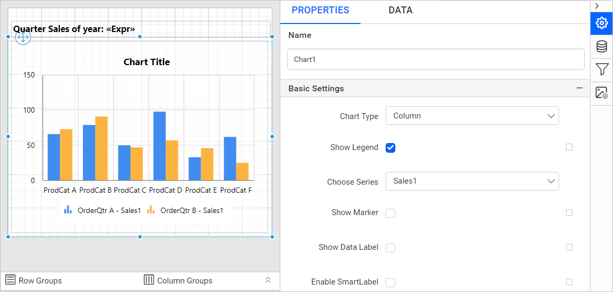

# Sort data in a chart data region

In the {{site.productNameTM}} Web Report Designer, you control the order of data in a chart data region by setting sort expressions. You can sort the data in either ascending or descending order.

## How do I set a sort expression on a chart category group?

You set a sort expression on a chart category group from the `DATA` tab of the {{site.productNameTM}} Web Report Designer.

1. Select the chart data region in the design area.
   
2. Switch to the `DATA` tab.
   
3. In the `DATA` assign panel, click the `Settings` icon under the column section.
   
4. Click the `Sorts...` option in the menu. The sort dialog opens, as shown in the following image.
   
5. Create the required sort expression in the sort dialog and click the `OK` button. For details, refer to the [Sort Data](./../../../compose-report/sort-data/) section.
   

## What does the sorted chart look like?

The sorted chart in the {{site.productNameTM}} report preview shows the category values in the order set by the sort expression. In this example, a sort expression sorts the `ProductCategory` field in descending order (Z-A). On report preview, the `ProductCategory` field values are sorted in Z-A alphabetical order.

## Can I sort a chart series group?

Yes. In the {{site.productNameTM}} Web Report Designer, you can set a sort expression on a `chart series group` in the same way.

> Download the [chart sort data report design file from GitHub](https://github.com/boldreports/resources/tree/master/docs/report-designer/chart/sort-data-in-chart-data-region.rdl)

## See also

* [Sort data in reports](./../../../compose-report/sort-data/)
* [Add filters to a chart data region](./../../../report-items/chart/add-filters-to-chart-data-region/)
* [Chart series properties](./../../../report-items/chart/series/)
