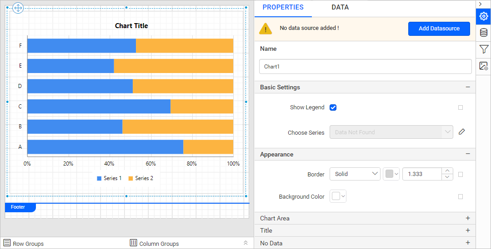
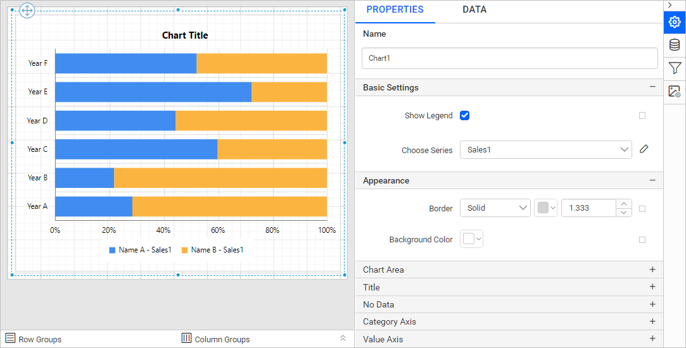
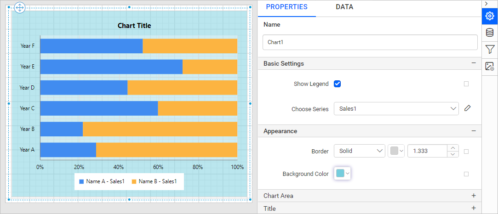
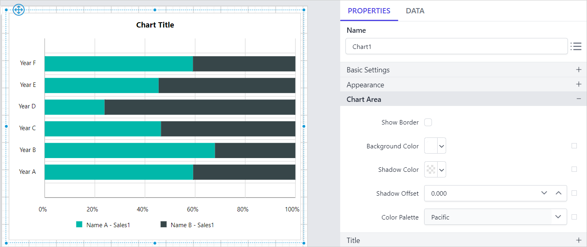

# Add a Stacked Bar 100% Chart in the Bold Reports<sup>®</sup> Web Report Designer

The **Stacked Bar 100% Chart** in the Bold Reports<sup>®</sup> Web Report Designer compares multiple measures through bars stacked one after the other horizontally. You add it from the item panel, bind data to it, and format it in the properties panel.

## How do I add a stacked bar 100% chart to the report?

The Bold Reports<sup>®</sup> Web Report Designer lists the stacked bar 100% chart under the `Comparison` category in the item panel.

Drag and drop a stacked bar 100% chart from the item panel into the design area.


The stacked bar 100% chart renders in the design area, and the properties panel lists the chart properties.



## How do I create data for the stacked bar 100% chart?

To present data in a Bold Reports<sup>®</sup> stacked bar 100% chart, create a dataset and bind data to the chart data region. This example uses the following JSON data to create the dataset.

```json
[
   {
      points: [
         { Year: 2007, Sales:453 }, { Year: 2008, Sales: 354 }, { Year: 2009, Sales: 282 }, { Year: 2010, Sales: 321 },
         { Year: 2011, Sales: 333 }, { Year: 2012, Sales:351 }, { Year: 2013, Sales:403 }, { Year: 2014,Sales:421 }],
      Name: "John"
   },
   {
      points: [
         { Year: 2007, Sales:876 }, { Year: 2008, Sales: 564 }, { Year: 2009, Sales: 242 }, { Year: 2010, Sales: 121 },
         { Year: 2011, Sales: 343 }, { Year: 2012, Sales: 451 }, { Year: 2013, Sales:203 }, { Year: 2014,Sales:431 }],
      Name: "Andrew"
   },
   {
      points: [
         { Year: 2007, Sales:356 }, { Year: 2008, Sales:876 }, { Year: 2009, Sales: 898 }, { Year: 2010, Sales: 567 },
         { Year: 2011, Sales: 456 }, { Year: 2012, Sales: 345 }, { Year: 2013, Sales: 543 }, { Year: 2014, Sales:654 }],
      Name: "Thomas"
   },
   {
      points: [
         { Year: 2007, Sales: 122 }, { Year: 2008, Sales: 444 }, { Year: 2009, Sales: 222 }, { Year: 2010, Sales: 231 },
         { Year: 2011, Sales: 122 }, { Year: 2012, Sales: 333}, { Year: 2013, Sales: 354}, { Year: 2014,Sales:100 }],
      Name: "Hendry"
   }
]
```

> For more information, see [Create an embedded dataset](./../../../manage-data/dataset/create-an-embedded-dataset/). This example creates the dataset with [JSON inline data](./../../../manage-data/data-connectors/json-data-source/#inline-data) to design the report.

## How do I assign data to the stacked bar 100% chart?

The Bold Reports<sup>®</sup> **Stacked Bar 100% Chart** needs a minimum of 1 value element and 1 column element to render. Drop the measure or expression field you want to analyze into the `Y Value(s)` section. Drop the dimension that categorizes the measure into the `Column` section. To categorize by a series, also drop the respective dimension into the `Row(s)` section.

To configure data in a stacked bar 100% chart, follow these steps:

1. Select the chart report item in the design area to bind data to it.

2. Click the `Properties` icon in the configuration panel to open the property pane. Then, switch to the `DATA` tab.

   

3. Choose a dataset in the dropdown list. The dropdown lists the data available in the report.

   

4. Review the fields. The `Measures` section lists numeric columns and numeric expressions. The `Dimensions` section lists other types of columns and dimension expressions.

   

5. **Drag and Drop Measure Element**:

   Drag the numeric column (measure element) or the numeric expression column from the `Measure` section and drop it in the `Y Values` section.

   

   The following image shows the report item design after you add the Y value field.

   

6. **Aggregate Options**:

   Click the `Settings` icon (highlighted in the image) to open the aggregation type dropdown list.

   

   Set the aggregation type that computes the selected column.

   

7. **Drag and Drop Dimension Element**:

   Drag the dimension element from the `Dimensions` section and drop it into the `Column` section. The dimension measures against the numeric column(s) selected in the `Y  Value(s)` section.

   

   The following image shows the report item design after you add the dimension field.

   

8. **Grouping**:

   Group the added column element with another column by adding the respective dimension element into the Row(s) section.

   

   The following image shows the report item design after you add the row field.

   

9. **Formatting Column and Row(s) sections**:

   You can also [Filter](./../../../compose-report/filter-data/), [Sort](./../../../compose-report/sort-data/), or [Group](./../../../compose-report/group-data/) the Column or Row(s) sections using expressions.

## How do I format the stacked bar 100% chart?

You format a stacked bar 100% chart in the Bold Reports<sup>®</sup> Web Report Designer through the settings in the `Properties` tab. Use them to get the view you need.

To format a stacked bar 100% chart, follow these steps:

1. Drag and drop the stacked bar 100% chart into the design area and resize it to the required size.

2. Configure the data for the stacked bar 100% chart.

3. Select the stacked bar 100% chart and click the `Properties` icon in the configuration panel to open the property pane.

   

The property pane lists the properties available for the report item with their default values.

### Name

The **Name** property provides a unique name for the stacked bar 100% chart item in the report.


### Basic Settings

The **Basic Settings** category of the stacked bar 100% chart contains the **Show Legend** and **Choose Series** properties shown in the following image.


#### Show Legend

A chart legend is text that describes the plotted data. You can toggle the visibility of the legend in the chart and customize the legend text appearance. To set or reset legend properties, see the [Show Legend](./../../../report-items/chart/legend/) property.

#### Choose Series

The stacked bar 100% chart lists all series you add in the `Choose Series` dropdown. To customize a series appearance, choose the required series name in the dropdown.


To customize each series using the properties panel, see [Series](./../../../report-items/chart/series/).

### Appearance

The stacked bar 100% chart **Appearance** properties (border style, color, width, and background color) style the chart and customize its appearance in the report design. The properties panel lists these properties under the `Appearance` category.




### Chart Area

The stacked bar 100% chart **Chart Area** properties, such as border width, color, shadow color, shadow offset, and background color, customize the area of the chart design.


The properties panel lists these properties under the `Chart Area` category.


In this example, the `Color Palette` is set to `Pacific`. The following image shows the resulting design.



Use the [Color Palette](./../../../report-items/chart/color-palette/) property to customize the color of the chart.

### Title

To show or hide the stacked bar 100% chart title, toggle the `Show Chart Title` checkbox. Customize the **chart title** by editing the `Title Text` property of the chart.


Use these properties to customize the font color, font text, font style, border, background, and position of the title in the chart design.

### No Data

The stacked bar 100% chart **No Data** property displays static text when a dataset returns empty or zero rows at runtime.


To set or reset no data message properties, see the [No Data Message](./../../../report-items/chart/no-data-message/) property section.

### Category Axis

The stacked bar 100% chart **Category axis** displays text labels instead of numbers. To use the categorical axis, toggle the `Enable Axis` checkbox under the `Category Axis` category in the chart properties.


To set or reset axis properties, see the [Axis Properties](./../../../report-items/chart/axis/) property.

### Value Axis

The stacked bar 100% chart **Value axis** uses a numerical scale and displays numbers as labels. To use the value axis, toggle the `Enable Axis` checkbox under the `Value Axis` category in the chart properties.


To set or reset axis properties, see the [Axis Properties](./../../../report-items/chart/axis/) property.

### Grid line

You can set the stacked bar 100% chart **Grid line** properties for the category axis and the value axis.


#### Category Axis

To show the grid line for the category axis, enable the `Category Axis` checkbox.


You can also enable the `Minor Grid Lines` and customize the major and minor gridline style and color in the `Advanced Options` menu.


#### Value Axis

To show the grid line for the value axis, enable the `Value Axis` checkbox.


You can also enable the `Minor Grid Lines` and customize the major and minor gridline style and color in the `Advanced Options` menu.


### Page break

The stacked bar 100% chart **page break** property controls the amount of information on each page when you preview the report. To apply the page break property to the chart report item, follow these steps:

1. Choose a `Break Location` type in the dropdown. The **Break Location** property specifies where the page break occurs.

   

2. To prevent predefined page breaks from being applied during report preview, enable the `Break Disabled` property checkbox. You can also control page breaks during report preview with expressions. For details on setting and resetting page breaks dynamically, see the [Set Expression](./../../../compose-report/properties-panel/#set-expression) and [Reset Expression](./../../../compose-report/properties-panel/#reset-expression) sections.

   

3. To restart page numbering on each page, enable the `Page Number Reset` property checkbox.

   

### Data Element

The stacked bar 100% chart **Data element** properties control the visibility of a report item when you export the report in XML format. The properties panel lists them under the `Data Element` category.


#### Name

The `Name` field assigns a custom name to the chart element. The chart report item exports with the provided name.


> Note: The name cannot contain spaces, and it must begin with a letter followed by letters, numbers, or the underscore character (_).

#### Output

The `Output` property controls the visibility of the chart when you export the report. Each option performs the following operation:

* **Auto** or **Output** - Exports the chart report item.
* **NoOutput** - Does not export the chart report item.


### Miscellaneous

The stacked bar 100% chart **Miscellaneous** category contains the page name, custom attributes, document map, bookmark, tooltip, and custom style properties.

#### Page name

The **page name** property names the first worksheet of the Excel workbook when you export the report to Excel format.


You can set static or dynamic text as the page name. To set and reset dynamic text, see the [Set Expression](./../../../compose-report/properties-panel/#set-expression) and [Reset Expression](./../../../compose-report/properties-panel/#reset-expression) sections.

#### Custom attributes

The **custom attributes** property sets the values for chart custom properties. To assign values to custom properties using the properties panel, see the [Custom Properties](./../../../compose-report/common-properties/#custom-properties) section.

#### Document Map

A **document map** is a navigational feature that displays a separate side pane with a set of navigational links in a hierarchical structure when you view a report. A user can click the content in the list to navigate to the report page that displays that item. To configure the document map in the report design, see the [Document Map](./../../../compose-report/document-map/) section.

You can set static or dynamic text as the value for the document map property. To set and reset dynamic text, see the [Set Expression](./../../../compose-report/properties-panel/#set-expression) and [Reset Expression](./../../../compose-report/properties-panel/#reset-expression) sections.

#### Bookmark

Bookmark links let users navigate to different parts of an SSRS report. You can add bookmarks to each textbox, image, table, or chart, or to the unique group values displayed in a tablix, to direct users to specified locations in the report. The value of the bookmark property can be your own strings or an expression. To configure bookmarks in the report design, see the [Bookmark](./../../../compose-report/bookmark/) section.

You can set static or dynamic text as the value for the bookmark property. To set and reset dynamic text, see the [Set Expression](./../../../compose-report/properties-panel/#set-expression) and [Reset Expression](./../../../compose-report/properties-panel/#reset-expression) sections.

#### Tooltip

The **Tooltip** property displays informative text or values when the user hovers over the report item in the report preview. To set a tooltip for a chart item using the properties panel, see the [Tooltip](./../../../compose-report/common-properties/#tooltip) section.

#### Custom Style

The `Custom Style` property enables external CSS for styling report items, giving more flexibility than the built-in styling options. Use this property to meet specific design requirements and keep styling consistent across multiple reports. For a step-by-step guide on setting up custom styles in your report, see the **How To** section of this guide.


## How do I preview the stacked bar 100% chart report?

You preview the stacked bar 100% chart report from the design view of the Bold Reports<sup>®</sup> Web Report Designer.

1. Review the final design view of the report, shown in the following image.

   

2. Preview the report. The following image shows the report preview.

   

> Download the [stacked bar 100% chart report design (RDL) from GitHub](https://github.com/boldreports/resources/tree/master/docs/report-designer/chart/stacked-bar-100-chart.rdl).

## Frequently asked questions

### Where is the stacked bar 100% chart in the item panel?

The Bold Reports<sup>®</sup> Web Report Designer lists the stacked bar 100% chart under the `Comparison` category in the item panel.

### What data does a stacked bar 100% chart need?

The stacked bar 100% chart needs a minimum of 1 value element in `Y Value(s)` and 1 column element in `Column`. Add a dimension to `Row(s)` to categorize by series.

## See also

* [Chart legend properties](./../../../report-items/chart/legend/)
* [Chart series properties](./../../../report-items/chart/series/)
* [Chart axis properties](./../../../report-items/chart/axis/)
* [Chart color palette](./../../../report-items/chart/color-palette/)
