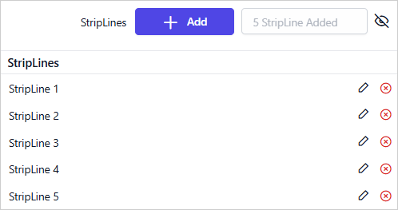

# Add Chart Striplines in the {{site.productNameTM}} Web Report Designer

Striplines in the {{site.productNameTM}} Web Report Designer are visual indicators that highlight specific values or ranges on a chart axis. Use them to emphasize important data points, thresholds, or intervals. You customize the appearance of chart striplines in the Properties panel.

## How do I add, view, edit, or delete a stripline?

You manage chart striplines in the {{site.productNameTM}} Web Report Designer from the **StripLines** property in the Properties panel.

1. To create a stripline, click the `+ Add` button. The total number of striplines appears next to the add button.

   

2. To show or hide the striplines list, use the `Eye` icon.

   

3. To remove a stripline, click the `Delete` icon.

   

4. To customize a stripline, click the `Edit` icon.

   

The secondary panel then displays the properties of that stripline.

## Which charts support striplines?

{{site.productNameTM}} chart striplines are not supported for the Polar and Radar chart types.

> **Note**: The **StripLines** property is not supported for Polar and Radar chart types. Also, the applied StripLine properties do not appear in the design view. They are only visible in the report preview.

## Appearance

The stripline **Appearance** properties set the background color and border of each chart stripline.

### Background Color

The **Background Color** property customizes the chart stripline background color. If the chart has multiple striplines, use this property to tell them apart.

You can also set properties based on dynamic values by using `Expressions`. To open the set or reset expression menu in the properties panel, see the [Set Expression](./../../../compose-report/properties-panel/#set-expression) and [Reset Expression](./../../../compose-report/properties-panel/#reset-expression) sections.

### Border

The **Border** properties customize the chart stripline border color and width.

You can also set properties based on dynamic values by using `Expressions`. To open the set or reset expression menu in the properties panel, see the [Set Expression](./../../../compose-report/properties-panel/#set-expression) and [Reset Expression](./../../../compose-report/properties-panel/#reset-expression) sections.

## Title

The stripline **Title** properties set the text, font, orientation, and alignment of the stripline title.

### Title Text

Customize the stripline title by editing the `Title Text` property of the chart stripline.

You can also set properties based on dynamic values by using `Expressions`. To open the set or reset expression menu in the properties panel, see the [Set Expression](./../../../compose-report/properties-panel/#set-expression) and [Reset Expression](./../../../compose-report/properties-panel/#reset-expression) sections.

### Font

The stripline **Font** properties (font family, font size, font color, font style, and font weight) style the title content in the stripline.

### Font Family

The `Title` category lists the supported font family names in a dropdown. To change the `Font Family` of the stripline title, choose the required font family in the dropdown list.

You can also set properties based on dynamic values by using `Expressions`. To open the set or reset expression menu in the properties panel, see the [Set Expression](./../../../compose-report/properties-panel/#set-expression) and [Reset Expression](./../../../compose-report/properties-panel/#reset-expression) sections.

### Font Color

To set the font color for the stripline title content, click the color palette icon and choose the required color in the `Color Palette`.

You can also set properties based on dynamic values by using `Expressions`. To open the set or reset expression menu in the properties panel, see the [Set Expression](./../../../compose-report/properties-panel/#set-expression) and [Reset Expression](./../../../compose-report/properties-panel/#reset-expression) sections.

### Font Size

The **Font Size** property controls the size of the stripline title text. Use the numeric dropdown to increase or decrease the font size.

You can also set properties based on dynamic values by using `Expressions`. To open the set or reset expression menu in the properties panel, see the [Set Expression](./../../../compose-report/properties-panel/#set-expression) and [Reset Expression](./../../../compose-report/properties-panel/#reset-expression) sections.

### Font Styles

To change the font style of the stripline title content, choose the required font style in the `Font Style` dropdown list. The stripline title supports the following font styles:

* Default
* Normal
* Italic

You can also set properties based on dynamic values by using `Expressions`. To open the set or reset expression menu in the properties panel, see the [Set Expression](./../../../compose-report/properties-panel/#set-expression) and [Reset Expression](./../../../compose-report/properties-panel/#reset-expression) sections.

### Font Weight

To change the font weight of the stripline title content, choose the required font weight in the dropdown list.

You can also set properties based on dynamic values by using `Expressions`. To open the set or reset expression menu in the properties panel, see the [Set Expression](./../../../compose-report/properties-panel/#set-expression) and [Reset Expression](./../../../compose-report/properties-panel/#reset-expression) sections.

### Text Orientation

The `Text Orientation` property controls the direction of the stripline title text. Choose the required option in the dropdown list.

* **Auto** - Automatically adjusts the text orientation based on the stripline direction.
* **Horizontal** - Displays the text in the standard horizontal direction.
* **Rotated90** - Rotates the text 90 degrees clockwise.
* **Rotated270** - Rotates the text 270 degrees clockwise (equivalent to 90 degrees counterclockwise).

### Vertical Align

The **Vertical Align** property aligns the stripline title content to the `Top`, `Middle`, or `Bottom` position. Choose the required option in the `Vertical Align` dropdown list.

You can also set properties based on dynamic values by using `Expressions`. To open the set or reset expression menu in the properties panel, see the [Set Expression](./../../../compose-report/properties-panel/#set-expression) and [Reset Expression](./../../../compose-report/properties-panel/#reset-expression) sections.

## Interval

The stripline **Interval** properties set where a stripline starts on the axis, how often it repeats, and how wide it is.

### Interval

The `Interval` property defines how often the stripline repeats along the axis. For example, an interval of `2` renders a stripline at every 2 units along the axis. Leave the field empty to render the stripline only at the position defined by `Interval Offset`.

You can also set properties based on dynamic values by using `Expressions`. To open the set or reset expression menu in the properties panel, see the [Set Expression](./../../../compose-report/properties-panel/#set-expression) and [Reset Expression](./../../../compose-report/properties-panel/#reset-expression) sections.

### Interval Type

The `Interval Type` property specifies the unit of measurement for the `Interval` value.

### Interval Offset

The `Interval Offset` property specifies the starting position of the stripline on the axis. For example, an offset of `10` places the stripline at value `10` on the axis.

You can also set properties based on dynamic values by using `Expressions`. To open the set or reset expression menu in the properties panel, see the [Set Expression](./../../../compose-report/properties-panel/#set-expression) and [Reset Expression](./../../../compose-report/properties-panel/#reset-expression) sections.

### Interval Offset Type

The `Interval Offset Type` property specifies the unit of measurement for the `Interval Offset` value.

### Strip Width

The `Strip Width` property defines the width of the stripline band measured along the axis. Use this property to render the stripline as a shaded range rather than a single reference line. For example, a `Strip Width` of `5` renders a band spanning 5 units along the axis.

You can also set properties based on dynamic values by using `Expressions`. To open the set or reset expression menu in the properties panel, see the [Set Expression](./../../../compose-report/properties-panel/#set-expression) and [Reset Expression](./../../../compose-report/properties-panel/#reset-expression) sections.

### Strip Width Type

The `Strip Width Type` property specifies the unit of measurement for the `Strip Width` value.

The preceding properties are configured for StripLine 1. The remaining four striplines use their own properties to represent different seasonal periods throughout the year. Together they depict the weather report shown in the report preview.

## What does a report with striplines look like?

A {{site.productNameTM}} chart with striplines shows them only in the report preview. In the following example, striplines on the `Category Axis` represent the weather report and highlight different seasonal periods throughout the year.

> Download the [category axis stripline report (RDL) from GitHub](https://github.com/boldreports/resources/tree/master/docs/report-designer/chart/chart-category-axis-stripline.rdl).

> Download the [value axis stripline report (RDL) from GitHub](https://github.com/boldreports/resources/tree/master/docs/report-designer/chart/chart-value-axis-stripline.rdl) for the `Value Axis` stripline example.

## Frequently asked questions

### Why do striplines not appear in the design view?

Applied stripline properties do not appear in the design view of the {{site.productNameTM}} Web Report Designer. They are only visible in the report preview.

### How do I draw a shaded band instead of a single line?

Set the `Strip Width` property. For example, a `Strip Width` of `5` renders a band spanning 5 units along the axis.

## See also

* [Chart axis properties](./../axis/)
* [Chart series properties](./../series/)
* [Chart types](./../types/)
