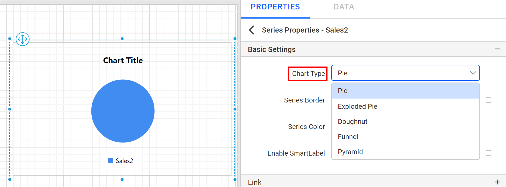
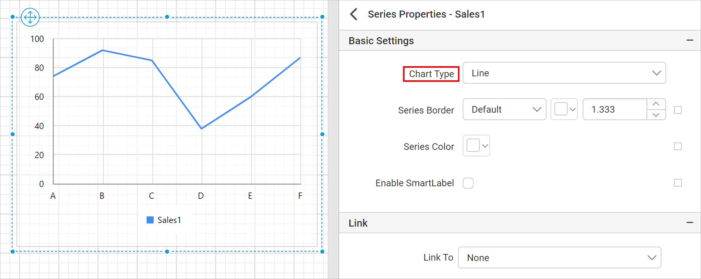

# Switch the Series Chart Type in the {{site.productNameTM}} Report Designer

The chart type switcher in the {{site.productNameTM}} Report Designer lets you change the series chart type of a chart report item at any point during report design. You change it with the `Chart Type` dropdown under the series properties.

## How do I switch a series chart type?

You switch a series chart type in the {{site.productNameTM}} Report Designer from the series properties of the chart.

1. To open the properties of a specific series, choose the series name in the `Choose Series` dropdown.

   

2. Click the `Edit` icon. The properties panel displays the properties of that series.

   

3. Find the chart type switcher under `Basic Settings` and choose a type in the `Chart Type` dropdown.

   

## Which chart types can I switch to?

The {{site.productNameTM}} Report Designer lists only the types compatible with the present series chart type in the chart type dropdown. For example, if the existing series chart type is pie chart, the chart type dropdown lists the compatible types shown in the following image.

## Chart with single series

When a {{site.productNameTM}} chart has a single series, changing the series chart type changes the whole chart to the expected chart type. For example, the following report has a column chart with a single series.

To change the series chart type to `Line`, choose `Line` in the chart type dropdown.

## Chart with multiple series

A {{site.productNameTM}} chart with multiple series can behave differently during series chart type switching, depending on the source and target chart types. The following sections describe when [individual chart series type switching](#individual-chart-series-type-switching) (affecting only the selected series) or [combined chart series type switching](#combined-chart-series-type-switching) (affecting all series collectively) takes place.

### Individual Chart Series Type Switching

The Report Designer switches only the selected series to the new chart type for the following source and target types.

<table>
<tr>
<th>Source Series Chart Type(s)</th>
<th>Target Series Chart Type(s)</th>
</tr>
<tr>
<td>All Column types</td>
<td>All Line and Area types</td>
</tr>
<tr>
<td>All Line types</td>
<td>All Column, Area and other Line types</td>
</tr>
<tr>
<td>All Area types</td>
<td>Column and Line types</td>
</tr>
<tr>
<td>Range Column</td>
<td>Range Area, Smooth Range Area and vice versa</td>
</tr>
</table>

For example, the following report has a column chart with multiple series.

1. Choose the series whose type you want to change.

   

2. To change the chart series type to `Line`, choose `Line` in the chart type dropdown.

   

The following image shows the resulting chart with mixed column and line series.

### Combined Chart Series Type Switching

The Report Designer switches all series in the chart together in the following two cases.

* All series chart types in the chart switch to the target chart type when the source and target types belong to the same category. Use the following table to find the category of each chart.

    <table>
    <tr>
    <th>Chart Category</th>
    <th>Chart Types</th>
    </tr>
    <tr>
    <td>Proportion Charts</td>
    <td>Pie, Exploded Pie, Doughnut, Pyramid, Funnel</td>
    </tr>
    <tr>
    <td>Column Charts</td>
    <td>Column, Stacked Column, Stacked Column 100</td>
    </tr>
    <tr>
    <td>Bar Charts</td>
    <td>Bar, Stacked Bar, Stacked Bar 100</td>
    </tr>
    <tr>
    <td>Area Charts</td>
    <td>Area, Smooth Area, Stacked Area, Stacked Area 100</td>
    </tr>
    <tr>
    <td>Polar and Radar Chart</td>
    <td>Polar, Radar</td>
    </tr>
    </table>

    For example, the following report has a column chart with multiple series.

    

    Choose the series whose type you want to change.

    

    To change the chart series type to `Stacked Column`, choose `Stacked Column` in the chart type dropdown.

    

    The following image shows all series switched to stacked column.

    

* All series chart types convert to the new type for the following source and target combinations. A warning dialog asks you to confirm this action before it proceeds.

    <table>
    <tr>
    <th>Source Series Chart Type(s)</th>
    <th>Target Series Chart Type(s)</th>
    </tr>
    <tr>
    <td>Range Column, Range Area, Smooth Range Area</td>
    <td>Range Bar</td>
    </tr>
    <tr>
    <td>All Column, Area and Line types</td>
    <td>All Bar types</td>
    </tr>
    </table>

    For example, take a column chart with multiple series.

    

    Choose the series whose type you want to change.

    

    To change the series chart type to `Bar`, choose `Bar` in the chart type dropdown.

    

    The following confirmation dialog appears.

    

    Click `Yes` to change the existing series types to `Bar`.

    

    Click `No` to leave the respective series unchanged.

    

## Frequently asked questions

### Can I mix column and line series in one chart?

Yes. Switching one series of a multi-series column chart to `Line` changes only the selected series, so the chart shows mixed column and line series.

### Why does a warning dialog appear when I switch to a bar type?

Switching from Column, Area, or Line types to Bar types, or from range types to Range Bar, converts all series in the chart. The Report Designer asks you to confirm this first.

## See also

* [Chart types](./../types/)
* [Chart series properties](./../series/)
* [Add a stacked column chart](./../stacked-column-chart/)
