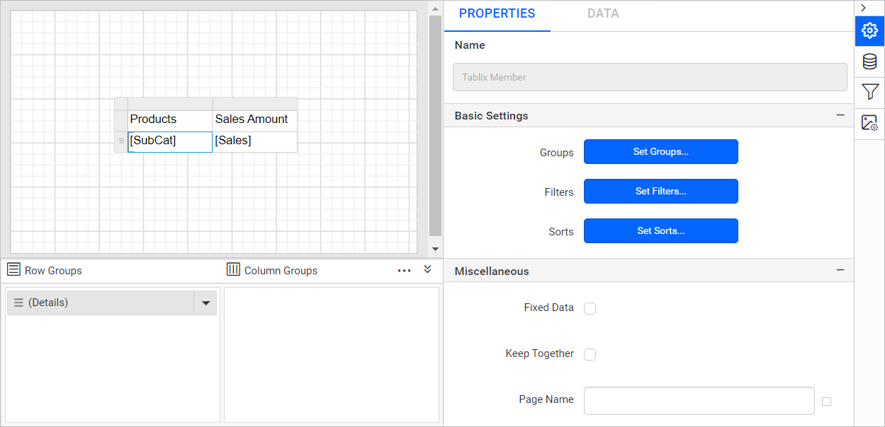
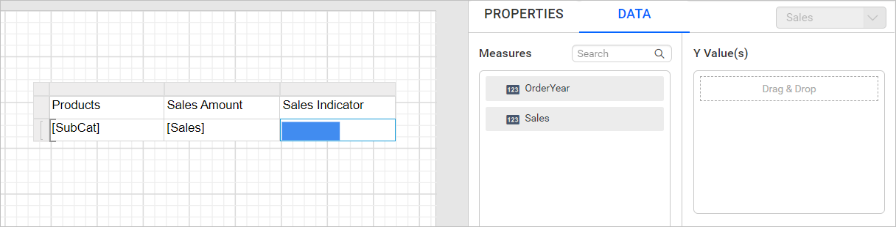

# Design an SSRS data bar report using a table in {{site.productNameTM}}

To design a `Data bar` report in the {{site.productNameTM}} Web Report Designer, create a dataset, add a table report item, and place a data bar in a table column. The finished report shows the difference in sales between product subcategories.

## How do I create the dataset?

The {{site.productNameTM}} `Data bar` report in this example uses the following dataset query.

```sql
SELECT PC.Name AS ProdCat, PS.Name AS SubCat, DATEPART(yy, SOH.OrderDate) AS OrderYear, 'Q' + DATENAME(qq, SOH.OrderDate) AS OrderQtr,SUM(SOD.UnitPrice * SOD.OrderQty) AS Sales
FROM Production.ProductSubcategory PS INNER JOIN
Sales.SalesOrderHeader SOH INNER JOIN
Sales.SalesOrderDetail SOD ON SOH.SalesOrderID = SOD.SalesOrderID INNER JOIN
Production.Product P ON SOD.ProductID = P.ProductID ON PS.ProductSubcategoryID = P.ProductSubcategoryID INNER JOIN
Production.ProductCategory PC ON PS.ProductCategoryID = PC.ProductCategoryID
GROUP BY DATEPART(yy, SOH.OrderDate), PC.Name, PS.Name, 'Q' + DATENAME(qq, SOH.OrderDate), PS.ProductSubcategoryID
```

> To create the dataset with this query, see [Create an embedded dataset](./../../../manage-data/dataset/create-an-embedded-dataset/). This example uses the `AdventuresWorks` database.

## How do I add the data bar report item to a table?

You add a data bar to a table cell in the {{site.productNameTM}} Web Report Designer after you set up the table and its groups.

1. Drag and drop the table report item to the design area.
   
2. Assign a [dataset to the table](./../../../report-items/tablix/assign-data-to-tablix-data-region/#assign-dataset-from-properties-panel).
   
3. Create a simple table design with two columns, as shown in the following image.
   
4. Click `Details group` in the `Row Groups` pane. The properties panel lists the respective tablix member properties.
   
5. Click the `Set Groups...` button in the properties panel. The `Grouping` dialog opens.
   
6. Click the `Add` button, select `SubCat`, and click OK.
   
7. Select the `Sales` text box and [assign an expression with the data assign menu](./../../../report-items/tablix/assign-data-to-tablix-data-region/#edit-expression-using-data-assign-menu). Use the expression `=Sum(Fields!Sales.Value)` in the cell.
   
8. Format the numbers produced by the `Sales` field with the `Format` property. Set `'$'#,0;('$'#,0)` as the value of the format property field.
   
9. [Add a column to the right](./../../../report-items/tablix/insert-or-delete-a-column-ssrs/#insert-a-column) and name it `Sales Indicator`.
   
10. Drag and drop the data bar report item into the last cell of the table.
    

    The following image shows the resulting report design.

    

> Cannot insert a data bar into a detail cell. Detail members can only contain the static inner members.

## How do I assign data to the data bar?

You assign data to a {{site.productNameTM}} data bar in the `DATA` tab of the properties panel.

1. Select the cell that contains the data bar report item and switch to the `DATA` tab in the properties panel.
   
2. Drag and drop the `Sales` field into the `Y-Values` section.
      

## How do I configure the data bar properties?

You configure the {{site.productNameTM}} data bar series and data labels in the `PROPERTIES` tab of the properties panel.

1. Switch to the `PROPERTIES` tab in the properties panel.
2. Choose the `Sales` series in the `Choose Series` dropdown.
   
3. Click the edit icon to open the series properties.
   
4. Under the data label settings category, enable the [Data Label](./../../../report-items/chart/data-label/) property checkbox.
   
5. Format the numbers produced by the `Data labels` with the `Format` property. Set `'$'#,0;('$'#,0)` as the value in the format property field.
   
6. Change the background color and font styles of the table cells to improve the report design, as shown in the following image.
   

> To style the table cell, see [Cell Properties](./../../../report-items/tablix/cell-properties/#cell-properties).

## What does the data bar report look like in preview?

The {{site.productNameTM}} data bar report preview displays the difference in sales between each product category, as shown in the following image.


> Download the [data bar report design (RDL) from GitHub](https://github.com/boldreports/resources/tree/master/docs/report-designer/data-bar/design-ssrs-data-bar-using-table.rdl)

## Frequently asked questions

### Can I insert a data bar into a table detail cell?

No. You cannot insert a data bar into a detail cell, because detail members can only contain static inner members. Group the details first, as this example does with `SubCat`.

### How do I show currency values on the data bar?

Enable the `Data Label` property in the series properties. Then, set `'$'#,0;('$'#,0)` in the `Format` property field.

## See also

* [Data bar report item](./../)
* [Assign data to a tablix data region](./../../../report-items/tablix/assign-data-to-tablix-data-region/)
* [Chart data label properties](./../../../report-items/chart/data-label/)
* [Table cell properties](./../../../report-items/tablix/cell-properties/)
