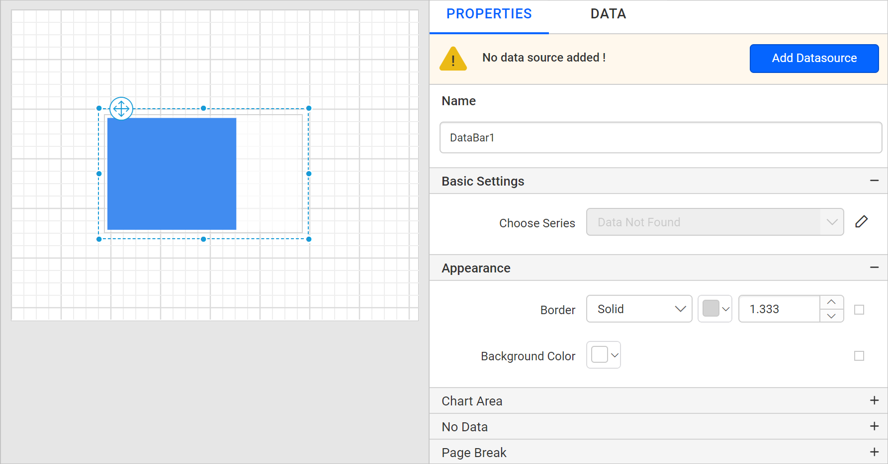
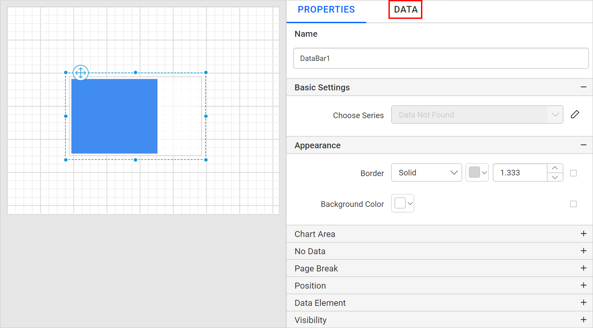

# Add a data bar in the Bold Reports<sup>®</sup> Web Report Designer

A data bar in the Bold Reports<sup>®</sup> Web Report Designer is a small, simple chart that shows trends and changes in data over time, especially over many periods. Data bars convey a lot of information in a little space, and you often use them in tables and matrices.

## How do I add a data bar to the report?

The Bold Reports<sup>®</sup> Web Report Designer lists the data bar report item in the item panel under the `KPI` category.

1. Find the data bar report item under the `KPI` category in the item panel.
   
2. Drag and drop the data bar report item from the item panel into the design area or inside a tablix cell.
   
3. Review the item properties. After you drop the data bar item in the design area or inside a tablix cell, the properties panel lists its properties.
   

## How do I create data for the data bar?

To present data in a Bold Reports<sup>®</sup> data bar, create a dataset and bind data to it. This example uses the following dataset query to create the dataset.

```sql
SELECT PC.Name AS ProdCat, PS.Name AS SubCat, DATEPART(yy, SOH.OrderDate) AS OrderYear, 'Q' + DATENAME(qq, SOH.OrderDate) AS OrderQtr,SUM(SOD.UnitPrice * SOD.OrderQty) AS Sales
FROM Production.ProductSubcategory PS INNER JOIN
Sales.SalesOrderHeader SOH INNER JOIN
Sales.SalesOrderDetail SOD ON SOH.SalesOrderID = SOD.SalesOrderID INNER JOIN
Production.Product P ON SOD.ProductID = P.ProductID ON PS.ProductSubcategoryID = P.ProductSubcategoryID INNER JOIN
Production.ProductCategory PC ON PS.ProductCategoryID = PC.ProductCategoryID
GROUP BY DATEPART(yy, SOH.OrderDate), PC.Name, PS.Name, 'Q' + DATENAME(qq, SOH.OrderDate), PS.ProductSubcategoryID
```

> To create the dataset with this query, see [Create an embedded dataset](./../../manage-data/dataset/create-an-embedded-dataset/). This example uses the `AdventuresWorks` database.

## How do I assign data to the data bar?

A Bold Reports<sup>®</sup> data bar needs a minimum of 1 value element to show data. Drop the measure or expression field you want to analyze into the `Y Values` section. Drop the dimension that categorizes the measure into the `Columns` section. To categorize by a series, also drop the respective dimension into the `Rows` section.

To configure data in the data bar, follow these steps:

1. Select the data bar report item to bind data to it.
2. Click the `Properties` icon in the configuration panel to open the property pane. Then, switch to the `DATA` tab.
   
3. Choose a dataset in the dropdown list. The dropdown lists the data available in the report.
   
4. Review the fields. The `Measures` section lists numeric columns and numeric expressions. The `Dimensions` section lists other types of columns and dimension expressions.
   
5. **Drag and Drop Measure Element**:
   Drag the numeric column (measure element) or the numeric expression column from the `Measure` section and drop it in the `Y Values` section.
   
   The following image shows the report item design after you add the Y value field.
   
6. **Aggregate Options**:
   Click the `Settings` icon (highlighted in the image) to open the aggregation type dropdown list.
   
   Set the aggregation type that computes the selected column.
   
7. **Drag and Drop Dimension Element**:
   Drag the dimension element from the `Dimensions` section and drop it into the `Column(s)` section. The dimension measures against the numeric column(s) selected in the `Y Value(s)` section.
   
   The following image shows the report item design after you add the dimension field.
   
8. **Grouping**:
   Group the added column element with another column by adding the respective dimension element into the Row(s) section.
   
   The following image shows the report item design after you add the row field.
   

## Which properties can I set for a data bar?

The Bold Reports<sup>®</sup> data bar properties control its name, series, appearance, page breaks, position, export behavior, and visibility. Before you set the following properties, see the [Properties panel](./../../compose-report/properties-panel/) section.

### Name

The **Name** property provides a unique name for the data bar item in the report.


### Basic Settings

The data bar **Basic Settings** category is shown in the following image.


### Choose Series

The data bar lists all series you add in the `Choose Series` dropdown. To customize a series appearance, choose the required series name in the dropdown.


To customize each series using the properties panel, see [Series](../chart/series/).

### Appearance

The data bar **Appearance** properties (border style, color, width, and background color) style the chart and customize its appearance in the report design. The properties panel lists these properties under the `Appearance` category.


### Chart Area

The data bar **Chart Area** properties, such as border width, color, shadow color, shadow offset, and background color, customize the area of the chart design. The properties panel lists these properties under the `Chart Area` category.


### No Data

The data bar **No Data** property displays static text when a dataset returns empty or zero rows at run time.


To set or reset no data message properties, see the [No Data Message](../chart/no-data-message/) property section.

### Page break

The data bar **page break** property controls the amount of information on each page when you preview the report. To apply the page break property to the data bar report item, follow these steps:

1. Choose a `Break Location` type in the dropdown. The Break Location property specifies where the page break occurs.
   
2. To restart the page numbering on each page, enable the `Page Number Reset` property checkbox.
   

### Position

The data bar **Position** property sets the width, height, left, and top position of the data bar in the report design. To handle these properties using the properties panel, see the [Position](./../../compose-report/common-properties/#position) section.


### Data Element

The data bar **Data element** properties control the visibility of a report item when you export the report in XML format. The properties panel lists them under the `Data Element` category.


#### Name

The `Name` field assigns a custom name to the data bar element. The data bar exports with the provided name.


> Note: The name cannot contain spaces, and it must begin with a letter followed by letters, numbers, or the underscore character (_).

#### Output

The `Output` property controls the visibility of the data bar when you export the report. Each option performs the following operation:

* **Auto** or **Output** - Exports the data bar report item.
* **NoOutput** - Does not export the data bar report item.


### Visibility

The data bar **Visibility** property conditionally shows or hides the data bar report item on report preview or export. To set the visibility of a data bar item using the properties panel, see the [Visibility](./../../compose-report/common-properties/#visibility) section.


### Miscellaneous

The data bar **Miscellaneous** category contains the page name, document map, bookmark, custom attributes, tooltip, and custom style properties.

#### Page name

The **page name** property names the first worksheet of the Excel workbook when you export the report to Excel format.


You can set static or dynamic text as the page name. To set and reset dynamic text, see the [Set Expression](./../../compose-report/properties-panel/#set-expression) and [Reset Expression](./../../compose-report/properties-panel/#reset-expression) sections.

#### Document Map

A **document map** is a navigational feature that displays a separate side pane with a set of navigational links in a hierarchical structure when you view a report. A user can click the content in the list to navigate to the report page that displays that item. To configure the document map in the report design, see the [Document Map](./../../compose-report/document-map/) section.

You can set static or dynamic text as the value for the document map property. To set and reset dynamic text, see the [Set Expression](./../../compose-report/properties-panel/#set-expression) and [Reset Expression](./../../compose-report/properties-panel/#reset-expression) sections.

#### Bookmark

Bookmark links let users navigate to different parts of an SSRS report. You can add bookmarks to each textbox, image, table, or chart, or to the unique group values displayed in a tablix, to direct users to specified locations in the report. The value of the bookmark property can be your own strings or an expression. To configure bookmarks in the report design, see the [Bookmark](./../../compose-report/bookmark/) section.

You can set static or dynamic text as the value for the bookmark property. To set and reset dynamic text, see the [Set Expression](./../../compose-report/properties-panel/#set-expression) and [Reset Expression](./../../compose-report/properties-panel/#reset-expression) sections.

#### Custom attributes

The **custom attributes** property sets the values for chart custom properties. To assign values to custom properties using the properties panel, see the [Custom Properties](./../../compose-report/common-properties/#custom-properties) section.

#### Tooltip

The **Tooltip** property displays informative text or values when the user hovers over the report item in the report preview. To set a tooltip for a data bar report item using the properties panel, see the [Tooltip](./../../compose-report/common-properties/#tooltip) section.

#### Custom Style

The `Custom Style` property enables external CSS for styling report items, giving more flexibility than the built-in styling options. Use this property to meet specific design requirements and keep styling consistent across multiple reports. For a step-by-step guide on setting up custom styles in your report, see the **How To** section of this guide.


## How do I set an expression on a data bar property?

You can set an expression on a few Bold Reports<sup>®</sup> data bar properties to process their values based on expressions. To set expressions on data bar report item properties, see the [Set Expression](./../../compose-report/properties-panel/#set-expression) section.

## How do I reset an expression?

To `Reset` the expression applied to a Bold Reports<sup>®</sup> data bar property, see the [Reset Expression](./../../compose-report/properties-panel/#reset-expression) section.

## How do I open advanced properties?

A few Bold Reports<sup>®</sup> data bar properties contain nested properties. To open and handle the nested properties, see the [Advanced Properties](./../../compose-report/properties-panel/#advanced-properties) section.

## Frequently asked questions

### Where is the data bar in the item panel?

The Bold Reports<sup>®</sup> Web Report Designer lists the data bar report item under the `KPI` category in the item panel.

### What data does a data bar need?

A data bar needs a minimum of 1 value element in the `Y Values` section. Add dimensions to the `Columns` and `Rows` sections to categorize the measure.

## See also

* [Design an SSRS data bar report using a table](./design-ssrs-data-bar-using-table/)
* [Chart series properties](../chart/series/)
* [Chart no data message](../chart/no-data-message/)
