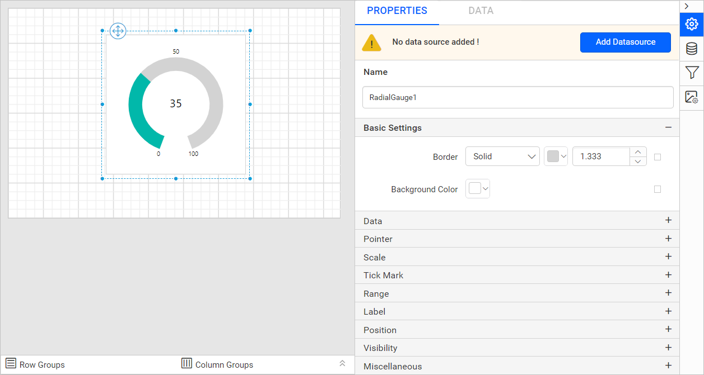
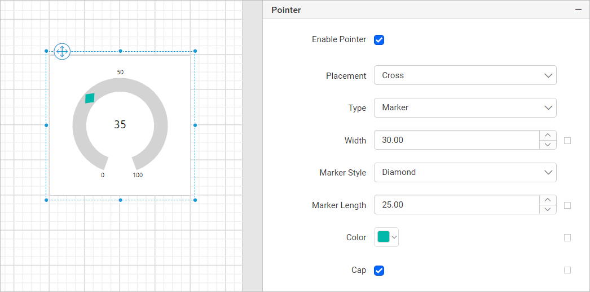
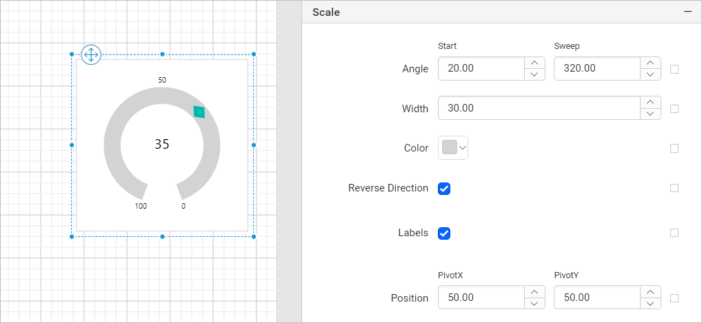
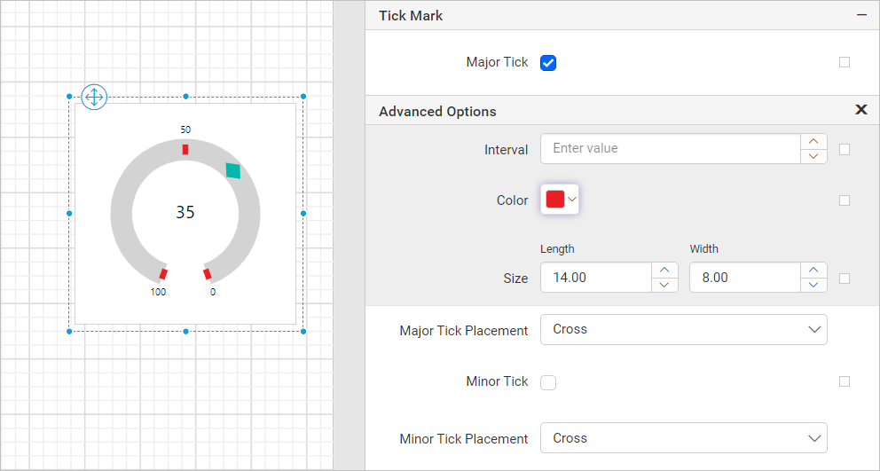
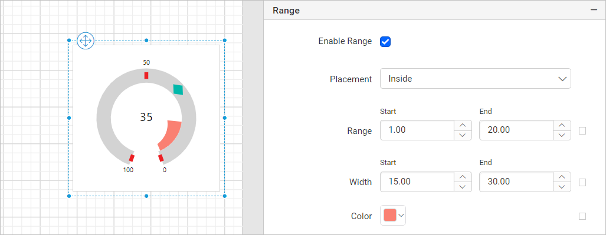

# Radial gauge in Bold Reports® Web Report Designer

In the Bold Reports® Web Report Designer, a radial gauge is a circular report item that represents key performance indicators. You can place a radial gauge inside the `Tablix` and `Matrix` report items.

## How do I add a radial gauge to the report?

You add a radial gauge to a Bold Reports® report by dragging it from the item panel into the design area.

1. Find the radial gauge report item in the item panel under the `Deviation category`.
   
2. Drag the radial gauge report item into the design area from the item panel.
   
3. Drop the radial gauge item in the design area. The properties panel then lists the item properties.
   

## Which properties can I set for a radial gauge?

The Bold Reports® properties panel lists every radial gauge property described below. Read the [Properties panel](./../../../compose-report/properties-panel/) section before you work with the following properties.

### Basic settings

The border style, color, width, and background color properties customize the appearance of a radial gauge in the report design. The properties panel lists these properties under the `Basic settings` category.

#### Border

The border properties add or customize the border around a radial gauge item to visually separate items in the report design. To set border properties for the radial gauge item in the properties panel, see the [Border Properties](./../../../compose-report/common-properties/#border-properties) section.

#### Background color

The background color property customizes the background color of a radial gauge. To set the background color in the properties panel, see the [Background color](./../../../compose-report/common-properties/#background-color) section.

### Data

The Data category of the radial gauge holds the dataset, type, value, range, and interval properties.

#### Dataset

The Dataset property assigns a dataset to a radial gauge report item. The `Dataset` property dropdown lists the available datasets in the report. Choose the dataset you want from the dropdown.

> To add a dataset to your report, see the [Create Data](./../../../manage-data/dataset/create-an-embedded-dataset/) section.

#### Type

The Type property selects the type of a radial gauge report item. You can select `Radial`, `Half Circle`, or `Auto` from the dropdown.

* `Radial`: Displays the radial gauge with start-angle(0) and sweep-angle(320).

* `Half Circle`: Displays the radial gauge with start-angle(90) and sweep-angle(180).

* `Auto`: Displays the radial gauge with a custom start-angle and sweep-angle.

#### Value

The Value property assigns the `pointer value` of a radial gauge. You can also set the pointer value based on dynamic values by using [expressions](./../../../compose-report/properties-panel/#set-expression).

#### Range

The Range property assigns the `minimum` and `maximum` values of a radial gauge. You can also set the minimum and maximum values based on dynamic values by using [expressions](./../../../compose-report/properties-panel/#set-expression).

#### Interval

The Interval property assigns the `interval` value between the [scale labels](./../../../report-items/gauge/radial-gauge/#labels). You can also set the interval value based on dynamic values by using [expressions](./../../../compose-report/properties-panel/#set-expression).

### Pointer

The Pointer properties customize the pointer placement, type, marker style, marker length, cap, width, and color in the radial gauge design.

#### Enable pointer

To show or hide the pointer in a radial gauge, toggle the `Enable Pointer` checkbox.

#### Placement

Radial gauge pointer placement can be `Inside`, `Outside`, or `Cross`. Select a placement option from the dropdown.

#### Type

The pointer Type property sets the pointer to `Needle`, `Marker`, or `Bar`. Select the type from the dropdown. If you select the `Marker` option, the `Marker Style` and `Marker Length` properties appear in the properties panel.

##### Marker style

The Marker style property sets the shape of a marker pointer. Select `Circle`, `Rectangle`, `Triangle`, or `Diamond` from the dropdown.

The following image shows a radial gauge with the `Marker` pointer type, `Diamond` marker style, and `Cross` pointer placement.

##### Marker length

The Marker length property assigns the `pointer marker length` value. You can also set the marker length based on dynamic values by using [expressions](./../../../compose-report/properties-panel/#set-expression).

##### Enable cap

To show or hide the pointer cap in a radial gauge, toggle the `Enable Cap` checkbox. The pointer cap is supported only for the `Needle` pointer type.

You can customize the Cap in the `Advanced Options` menu. To open and handle the nested properties of Pointer Cap, see the [Advanced Properties](./../../../compose-report/properties-panel/#advanced-properties) section.

These properties customize the pointer cap width and pointer cap color in the radial gauge design.

#### Width

The pointer Width property assigns the `pointer width` value. You can also set the width based on dynamic values by using [expressions](./../../../compose-report/properties-panel/#set-expression).

#### Color

The pointer Color property customizes the `pointer color` of a radial gauge.

### Scale

The Scale properties set the angle, width, color, direction, labels, and position of the radial gauge scale.

#### Angle

The Angle property sets the start angle and sweep angle of the radial gauge. You can also set the start angle and sweep angle based on dynamic values by using [expressions](./../../../compose-report/properties-panel/#set-expression).

#### Width

The scale Width property assigns the `scale width` value. You can also set the width based on dynamic values by using [expressions](./../../../compose-report/properties-panel/#set-expression).

#### Color

The scale Color property customizes the `scale color` of the radial gauge.

#### Reverse direction

The Reverse direction property reverses the radial gauge scale direction from maximum to minimum. To turn it on, select the `Reverse Direction` checkbox.

#### Labels

To show or hide the scale labels in a radial gauge, toggle the `Label` checkbox.

You can customize the scale label in the `Advanced Options` menu. To open and handle the nested properties of labels, see the [Advanced Properties](./../../../compose-report/properties-panel/#advanced-properties) section.

These properties customize the scale label font color, font family, font size, and font style in the radial gauge design.

##### Show labels at the end

To show or hide the scale labels at the end of the scale, toggle the `Show Labels At End` checkbox.

##### Rotate labels

To rotate the radial gauge scale labels, toggle the `Rotate Lables` checkbox.

##### Placement

Scale label placement can be `Inside`, `Outside`, or `Cross`. Select an option from the dropdown.

#### Position

The scale Position property sets the `PivotX` and `PivotY` of the radial gauge. You can also set the pivot values based on dynamic values by using [expressions](./../../../compose-report/properties-panel/#set-expression).

### Tick mark

The Tick mark property customizes the major and minor ticks of the radial gauge.

#### Major tick and minor tick

To show or hide major and minor ticks in a radial gauge scale, toggle the `Major Tick` and `Minor Tick` checkboxes.

You can customize major and minor ticks in the `Advanced Options` menu. To open and handle the nested properties of major and minor ticks, see the [Advanced Properties](./../../../compose-report/properties-panel/#advanced-properties) section.

These properties customize the major and minor tick interval, color, length, and width.

#### Major tick placement and minor tick placement

Radial gauge major tick and minor tick placement can be `Inside`, `Outside`, or `Cross`. Select the placement from the dropdown.

### Range

The Range properties customize the range placement, start value, end value, start width, end width, and color in the radial gauge design.

#### Enable range

To show or hide the range in a radial gauge, toggle the `Enable Range` checkbox.

#### Placement

Radial gauge range placement can be `Inside`, `Outside`, or `Cross`. Select an option from the dropdown.

#### Range

The range property assigns the range `start` and `end` values of the radial gauge. You can also set the start and end values based on dynamic values by using [expressions](./../../../compose-report/properties-panel/#set-expression).

#### Width

The range Width property assigns the range `start width` and `end width` values of the radial gauge. You can also set the start and end width values based on dynamic values by using [expressions](./../../../compose-report/properties-panel/#set-expression).

#### Color

The range Color property customizes the `range color` of a radial gauge.

### Position

The position property sets the width, height, left, and top position of the radial gauge in the report design. To set these properties in the properties panel, see the [Position](./../../../compose-report/common-properties/#position) section.

### Link

The Linking property in Bold Reports® lets you create interactive, user-friendly reports by adding actions such as **Hyperlink** and **Report Linking**. To learn more, see the [Linking](./../../../compose-report/link-data/) section.

### Data Element

The Data element properties control the visibility of a radial gauge when you export the report in XML format. The properties panel lists these properties under the `Data Element` category.

Name

Use the `Name` field to assign a custom name to the radial gauge element. The radial gauge is exported with the name you provide.

> Note: The name cannot contain spaces, and it must begin with a letter followed by letters, numbers, or the underscore character (_).

Output

The `Output` property controls the visibility of the radial gauge when you export the report. Each option performs the following operation:

* **Auto** or **Output**: Exports the radial gauge report item.
* **NoOutput**: Does not export the radial gauge report item.

### Visibility

The visibility property conditionally shows or hides the radial gauge report item on report preview or export. To set the visibility of a radial gauge item in the properties panel, see the [Visibility](./../../../compose-report/common-properties/#visibility) section.

### Miscellaneous

The Miscellaneous category holds the page name, document map, bookmark, custom attributes, and custom style properties of the radial gauge.

#### Page name

The page name property names the first worksheet of the Excel workbook when you export the report to Excel format.

You can set static or dynamic text as the page name. To set and reset dynamic text, see the [Set Expression](./../../../compose-report/properties-panel/#set-expression) and [Reset Expression](./../../../compose-report/properties-panel/#reset-expression) sections.

#### Document Map

A document map is a navigational feature that displays a separate side pane with a set of navigational links in a hierarchical structure when you view a report. Users click an entry in the list to navigate to the report page that displays that item. To configure a document map in the report design, see the [Document Map](./../../../compose-report/document-map/) section.

You can set static or dynamic text as the value of the document map property. To set and reset dynamic text, see the [Set Expression](./../../../compose-report/properties-panel/#set-expression) and [Reset Expression](./../../../compose-report/properties-panel/#reset-expression) sections.

#### Bookmark

Bookmark links let users navigate to different parts of an SSRS report. You can add bookmarks to each textbox, image, table, or chart, or to the unique group values displayed in a tablix, to direct users to specified locations in the report. The bookmark value can be your own string or an expression. To configure a bookmark in the report design, see the [Bookmark](./../../../compose-report/bookmark/) section.

You can set static or dynamic text as the value of the bookmark property. To set and reset dynamic text, see the [Set Expression](./../../../compose-report/properties-panel/#set-expression) and [Reset Expression](./../../../compose-report/properties-panel/#reset-expression) sections.

#### Custom attributes

The custom attributes property sets the values of radial gauge custom properties. To assign values to custom properties in the properties panel, see the [Custom Properties](./../../../compose-report/common-properties/#custom-properties) section.

Tooltip

The **Tooltip** property displays informative text or a value when the user hovers over the report item in report preview. To set a tooltip for the gauge report item in the properties panel, see the [Tooltip](./../../../compose-report/common-properties/#tooltip) section.

#### Custom Style

The `Custom Style` property lets you use external CSS to style report items, giving more flexibility than the built-in styling options. Use this property to meet specific design requirements and keep styling consistent across multiple reports. For a step-by-step guide on setting up custom styles in your report, see the **How To** section of this guide.

## Frequently asked questions

### Which radial gauge types can I choose?

You can choose `Radial`, `Half Circle`, or `Auto`. `Radial` uses start-angle(0) and sweep-angle(320), and `Half Circle` uses start-angle(90) and sweep-angle(180).

### Which pointer type supports a pointer cap?

The pointer cap is supported only for the `Needle` pointer type. Toggle the `Enable Cap` checkbox to show or hide it.

## See also

* [Gauge report items](./../)
* [Linear gauge](./../linear-gauge/)
* [Indicator report item](./../../indicator/)
