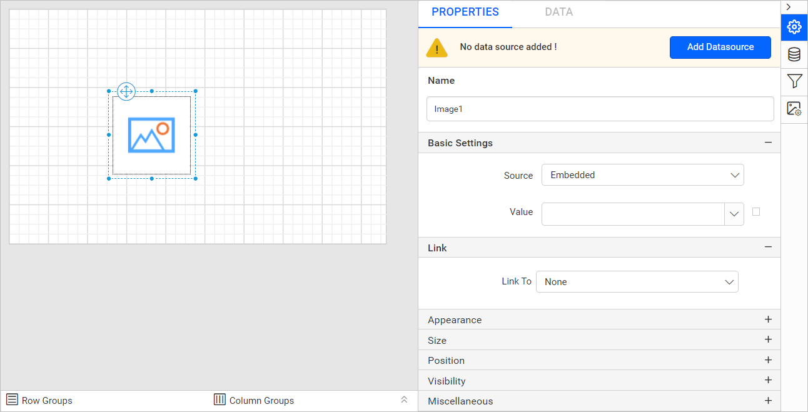

# Image report item in {{site.productNameTM}} Web Report Designer

In the {{site.productNameTM}} Web Report Designer, the image report item displays images in a report from an external link, data fields, or embedded images. Images can be of the BMP, GIF, JPG, PNG, X-PNG, or SVG type.

## How do I add an image to the report?

You add an image to a {{site.productNameTM}} report by dragging the image report item from the item panel into the design area.

1. Find the image report item in the item panel under the `Basic Items` category.
    

2. Drag and drop the image report item into the design area from the item panel.
    

3. Drop the image item into the design area. The properties panel then lists the item properties.
    

## Which properties can I set for an image?

The {{site.productNameTM}} image report item has basic settings, link, appearance, size, position, visibility, and miscellaneous properties.

### Basic Settings

`Basic Settings` contains the `Source` and `Value` properties. `Source` includes the **Embedded**, **External**, and **Database** image types.

* **External**

    The External image source displays a dynamic image in the report. Specify a URL to the image, or set an [Expression](./../../compose-report/link-data/#set-expression) that evaluates to the URL. To add an external image to a report, enter a valid URL in the value property text field.    

* **Embedded**

    The Embedded option displays the embedded images available in the report. To embed an image in a report, see the [Image Manager](./../../image-manager/add-image/#add-an-embedded-image) section.
    

* **Database**

    The Database option displays images from image data stored in a database. The `Value` and `MIME Type` properties are listed under the `Database` option.

    * **Value**

        The value field dropdown lists the available dataset fields in the report. Choose a dataset field bound to a database field that contains an image, or set an [Expression](./../../compose-report/link-data/#set-expression) that evaluates to the image value.        

    * **MIME Type**

        The MIME property specifies the type of image. The MIME property dropdown lists the supported MIME types. Images can be of the BMP, GIF, JPG, PNG, X-PNG, or SVG type. Choose the MIME type that matches your image type.

        

### Link

Linking in {{site.productNameTM}} creates an interactive report by using the **Hyperlink** and **Report Linking** actions. To learn more, see the [Linking](./../../compose-report/link-data/) section. Select the `Enable  Link` checkbox to enable the sub properties.

### Appearance

The `Appearance` properties improve the style of an image layout. The `Appearance` category lists the border style, color, and width properties.

#### Border

Border properties add or customize the border around an image report item to visually separate items in the report design. To set border properties for the image report item in the properties panel, see the [Border Properties](./../../compose-report/common-properties/#border-properties) section.

### Size

The Sizing property formats the size of the images displayed in the design area. It includes four options to adjust the image display. Choose the size you need in the `Sizing` dropdown list.

* AutoSize
* Fit
* FitProportional
* Clip

#### AutoSize

The AutoSize option displays the original size of an image in the design area.

#### Fit to Size

The Fit option fits the image inside the image report item.

#### Fit Proportional

The FitProportional option fits the image inside the image report item while maintaining a certain aspect ratio.

#### Clip

The Clip option displays an image from the top-left corner of the picture in the image report item. If the image is larger than the image report item, only a portion of the image is displayed.

### Position

The Position property sets the width, height, left, and top position of the image item in the report design. To set these properties in the properties panel, see the [Position](./../../compose-report/common-properties/#position) section.

### Visibility

The Visibility property conditionally shows or hides the image report item on report preview or export. To set the visibility of the image item in the properties panel, see the [Visibility](./../../compose-report/common-properties/#visibility) section.

### Miscellaneous

The Miscellaneous category holds the custom attributes, document map, bookmark, tooltip, and custom style properties of the image report item.

Custom attributes

The custom attributes property sets the values of image report item custom properties. To assign values to custom properties in the properties panel, see the [Custom Properties](./../../compose-report/common-properties/#custom-properties) section.

#### Document Map

A document map is a navigational feature that displays a separate side pane with a set of navigational links in a hierarchical structure when you view a report. Users click an entry in the list to navigate to the report page that displays that item. To configure a document map in the report design, see the [Document Map](./../../compose-report/document-map/) section.

You can set static or dynamic text as the value of the document map property. To set and reset dynamic text, see the [Set Expression](./../../compose-report/properties-panel/#set-expression) and [Reset Expression](./../../compose-report/properties-panel/#reset-expression) sections.

Bookmark

Bookmark links let users navigate to different parts of an SSRS report. You can add bookmarks to each textbox, image, table, or chart, or to the unique group values displayed in a tablix, to direct users to specified locations in the report. The bookmark value can be your own string or an expression. To configure a bookmark in the report design, see the [Bookmark](./../../compose-report/bookmark/) section.

Tooltip

The **Tooltip** property displays informative text or a value when the user hovers over the report item in report preview. To set a tooltip for the report item in the properties panel, see the [Tooltip](./../../compose-report/common-properties/#tooltip) section.

#### Custom Style

The `Custom Style` property lets you use external CSS to style report items, giving more flexibility than the built-in styling options. Use this property to meet specific design requirements and keep styling consistent across multiple reports. For a step-by-step guide on setting up custom styles in your report, see the **How To** section of this guide.

## Frequently asked questions

### Which image formats can I use?

Images can be of the BMP, GIF, JPG, PNG, X-PNG, or SVG type.

### Can I load an image from a database field?

Yes. Set the `Source` to **Database**, choose a dataset field that contains an image in `Value`, and choose the matching `MIME Type`.

## See also

* [Report items overview](./../)
* [Line report item](./../line/)
* [Rectangle report item](./../rectangle/)
