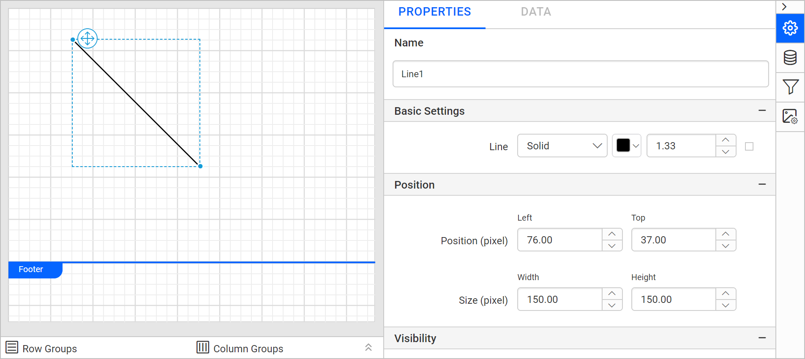

# Line report item in {{site.productNameTM}} Web Report Designer

In the {{site.productNameTM}} Web Report Designer, the line report item separates report sections horizontally, vertically, or diagonally. It has a start point and an end point with various style properties. A line has no data associated with it.

## How do I draw a line?

You draw a line in a {{site.productNameTM}} report by dragging the line report item from the item panel onto the designer surface.

1. Drag and drop the line report item from the item panel to the designer surface.
   

2. Check the properties panel. It lists the line report item and its associated properties.
   

## Which properties can I set for a line?

The {{site.productNameTM}} line report item has line style, border, position, size, visibility, and miscellaneous properties.

### Line Styles

The line style property changes the style of the line report item. The property is listed under the `Basic Settings` category. The styles are **Solid**, **Dashed**, and **Dotted**.

### Border

The border property increases or decreases the thickness of the line report item across the three line styles.

### Position

The position property places the line report item at a left and top position on the designer surface.

### Size

The size property increases or decreases the width and height of the line report item.

### Visibility

The visibility property shows or hides the line report item when you preview the report. Enable or disable it as needed.

### Miscellaneous

The Miscellaneous category holds the document map, bookmark, custom attributes, and custom style properties of the line report item.

#### Document Map

A document map is a navigational feature that displays a separate side pane with a set of navigational links in a hierarchical structure when you view a report. Users click an entry in the list to navigate to the report page that displays that item. To configure a document map in the report design, see the [Document Map](./../../compose-report/document-map/) section.

You can set static or dynamic text as the value of the document map property. To set and reset dynamic text, see the [Set Expression](./../../compose-report/properties-panel/#set-expression) and [Reset Expression](./../../compose-report/properties-panel/#reset-expression) sections.

#### Bookmark

Bookmark links let users navigate to different parts of an SSRS report. You can add bookmarks to each textbox, image, table, or chart, or to the unique group values displayed in a tablix, to direct users to specified locations in the report. The bookmark value can be your own string or an expression. To configure a bookmark in the report design, see the [Bookmark](./../../compose-report/bookmark/) section.

#### Custom attributes

The custom attributes property sets the values of line report item custom properties. To create and assign values to custom properties in the properties panel, see the [Custom Properties](./../../compose-report/common-properties/#custom-properties) section.

#### Custom Style

The `Custom Style` property lets you use external CSS to style report items, giving more flexibility than the built-in styling options. Use this property to meet specific design requirements and keep styling consistent across multiple reports. For a step-by-step guide on setting up custom styles in your report, see the **How To** section of this guide.

## Frequently asked questions

### Which line styles are available?

The line report item supports the **Solid**, **Dashed**, and **Dotted** styles, listed under the `Basic Settings` category.

### Does a line show report data?

No. A line separates report sections and has no data associated with it.

## See also

* [Report items overview](./../)
* [Image report item](./../image/)
* [Rectangle report item](./../rectangle/)
