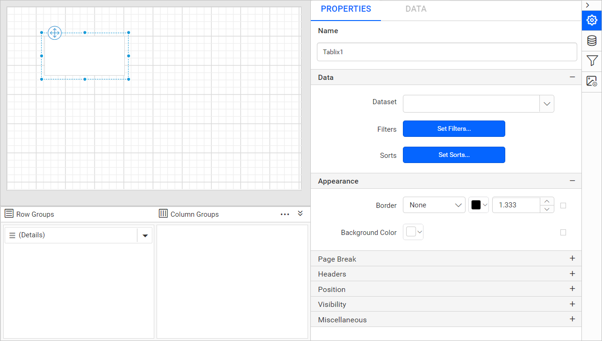
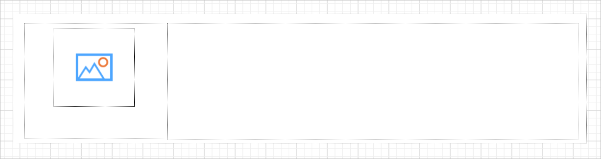
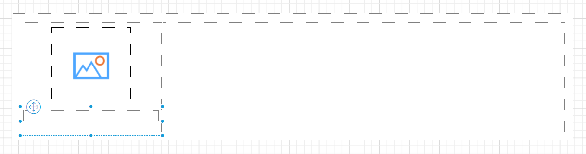
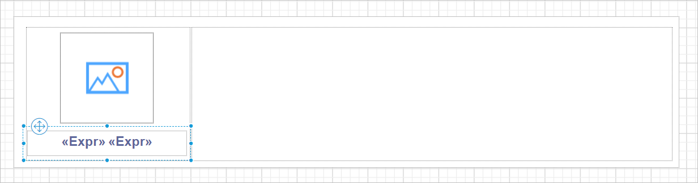
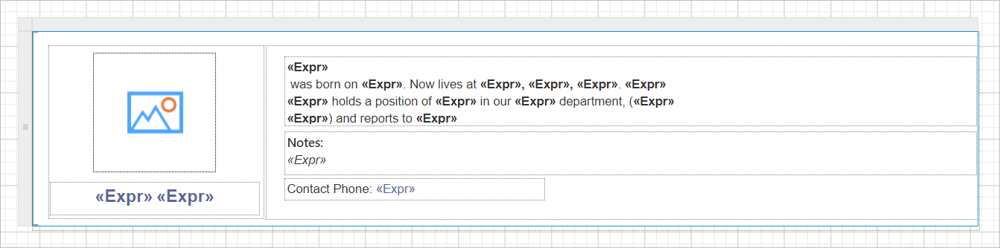
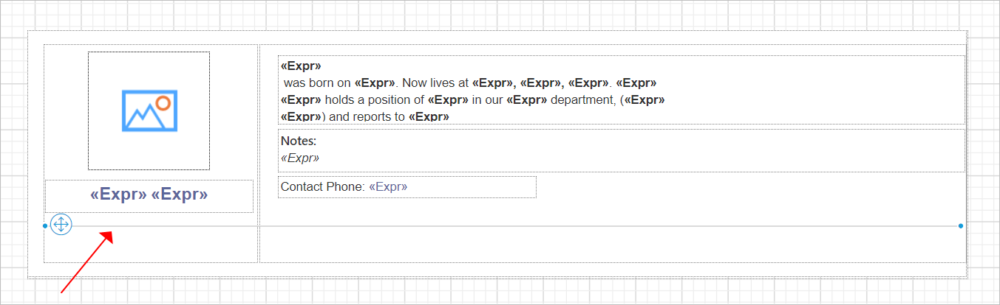
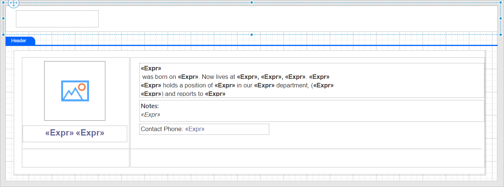
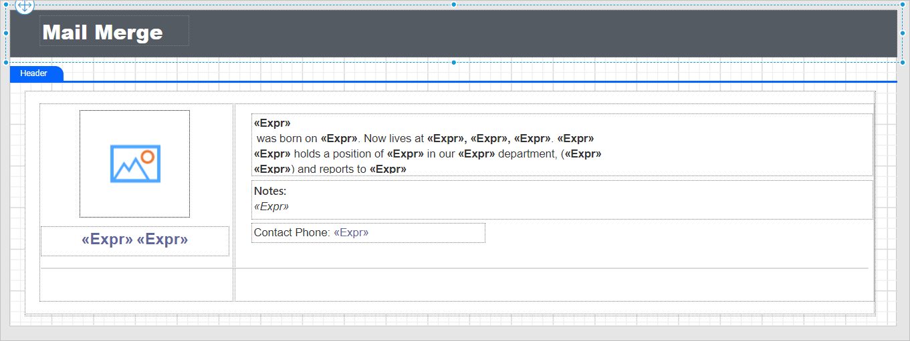
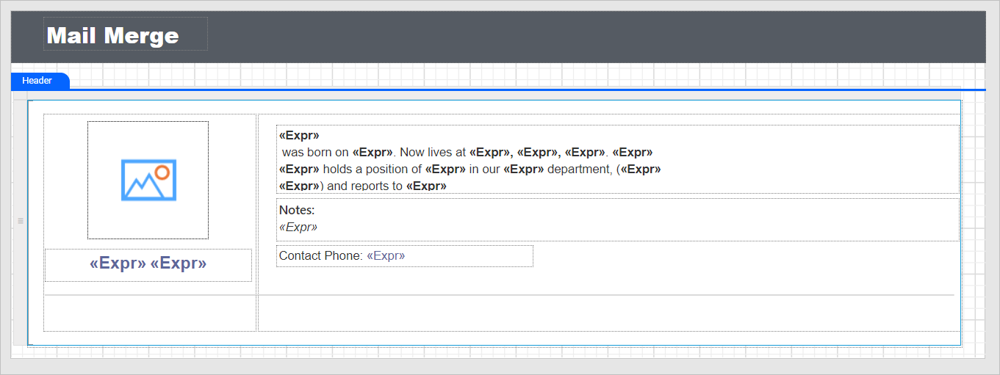
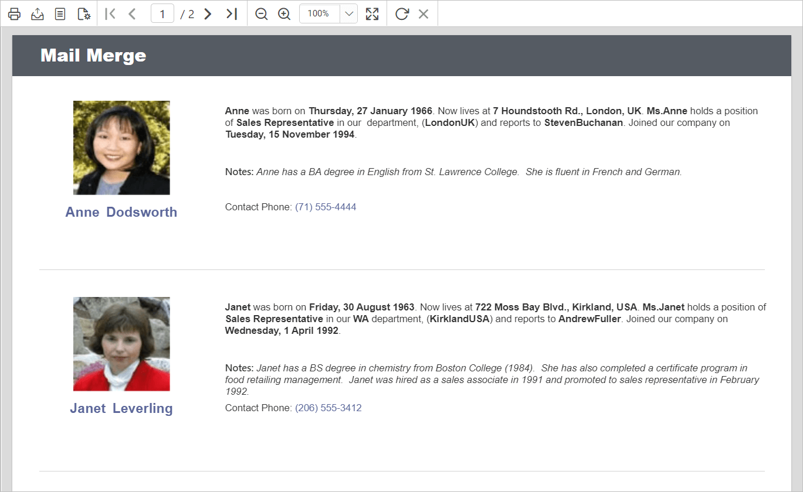

# Design an SSRS RDL report using a list in Bold Reports<sup>®</sup>

To design a `Mail Merge Report` in the Bold Reports<sup>®</sup> Web Report Designer, create a dataset, add a list report item, and place report items inside the list. Each employee record then displays in a free-form layout.

## How do I create the dataset?

You create a dataset in the Bold Reports<sup>®</sup> Web Report Designer to present data in the list format and bind it to the list data region. The following dataset query creates the dataset for this design.

```sql
SELECT Emp.Photo as Photo, Emp.FirstName, Emp.LastName,
(DATENAME(WEEKDAY,Emp.BirthDate)+', '+ DATENAME(DAY,Emp.BirthDate)+'+DATENAME(MONTH,Emp.BirthDate)+'+DATENAME(YEAR,Emp.BirthDate)) as BirthDate,
Emp.Address, Emp.Title, Emp.Region, Emp.City, Emp.Country, Emp.TitleOfCourtesy, Rep.FirstName as ReportingFirstName, Rep.LastName as ReportingLastName,
(DATENAME(WEEKDAY,Emp.HireDate)+', '+DATENAME(DAY,Emp.HireDate)+'+DATENAME(MONTH,Emp.HireDate)+'+DATENAME(YEAR,Emp.HireDate))as HireDate,
Emp.Notes, Emp.HomePhone    FROM  Employees Emp INNER JOIN Employees Rep ON Rep.EmployeeID=emp.ReportsTo

```

See the [Create Data](./../../../manage-data/dataset/create-an-embedded-dataset/) section and create the dataset by using the above query. The example uses the `Northwind` database.

## How do I configure the list?

You configure the list by adding the list report item to the design area and assigning the dataset to it.

1. Find the list report item in the item panel under the `Data Regions` category.
   
2. Drag and drop the list report item into the design area from the item panel.
   
3. Check the properties panel. It lists the list properties.
   
4. In the `DataSet` dropdown list, choose the dataset you need.
   

## What does the initial list design look like?

When you drop the list item, the Bold Reports<sup>®</sup> Web Report Designer renders a `Table` with a single cell in a row associated with the detail group. By default, the cell contains a rectangle that acts as a container.


> The cell in a list contains a rectangle. You can replace a default report item in a cell with any other report item.

## How do I add report items to the list?

In Bold Reports<sup>®</sup> list data regions, you can place report items anywhere instead of being limited to a table layout. To create a mail merge template, place images, rectangles, and textboxes inside the list report item in a free-form manner.

1. Drag and drop two rectangle report items inside the list to display the employee image and personal details side by side. Resize the list report item width and height as needed.
   
2. Drag and drop the image item into the left rectangle to display the employee image in the report.
   
3. Bind the `Photo` field from the database to the image item.
   
4. Add a textbox below the image report item to display the employee name.
   
5. Right-click the textbox and click the `Expression` option.
   
6. In the expression editor, choose the `FirstName` field from the dataset.
   
7. Assign the `LastName` field in the same way and create another expression. Then, customize the text appearance by using the textbox properties in the properties panel.
   
   > To assign an expression in a textbox report item, see the [Display dynamic text using expression](./../../../report-items/textbox/design-rdl-report-using-textbox/#display-dynamic-text-using-expression) section.
8. Place other report items in the list item to display other employee details. In the following image, textboxes hold the employee information, and the values are bound as expressions to fetch dynamic data from the database.
   
9. Separate each employee record with a line. On report preview, each employee's details display as a list, so drag and drop a line report item into the inside bottom position of the list cell.
   

## How do I add a report header?

You add a report title in Bold Reports<sup>®</sup> by enabling the report header and placing a textbox in it.

1. Enable the report `Header` to add a title to the report.
   
   > To add or remove the header or footer in the report, see the [Show or hide header and footer](./../../../compose-report/show-or-hide-header-footer-in-report/) section.
2. Add a rectangle report item in the report header area and a textbox within the rectangle.
   
3. Set the report title text in the textbox. Customize the title appearance by using the textbox and rectangle properties in the properties panel.
   

## What does the final design look like?

The final design of the Bold Reports<sup>®</sup> Mail Merge Report looks like the following image.



## How does the report look on preview?

On report preview, the Bold Reports<sup>®</sup> mail merge report displays as follows.



> Download the [mail merge report design (RDL) from GitHub](https://github.com/boldreports/resources/tree/master/docs/report-designer/list/design-ssrs-rdl-report-using-list.rdl)

## Frequently asked questions

### Can I replace the rectangle in a list cell?

Yes. The cell in a list contains a rectangle by default, and you can replace it with any other report item.

### How do I separate each record in the mail merge report?

Drag and drop a line report item into the inside bottom position of the list cell.

## See also

* [List report item](./../../../report-items/list/)
* [Image report item](./../../../report-items/image/)
* [Line report item](./../../../report-items/line/)
