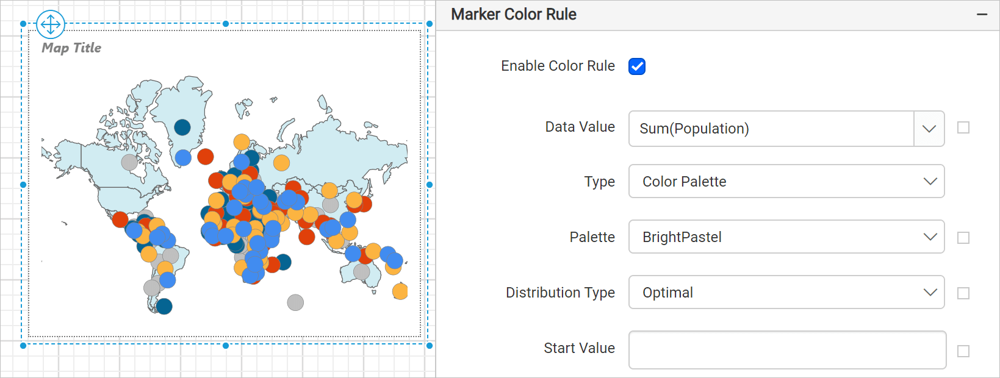

# Color palette rule for map markers in {{site.productNameTM}}

In the {{site.productNameTM}} Web Report Designer, the color palette rule fills each map marker icon in a layer with a color from the applied palette, then uses progressively lighter shades.

## How do I apply a color palette to map markers?

You apply a color palette to map markers in the {{site.productNameTM}} Web Report Designer from the `Marker Color Rule` category.

1. Under the `Marker Color Rule` category, choose the **Color Palette** option in the type dropdown.
2. Choose a palette from the **Palette** dropdown that appears under the type dropdown.

For example, set the palette type to `BrightPastel`. The map design with sample data then looks like the following image.

## How are the palette colors distributed?

During report processing, {{site.productNameTM}} automatically distributes the map marker icon colors on the map surface based on the selected palette and distribution type.

## See also

* [Marker color rule](./../../../report-items/map/marker-color-rule/)
* [Color palette rule for map shapes](./../../../report-items/map/color-palette-shape-rule/)
* [Map legend](./../../../report-items/map/legend/)
