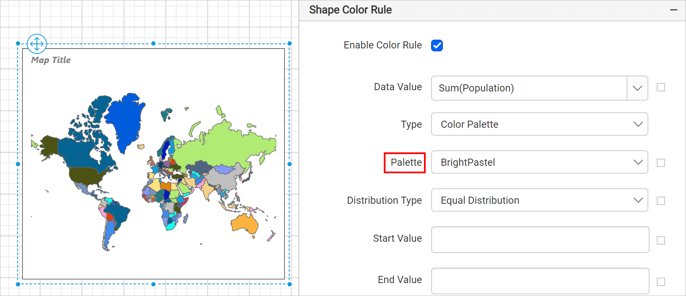

# Color palette rule for map shapes in Bold Reports®

In the Bold Reports® Web Report Designer, the color palette rule fills each map shape in a layer with a color from the applied palette, then uses progressively lighter shades.

## How do I apply a color palette to map shapes?

You apply a color palette to map shapes in the Bold Reports® Web Report Designer from the `Shape Color Rule` category.

1. Under the `Shape Color Rule` category, choose the **Color Palette** option in the type dropdown.
2. Choose a palette from the **Palette** dropdown that appears under the type dropdown.

For example, set the palette type to `BrightPastel`. The map design with sample data then looks like the following image.

During report processing, Bold Reports® automatically distributes the map shape colors on the map surface based on the selected palette and distribution type.

## Is there a use case example?

Yes. See the [Design map using color palette rule](./../../../report-items/map/use-case/design-map-using-color-palette-rule/) section to design a simple election results analysis report by using the color palette rule in the Bold Reports® map report item.

## See also

* [Shape color rule](./../../../report-items/map/shape-color-rule/)
* [Color palette rule for map markers](./../../../report-items/map/color-palette-marker-rule/)
* [Map legend](./../../../report-items/map/legend/)
