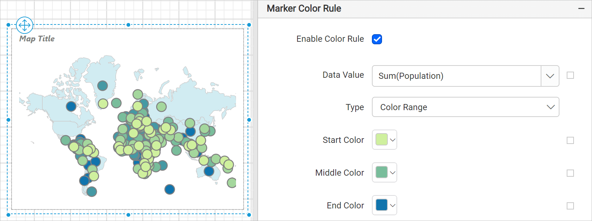

# Color range rule for map markers in {{site.productNameTM}}

In the {{site.productNameTM}} Web Report Designer, the map marker color range rule uses start, middle, and end colors that you set, plus distribution options. Based on the distribution type and the provided colors, the rule creates many hues that deliver a presentation like a heat map. The start color applies to the low end of the data range, and the end color applies to data at the high end of the data range.

## How do I set the color range colors?

You set the {{site.productNameTM}} marker color range by entering colors in the `Start` color, `Middle` color, and `End` color fields. By default, red, yellow, and green colors are applied to map marker icons.

* Start color: the color to use for the lowest range.
* Middle color: the color to use for the middle range.
* End color: the color to use for the highest range.

For example, to display the population of each country on a map, set the color codes #CFF09E, #79BD9B, and #1074AD, respectively. The map design with sample data then looks like the following image.

During report processing, {{site.productNameTM}} distributes these three colors across the map marker icons based on the distribution type, which delivers a presentation like a heat map.

## Is there a use case example?

Yes. See the [Design map using color range rule](./../../../report-items/map/use-case/design-map-using-marker-color-range-rule/) section to design a U.S. sales analysis report by using the color range rule in the {{site.productNameTM}} map report item.

## Frequently asked questions

### Which colors does the marker color range use by default?

By default, red, yellow, and green colors are applied to map marker icons.

## See also

* [Marker color rule](./../../../report-items/map/marker-color-rule/)
* [Color range rule for map shapes](./../../../report-items/map/color-range-shape-rule/)
* [Define a custom data range](./../../../report-items/map/define-custom-data-range/)
