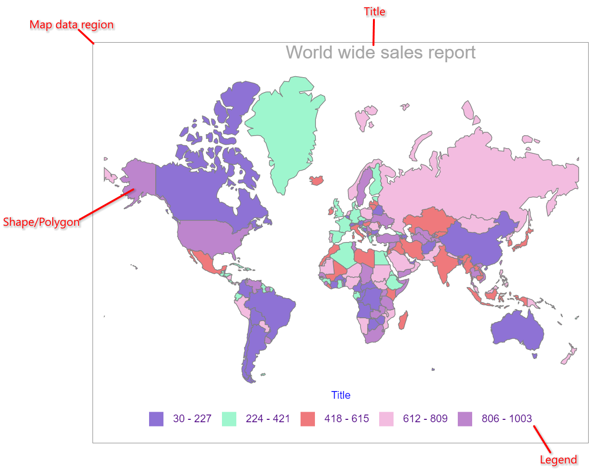
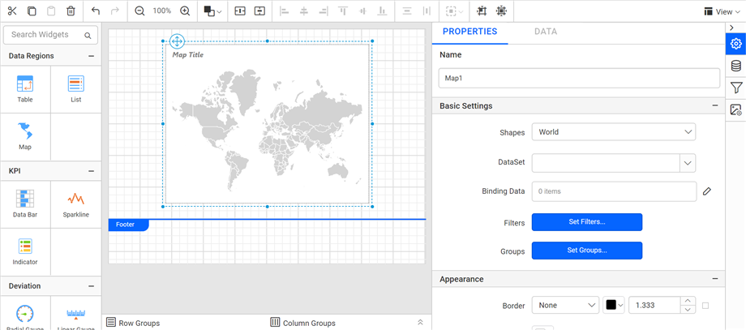

# Map report item in {{site.productNameTM}} Web Report Designer

A map in the {{site.productNameTM}} Web Report Designer is a data visualization report item that presents analytical data with a geographical background. It helps you visualize factors such as population density, election results, sales, weather, and popularity of social networking sites.

## What data does a map need?

The {{site.productNameTM}} map report item requires two types of data: shape data and optional analytical data. Shape data is a set of geodesic or geometric coordinates that defines the physical appearance of the map. Analytical data provides values to the shapes.

For example, to display the population of each country, use the country name and population count as analytical data, and the country name and location as shape data. To display such data on a map, match the shape data and analytical data. If both come from the same source, the matching is known. Otherwise, define the matching manually.

## Which map types are supported?

The {{site.productNameTM}} map report item supports a single map layer. Each shape is also called a `Polygon`. A map layer can display either built-in or custom shape data.

The Report Designer supports three types of map:

* A basic map displays only locations.
* A color map varies map shape colors based on ranges of analytical data.
* A marker map displays different marker styles based on ranges of analytical data.

To render each type of map, you specify the rules that vary the style or distribute colors on map shapes based on the range of analytical data.

## Map parts

The following image shows the different elements used in a {{site.productNameTM}} map.

## How do I add a map to the report?

You add a map to a {{site.productNameTM}} report by dragging the `Map` report item from the item panel into the design area.

1. Find the `Map` report item under the `Data Regions` category in the item panel.

   

2. Drag and drop the map from the item panel into the design area.

   

3. Check the result. The map item renders in the design area, and the properties panel lists the map properties.

   

Configure data and format the map to visualize the analytical data with a geographical background.

> By default, map report item renders with world map shapes.

## How do I design an RDL report using a map?

To learn how to design a simple map in your {{site.productNameTM}} report, see the [Design ssrs RDL report using map](./../../report-items/map/use-case/design-map-using-custom-rule/) section.

## Frequently asked questions

### Is analytical data required for a map?

No. Shape data is required, and analytical data is optional. Analytical data provides values to the shapes.

### Which shapes does a new map use?

By default, the map report item renders with world map shapes.

## See also

* [Bind data to a map](./../../report-items/map/binding-data/)
* [Shape color rule](./../../report-items/map/shape-color-rule/)
* [Marker color rule](./../../report-items/map/marker-color-rule/)
* [Map legend](./../../report-items/map/legend/)
