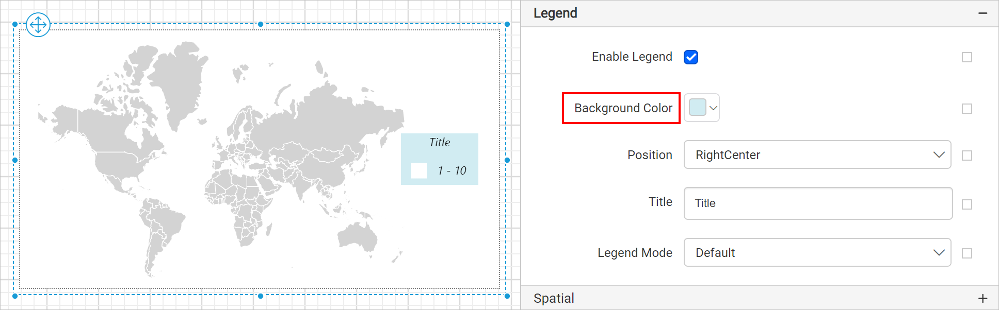
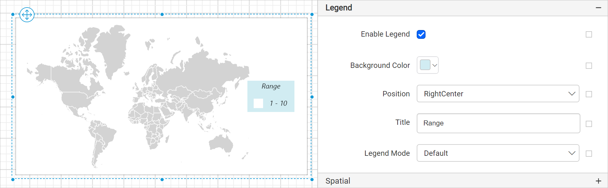
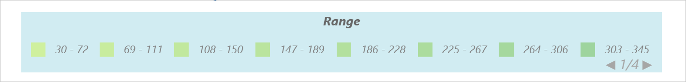
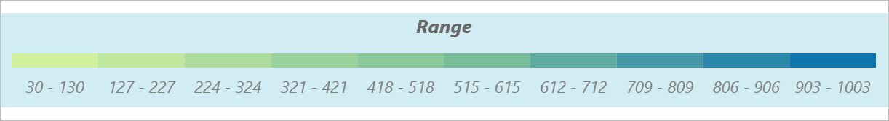

# Map legend in {{site.productNameTM}} Web Report Designer

In the {{site.productNameTM}} Web Report Designer, a map legend explains the meaning of the colors on map shapes. Use the **Legend** property of the map to toggle the legend visibility and customize the legend appearance in the map design. The property is listed under the **Legend** category in the map properties.

> The legend split the data range based on the shape color rules specified for respective map report item.

## How do I show or hide the legend?

To show or hide the legend on the {{site.productNameTM}} map surface, toggle the `Enable Legend` checkbox.

When you select the `Enable Legend` checkbox, the map legend displays in the right center position of the map surface.

You can also enable or disable the legend based on dynamic values by using `Expressions`. To open the set or reset expression menu in the properties panel, see the [Set Expression](./../../../compose-report/properties-panel/#set-expression) and [Reset Expression](./../../../compose-report/properties-panel/#reset-expression) sections.

## How do I customize the legend?

After you enable the {{site.productNameTM}} map legend, the other properties required for legend customization appear under the **Legend** category.

You customize the legend appearance through these properties.

### Background color

The Background color property sets the background color of the map legend area.

The background color is then applied to the legend area.

You can also apply the background color based on dynamic values by using `Expressions`. To open the set or reset expression menu in the properties panel, see the [Set Expressions](./../../../compose-report/properties-panel/#set-expression) and [Reset Expressions](./../../../compose-report/properties-panel/#reset-expression) sections.

### Position

The Position property places the map legend in different positions inside the map surface. The `Position` dropdown lists the supported positioning patterns.

By default, the legend is placed in the `RightCenter` position. In the following image, the legend is positioned at `LeftTop` inside the map surface.

### Title

The Title property customizes the title text of the map legend. By default, the text displays as `Title`. Enter the title text you want in the title property textbox, and it displays as the map legend title in the map design.

You can also apply title text based on dynamic values by using `Expressions`. To open the set or reset expression menu in the properties panel, see the [Set Expressions](./../../../compose-report/properties-panel/#set-expression) and [Reset Expressions](./../../../compose-report/properties-panel/#reset-expression) sections.

#### Title font

You customize the legend title text appearance through the properties in the `Advanced` menu of the title property. Follow these steps:

1. Click the square icon on the right side of the `Title` text field.
2. Click the `Advanced` option in the menu.

The title font properties then display in the advanced options.

You can also apply font properties based on dynamic values by using `Expressions`. To open the set or reset expression menu in the properties panel, see the [Set Expressions](./../../../compose-report/properties-panel/#set-expression) and [Reset Expressions](./../../../compose-report/properties-panel/#reset-expression) sections.

Legends automatically extend to show the legend title or legend text.

### Legend mode

The Legend mode property sets the mode of the legend on the map surface.

Default mode groups the ranges and displays the legend as shown in the following image.

Interactive mode displays the ranges in a color scale.

## Frequently asked questions

### Where does the map legend appear by default?

When you enable the legend, it displays in the `RightCenter` position of the map surface.

### What is the difference between the legend modes?

Default mode groups the ranges in the legend. Interactive mode displays the ranges in a color scale.

## See also

* [Map report item](./../../../report-items/map/)
* [Shape color rule](./../../../report-items/map/shape-color-rule/)
* [Marker color rule](./../../../report-items/map/marker-color-rule/)
