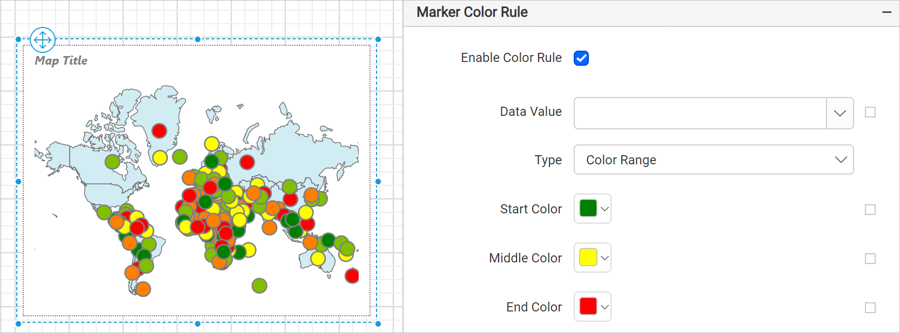

# Marker color rule in {{site.productNameTM}} Web Report Designer

In the {{site.productNameTM}} Web Report Designer, the marker color rule properties define color filling rules for map marker icons with a user-specified number of ranges.

## Which rules and distribution types are available?

The {{site.productNameTM}} marker color rule has three rules to fill colors on map marker icons:

* [Color palette](./../../../report-items/map/color-palette-marker-rule/)
* [Color ranges](./../../../report-items/map/color-range-marker-rule/)
* [Custom colors](./../../../report-items/map/custom-color-marker-rule/)

The marker color rule also has four distribution types to distribute colors on map marker icons:

* [Equal](./../../../report-items/map/equal-distribution-marker-rule/)
* [Equal interval](./../../../report-items/map/equal-interval-marker-rule/)
* [Optimal](./../../../report-items/map/optimal-distribution-marker-rule/)
* [Custom](./../../../report-items/map/custom-distribution-marker-rule/)

## How do I define a marker color rule?

You can apply {{site.productNameTM}} marker color rules after you match the map shapes based on shape data and analytical data from a dataset field.

The properties are listed under **Marker Color Rule** in the map properties. To enable or disable the marker color rule on the map surface, toggle the `Enable Color Rule` checkbox.

When you enable the marker color rule, the other properties required to define it appear under the **Marker Color Rule** category. By default, the **Color Range** type is applied on the map surface, as shown in the following image.

### Data value

The Data value field lists the available shape data fields and analytical data fields, depending on the source of shape data and analytical data in the report.

For example, to vary the marker colors based on the population of each country, choose the sum of the population data field as the data value. You can also set the data value based on dynamic values by using `Expressions`. To open the set or reset expression menu in the properties panel, see the [Set Expressions](./../../../compose-report/properties-panel/#set-expression) and [Reset Expressions](./../../../compose-report/properties-panel/#reset-expression) sections.

### Type

The Type property selects one of the three map marker color rules: Color Range, Color Palette, and Custom. The **Type** dropdown lists these options.

To learn about each marker color rule, see the following sections:

* [Color palette](./../../../report-items/map/color-palette-marker-rule/)
* [Color ranges](./../../../report-items/map/color-range-marker-rule/)
* [Custom colors](./../../../report-items/map/custom-color-marker-rule/)

### Distribution type

The color distribution options govern how colors are visualized on the marker icons. When you set a value for the `Data Value` property, the properties required to configure the distribution type appear under the marker color rule category.

The **Distribution Type** dropdown lists these options.

To design map markers with each distribution type, see the following sections:

* [Equal](./../../../report-items/map/equal-distribution-marker-rule/)
* [Equal interval](./../../../report-items/map/equal-interval-marker-rule/)
* [Optimal](./../../../report-items/map/optimal-distribution-marker-rule/)
* [Custom](./../../../report-items/map/custom-distribution-marker-rule/)

On report preview, the analytical data is split into ranges based on the selected distribution type, and the specified color rules are applied to the marker icons.

## Frequently asked questions

### Which color rule is applied by default?

When you enable the marker color rule, the **Color Range** type is applied on the map surface by default.

### When can I apply a marker color rule?

You can apply marker color rules after you match the map shapes based on shape data and analytical data from a dataset field.

## See also

* [Map report item](./../../../report-items/map/)
* [Bind data to a map](./../../../report-items/map/binding-data/)
* [Map legend](./../../../report-items/map/legend/)
