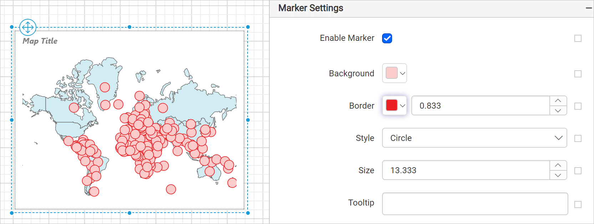
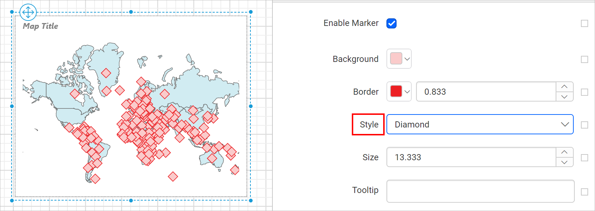
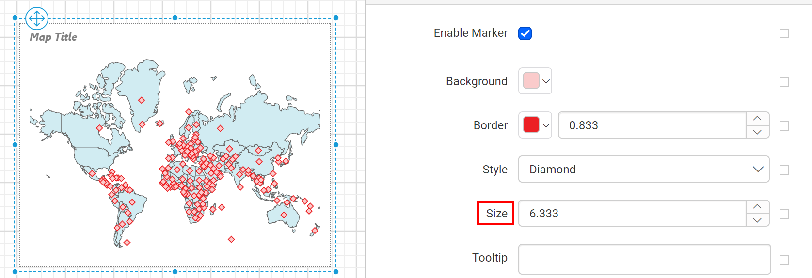

# Map marker settings in {{site.productNameTM}} Web Report Designer

In the {{site.productNameTM}} Web Report Designer, a marker identifies a location on a map. By default, a marker uses standard icons. You can set the background color, border, style, size, and tooltip for it.

> When you apply any of the marker color rules or template rule, it will take precedence over basic marker settings.

## How do I define marker settings?

You can apply marker settings in the {{site.productNameTM}} Web Report Designer after you match the map shapes based on shape data and analytical data. The analytical data can come from a data set field or from a spatial data source field.

The marker properties are listed under **Marker Settings** in the map properties. To enable or disable markers on the map surface, toggle the `Enable Marker` checkbox.

After you enable the marker, the other properties required for defining the marker appear under the **Marker Settings** category. By default, the **Circle** marker is applied on the map surface, as shown in the following image.

### Background color

The Background color property in the {{site.productNameTM}} Web Report Designer sets the background color for the marker icons on the map surface.

The background color is then applied to the map markers.

You can also apply the background color based on dynamic values by using `Expressions`. See [Set Expressions](./../../../compose-report/properties-panel/#set-expression) and [Reset Expressions](./../../../compose-report/properties-panel/#reset-expression) to open the set or reset expression menu in the properties panel.
> When you apply any of the marker color rules, it will take precedence over basic marker settings.

### Border

The Border property in the {{site.productNameTM}} Web Report Designer draws a border around each marker icon on the map surface. You can set the color and size of the border. The border is applied around the map marker icons, as shown in the following image.

You can also set the border properties based on dynamic values by using `Expressions`. See [Set Expression](./../../../compose-report/properties-panel/#set-expression) and [Reset Expression](./../../../compose-report/properties-panel/#reset-expression) to open the set or reset expression menu in the properties panel.

### Style

The Style property in the {{site.productNameTM}} Web Report Designer sets the style of the marker icon. The supported standard marker icon types are listed in the `Style` property drop-down.

Select the required marker icon style in this property. The style is applied on the map surface, as shown in the following image.

You can also set the marker properties based on dynamic values by using `Expressions`. See [Set Expression](./../../../compose-report/properties-panel/#set-expression) and [Reset Expression](./../../../compose-report/properties-panel/#reset-expression) to open the set or reset expression menu in the properties panel.

### Size

The Size property in the {{site.productNameTM}} Web Report Designer defines the size of the marker icons.

You can also set the marker properties based on dynamic values by using `Expressions`. See [Set Expression](./../../../compose-report/properties-panel/#set-expression) and [Reset Expression](./../../../compose-report/properties-panel/#reset-expression) to open the set or reset expression menu in the properties panel.

### Tooltip

The `ToolTip` property in the {{site.productNameTM}} Web Report Designer configures a tooltip for marker icons. Use it to display information, such as descriptive text or data related to the specific marker shape. When you hover over each marker icon in a rendered report, the information appears in the tooltip.

You can enter static text or set an expression that evaluates to a value. See [Set Expressions](./../../../compose-report/properties-panel/#set-expression) and [Reset Expressions](./../../../compose-report/properties-panel/#reset-expression) to open the set or reset expression menu in the properties panel.

## Frequently asked questions

### Which marker is applied by default when I enable markers?

The **Circle** marker is applied on the map surface by default when you enable the marker.

### Do marker color rules override basic marker settings?

Yes. When you apply any of the marker color rules or template rule, it takes precedence over basic marker settings.

## See also

* [Map marker rule](./../../../report-items/map/marker-rule/)
* [Map shape settings](./../../../report-items/map/shape-settings/)
* [Map properties](./../../../report-items/map/properties/)
