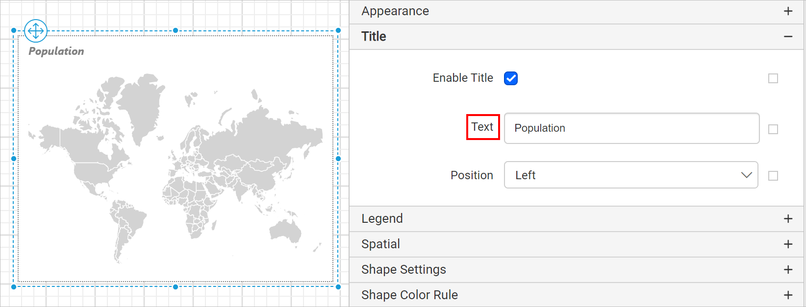

# Map report item properties in {{site.productNameTM}} Web Report Designer

You configure the map report item in the {{site.productNameTM}} Web Report Designer through properties such as basic settings, legend, and page break. Before you start, review the [Properties panel](./../../../compose-report/properties-panel/) section.

## Basic Settings

The Basic Settings category of the map report item in the {{site.productNameTM}} Web Report Designer holds the shapes, dataset, data binding, filter, and group properties.

### Shapes

The `Shapes` property in the {{site.productNameTM}} Web Report Designer displays the built-in and custom shapes that are available for the report. A map layer can display either built-in or custom shape data.

To import custom shape files into the Web Report Designer, see [Import shape files](./../../../how-to/configure-map-shapes/). Choose the required shape data from the drop-down to render the respective map in the design area.

### Dataset

The Dataset property in the {{site.productNameTM}} Web Report Designer assigns a dataset to the map. The available datasets in the report are listed in the `Dataset` property drop-down. Choose the desired dataset from the drop-down.

> Each map report item can only show data from one dataset.

> Refer [Create Data](./../../../manage-data/dataset/create-an-embedded-dataset/) section to add dataset to your report.

### Binding data

To display analytical data on the map surface in the {{site.productNameTM}} Web Report Designer, first link the analytical data and the shape data. The shape data is the map itself, and the analytical data is the data set you created. The analytical data gives meaning to the shape data. To bind analytical and shape data, see [Binding Data](./../../../report-items/map/binding-data/).

### Filter

The Filter property in the {{site.productNameTM}} Web Report Designer filters the data in the map. To open the `Filter` dialog, click the `Set Filters...` button. The filter dialog opens, as shown in the following image.

See [Filter Data](./../../../compose-report/filter-data/) to add or remove filters in the filter dialog.

### Groups

The Groups property in the {{site.productNameTM}} Web Report Designer groups the map elements with analytical data. To open the `Grouping` dialog, click the `Set Groups...` button in the properties panel. The `Grouping` dialog opens, as shown in the following image.

Modify the group `Name` or add a group expression in the group dialog, and click `OK`. See [Group Data](./../../../compose-report/group-data/) to add or remove groups in the grouping dialog.

## Appearance

The Appearance properties in the {{site.productNameTM}} Web Report Designer style the map and customize its look in the report design. They include border style, color, width, background color, and projection type. These properties are listed under the `Appearance` category in the properties panel.

### Border

The Border properties add or customize the border around a map item to visually separate it in the report design. To set border properties for the map item in the properties panel, see [Border Properties](./../../../compose-report/common-properties/#border-properties).

### Background color

The Background color property colors the map background. To set the background color in the properties panel, see [Background color](./../../../compose-report/common-properties/#background-color).

### Projection type

The Projection type property sets the rules that draw geographical data in a two-dimensional view onto a planar surface. A projection transforms longitude and latitude coordinates to 2D coordinates. This property must be specified when shape data is geographic.

## Title

The map title in the {{site.productNameTM}} Web Report Designer is customized by editing the `Text` property of the map. To show or hide the map title, toggle the `Enable Title` checkbox.

You can customize the title text for the map using this property. By default, the text is displayed as `Map Title`. Specify the required title text in the title property textbox, and it is displayed as the map title in the map design.

You can also apply the title text based on dynamic values by using `Expressions`. See [Set Expressions](./../../../compose-report/properties-panel/#set-expression) and [Reset Expressions](./../../../compose-report/properties-panel/#reset-expression) to open the set or reset expression menu in the properties panel.

### Title font

The title font properties in the {{site.productNameTM}} Web Report Designer customize the title text appearance. They are available in the `Advanced` menu of the title property. Click the square icon on the right side of the `Title` text field, and click the `Advanced` option in the menu.

The title font properties are displayed in the advanced options.

You can also apply font properties based on dynamic values by using `Expressions`. See [Set Expressions](./../../../compose-report/properties-panel/#set-expression) and [Reset Expressions](./../../../compose-report/properties-panel/#reset-expression) to open the set or reset expression menu in the properties panel.

### Position

The title position of the map is customized using the `Position` property.

## Link

The Link property in the {{site.productNameTM}} Web Report Designer creates an interactive report using **Hyperlink** and **Report Linking** actions. See [Linking](../../../compose-report/link-data/) to learn more about linking. Select the `Enable  Link` checkbox to enable the sub properties.

## Legend

A legend in the {{site.productNameTM}} Web Report Designer is text that describes the data plotted on the map. Use this property to toggle the visibility of the legend in the map and customize the legend text appearance. To set or reset legend properties, see [Map Legend](./../../../report-items/map/legend/).

## Spatial

The Spatial properties in the {{site.productNameTM}} Web Report Designer list the fields and polygons defined in the shape data.

**Fields** : The match fields that are available in the shape data are listed under the `Fields` section. Click the edit icon to view the fields.

You can edit the field name or data type and delete the fields based on the design requirements.

**Polygons** : Each map shape or polygon defined in the shape data file is listed under the `Polygons` section. Click the edit icon to view the polygon information.

You can edit the polygon details and delete polygons based on the design requirements. To edit a polygon, follow these steps:

1. Hover over a polygon in the list and click the edit icon.

   

2. The respective polygon properties are displayed, as shown in the following image.

   

3. Edit the required properties and click `Save`.

## Shape settings

Each region on a map surface in the {{site.productNameTM}} Web Report Designer is called a map shape. You can set a label, tooltip, border, and background color for it. To set or reset shape properties, see [Map Shape Settings](./../../../report-items/map/shape-settings/).

## Shape color rule

The shape color rule properties in the {{site.productNameTM}} Web Report Designer define color options for each shape on the map surface. To set or reset the shape color rule for a map, see [Shape Color Rule](./../../../report-items/map/shape-color-rule/).

## Marker settings

A marker in the {{site.productNameTM}} Web Report Designer identifies a location on a map. By default, a marker uses standard icons. You can set the background color, border, style, size, and tooltip for it. To set or reset marker properties, see [Map Marker Settings](./../../../report-items/map/marker-settings/).

## Marker color rule

The marker color rule properties in the {{site.productNameTM}} Web Report Designer define color options for each marker on the map surface. To set or reset the marker color rule for a map, see [Marker Color Rule](./../../../report-items/map/marker-color-rule/).

## Marker rule

The marker rule properties in the {{site.productNameTM}} Web Report Designer define marker styles for each marker on the map surface. To set or reset the marker rule for a map, see [Marker Rule](./../../../report-items/map/marker-rule/).

## Page break

The Page break property in the {{site.productNameTM}} Web Report Designer controls the amount of information on each page when you preview the report. Use the following properties to apply a page break to the map report item.

### Break location

The Break Location property specifies where the page break occurs. Choose the required `Break Location` type in the drop-down.

### Break Disabled

The Break Disabled property prevents predefined page breaks from being applied during report preview. Enable the `Break Disabled` property checkbox to use it. You can also control page breaks during report preview by using expressions. For details on setting and resetting page breaks dynamically, see the [Set Expression](./#set-expression) and [Reset Expression](./#reset-expression) sections.

### Page number reset

The Page Number Reset property restarts page numbering on each page. Enable the `Page Number Reset` property checkbox to use it.

## Position

The Position property in the {{site.productNameTM}} Web Report Designer sets the width, height, left, and top position of the map in the report design. To handle these properties in the properties panel, see [Position](./../../../compose-report/common-properties/#position).

## Data Element

The Data Element properties in the {{site.productNameTM}} Web Report Designer control the visibility of a report item when you export the report in XML format. The Data Element properties are listed in the properties panel under the `Data Element` category.

Name

You can assign a custom name for the map element using the `Name` field. The map is exported with the provided name.

> Note: The name cannot contain spaces, and it must begin with a letter followed by letters, numbers, or the underscore character (_).

Output

When you export the report, the `Output` property controls the visibility of the map. The `Output` property options perform the following operations:

* **Auto** or **Output** - Exports the map report item.
* **NoOutput** - Does not export the map report item.

## Visibility

The Visibility properties in the {{site.productNameTM}} Web Report Designer show, hide, or toggle the map report item.

**Visibility** - The Visibility property conditionally shows or hides the map report item on report preview or export. To set the visibility of the map item in the properties panel, see [Visibility](./../../../compose-report/common-properties/#visibility).
**Toggle** - The toggle settings property lets another report item interactively toggle the map report item visibility.

## Miscellaneous

The Miscellaneous category of the map report item in the {{site.productNameTM}} Web Report Designer holds the page name, document map, bookmark, custom attributes, and tooltip properties.

### Page name

The Page name property names the first worksheet of the Excel workbook when you export the report to Excel format.

You can set static or dynamic text as the page name. To set and reset dynamic text, see [Set Expression](./../../../compose-report/properties-panel/#set-expression) and [Reset Expression](./../../../compose-report/properties-panel/#reset-expression).

### Document Map

A document map is a navigational feature that displays a separate side pane with a set of navigational links in a hierarchical structure when you view a report. A user can click the content in the list to navigate to the report page that displays that item. See [Document Map](./../../../compose-report/document-map/) to configure a document map in the report design.

You can set static or dynamic text as the value for the document map property. To set and reset dynamic text, see [Set Expression](./../../../compose-report/properties-panel/#set-expression) and [Reset Expression](./../../../compose-report/properties-panel/#reset-expression).

### Bookmark

Bookmark links let users navigate to different parts of an SSRS report. You can add bookmarks to each textbox, image, table, or chart, or to the unique group values displayed in a tablix. Bookmarks direct users to specified locations in the report. The value of the bookmark property can be your own string or an expression. See [Bookmark](./../../../compose-report/bookmark/) to configure bookmarks in the report design.

You can set static or dynamic text as the value for the bookmark property. To set and reset dynamic text, see [Set Expression](./../../../compose-report/properties-panel/#set-expression) and [Reset Expression](./../../../compose-report/properties-panel/#reset-expression).

### Custom attributes

The Custom attributes property sets the values for map custom properties. To create and assign values for custom properties in the properties panel, see [Custom Properties](./../../../compose-report/common-properties/#custom-properties).

### Tooltip

The Tooltip property displays informative text or a value when the user hovers over the report item in report preview. To set a tooltip for the report item in the properties panel, see [Tooltip](./../../../compose-report/common-properties/#tooltip).

#### Custom Style

The `Custom Style` property enables the use of external CSS for styling report items, providing enhanced flexibility beyond the built-in styling options. Use this property to meet specific design requirements and keep styling consistent across multiple reports. For a step-by-step guide on setting up custom styles in your report, check the **How To** section of this guide.

## Set expression

The {{site.productNameTM}} Web Report Designer lets you set an expression on a few properties of the map report item, so the property values are processed based on expressions. To set expressions on the map report item properties, see [Set Expression](./../../../compose-report/properties-panel/#set-expression).

## Reset expression

To `Reset` the expression applied to a map property in the {{site.productNameTM}} Web Report Designer, see [Reset Expression](./../../../compose-report/properties-panel/#reset-expression).

## Advanced properties

A few properties of the map report item in the {{site.productNameTM}} Web Report Designer contain nested properties. To open and handle nested properties, see [Advanced Properties](./../../../compose-report/properties-panel/#advanced-properties).

## See also

* [Bind data to a map](./../../../report-items/map/binding-data/)
* [Map shape settings](./../../../report-items/map/shape-settings/)
* [Map legend](./../../../report-items/map/legend/)
