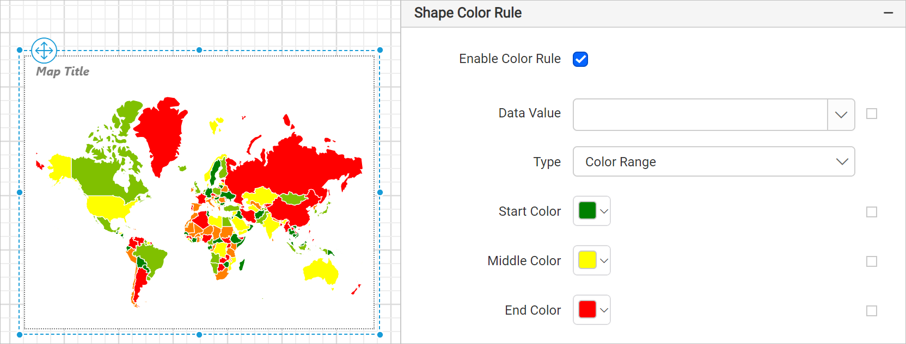

# Map shape color rule in {{site.productNameTM}} Web Report Designer

In the {{site.productNameTM}} Web Report Designer, the shape color rule properties define color filling rules for map shapes or polygons with a user-specified number of ranges. Shape color rules play a major role when you design choropleth maps.

## Which shape color rules and distribution types are available?

The {{site.productNameTM}} Web Report Designer offers three rules to apply colors on map shapes:

* [Color palette](./../../../report-items/map/color-palette-shape-rule/)
* [Color ranges](./../../../report-items/map/color-range-shape-rule/)
* [Custom colors](./../../../report-items/map/custom-color-shape-rule/)

It also offers four distribution types to distribute colors on map shapes:

* [Equal](./../../../report-items/map/equal-distribution-shape-rule/)
* [Equal interval](./../../../report-items/map/equal-interval-shape-rule/)
* [Optimal](./../../../report-items/map/optimal-distribution-shape-rule/)
* [Custom](./../../../report-items/map/custom-distribution-shape-rule/)

## How do I define a shape color rule?

You can apply shape color rules in the {{site.productNameTM}} Web Report Designer after you match the map shapes based on shape data and analytical data from a data set field.

The shape color rule properties are listed under **Shape Color Rule** in the map properties. To enable or disable the shape color rule on the map surface, toggle the `Enable Color Rule` checkbox.

After you enable the shape color rule, the other properties required for defining it appear under the **Shape Color Rule** category. By default, the **Color Range** type is applied on the map surface.

### Data value

The data value field in the {{site.productNameTM}} Web Report Designer lists the available shape data fields and analytical data fields. The list depends on the source of shape data and analytical data in the report.

For example, to display the population of each country on a map, choose the sum of population data field as the data value. You can also set the data value based on dynamic values by using `Expressions`. See [Set Expressions](./../../../compose-report/properties-panel/#set-expression) and [Reset Expressions](./../../../compose-report/properties-panel/#reset-expression) to open the set or reset expression menu in the properties panel.

### Type

The map shape color rule in the {{site.productNameTM}} Web Report Designer has three types of color rules: Color Range, Color Palette, and Custom. These options are listed in the **Type** drop-down.

See the following sections to learn about each shape color rule:

* [Color palette](./../../../report-items/map/color-palette-shape-rule/)
* [Color ranges](./../../../report-items/map/color-range-shape-rule/)
* [Custom colors](./../../../report-items/map/custom-color-shape-rule/)

### Distribution type

The color distribution options in the {{site.productNameTM}} Web Report Designer govern how colors are visualized on the map surface. After you set a value for the `Data Value` property, the properties required to configure the distribution type appear under the shape color rule category.

The options are listed in the **Distribution Type** drop-down.

See the following sections to design a map using each distribution type:

* [Equal](./../../../report-items/map/equal-distribution-shape-rule/)
* [Equal interval](./../../../report-items/map/equal-interval-shape-rule/)
* [Optimal](./../../../report-items/map/optimal-distribution-shape-rule/)
* [Custom](./../../../report-items/map/custom-distribution-shape-rule/)

On report preview, the analytical data is split into ranges based on the selected distribution type. The specified color rules are then applied to the map shapes.

## Frequently asked questions

### Which color rule type is applied by default?

The **Color Range** type is applied on the map surface by default when you enable the shape color rule.

### When can I apply a shape color rule?

You can apply shape color rules after you match the map shapes based on shape data and analytical data from a data set field.

## See also

* [Map shape settings](./../../../report-items/map/shape-settings/)
* [Bind data to a map](./../../../report-items/map/binding-data/)
* [Map properties](./../../../report-items/map/properties/)
