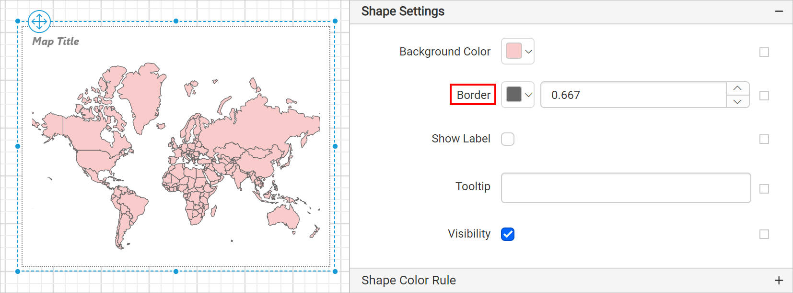
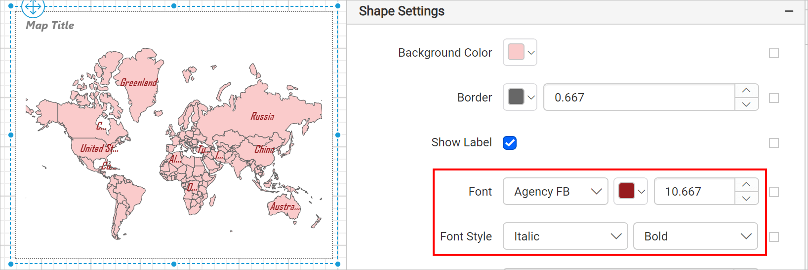

# Map shape settings in {{site.productNameTM}} Web Report Designer

In the {{site.productNameTM}} Web Report Designer, each region on a map surface is called a map shape or map polygon. You can customize these shapes by applying a label, tooltip, border, and background color.

## How do I customize map shapes?

You customize map shapes in the {{site.productNameTM}} Web Report Designer with the properties listed under **Shape Settings** in the map properties.

### Background color

The Background color property in the {{site.productNameTM}} Web Report Designer sets the background color for the shapes on the map surface.

The background color is then applied to the map shapes.

You can also apply the background color based on dynamic values by using `Expressions`. See [Set Expressions](./../../../compose-report/properties-panel/#set-expression) and [Reset Expressions](./../../../compose-report/properties-panel/#reset-expression) to open the set or reset expression menu in the properties panel.
> When you apply any of the map shape color rules, it will take precedence over basic shape settings.

### Border

The Border property in the {{site.productNameTM}} Web Report Designer draws a border around each shape on the map surface. You can set the color and size of the border. The border is applied around the map shapes, as shown in the following image.

You can also set the border properties based on dynamic values by using `Expressions`. See [Set Expression](./../../../compose-report/properties-panel/#set-expression) and [Reset Expression](./../../../compose-report/properties-panel/#reset-expression) to open the set or reset expression menu in the properties panel.

### Label

The Show label property in the {{site.productNameTM}} Web Report Designer toggles the label visibility for map shapes. To enable labels for shapes, toggle the `Show Label` checkbox. After you enable labels, the other properties required for label customization appear under the **Shape Settings** category.

The labels are enabled on the map surface, as shown in the following image.

#### Font

The font properties customize the label font family, size, and style.

You can also apply font style and weight properties based on dynamic values by using `Expressions`. See [Set Expressions](./../../../compose-report/properties-panel/#set-expression) and [Reset Expressions](./../../../compose-report/properties-panel/#reset-expression) to open the set or reset expression menu in the properties panel.

#### Text

The **Label Text** property drop-down lists the available shape data fields and analytical data fields.

> The fields prefixed with `#` are shape fields.

Choose the required field or enter static text in the label text property. If you choose a shape or analytical field, the respective field values are displayed in the respective shapes on the map surface. If you enter static text, the same text is displayed in all shapes on the map surface.

You can also apply the label text based on dynamic values by using `Expressions`. See [Set Expressions](./../../../compose-report/properties-panel/#set-expression) and [Reset Expressions](./../../../compose-report/properties-panel/#reset-expression) to open the set or reset expression menu in the properties panel.

### Tooltip

The `ToolTip` property in the {{site.productNameTM}} Web Report Designer configures a tooltip for shapes. Use it to display information, such as descriptive text or data related to the specific shape. When you hover over each shape in a rendered report, the information appears in the tooltip.

You can enter static text or set an expression that evaluates to a value. See [Set Expressions](./../../../compose-report/properties-panel/#set-expression) and [Reset Expressions](./../../../compose-report/properties-panel/#reset-expression) to open the set or reset expression menu in the properties panel.

### Visibility

The Visibility property in the {{site.productNameTM}} Web Report Designer conditionally shows or hides the map shapes on report preview or export. To show or hide shapes on the map surface, toggle the `Visibility` checkbox.

You can also set the visibility of map shapes based on dynamic values using expressions. See [Set Expressions](./../../../compose-report/properties-panel/#set-expression) and [Reset Expressions](./../../../compose-report/properties-panel/#reset-expression) to open the set or reset expression menu in the properties panel.

## Frequently asked questions

### Do shape color rules override basic shape settings?

Yes. When you apply any of the map shape color rules, it takes precedence over basic shape settings.

### Which label fields are shape fields?

In the **Label Text** drop-down, the fields prefixed with `#` are shape fields.

## See also

* [Map shape color rule](./../../../report-items/map/shape-color-rule/)
* [Map marker settings](./../../../report-items/map/marker-settings/)
* [Map properties](./../../../report-items/map/properties/)
