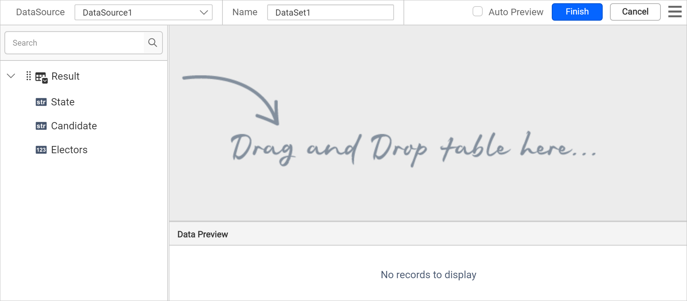
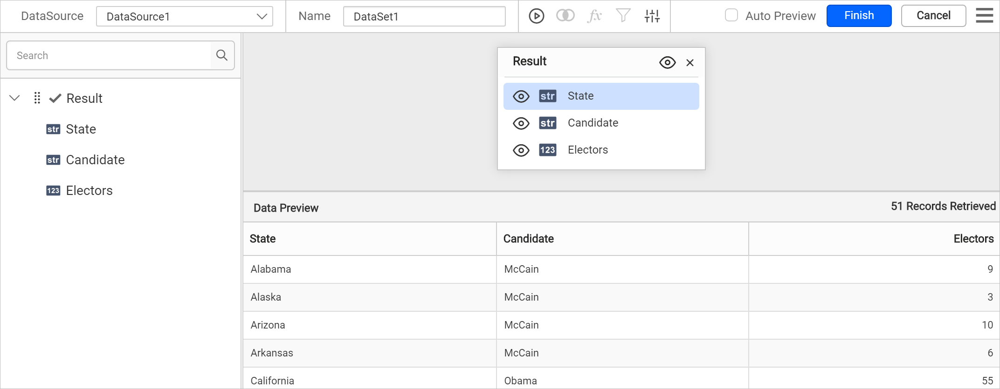
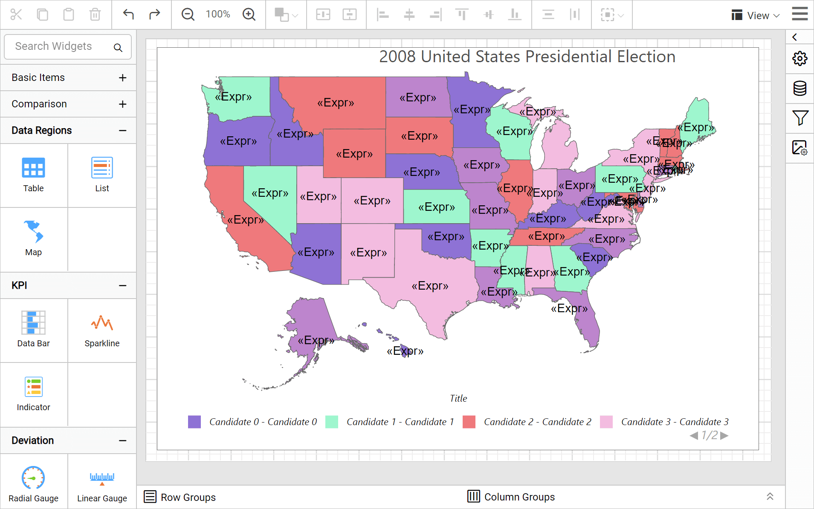
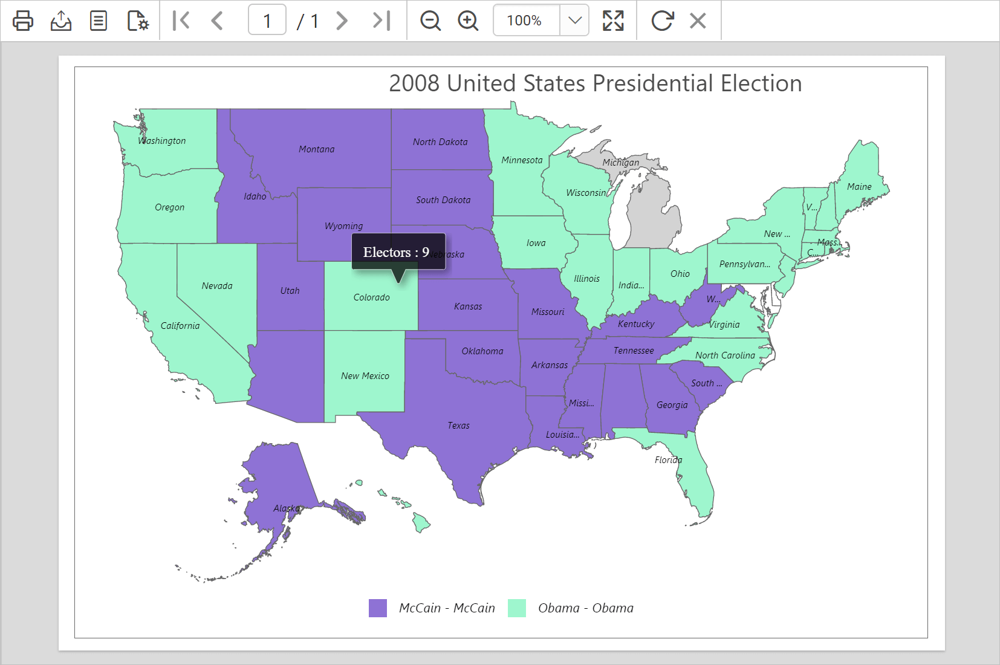

# Design a map using a color palette rule in Bold Reports®

You can design a map in the Bold Reports® Web Report Designer with a color palette rule and optimal distribution to display US presidential election results. Follow the steps in each section below.

## How do I create the data set?

You create the data set for the map in the Bold Reports® Web Report Designer from a JSON file. Follow these steps:

1. In the data panel, click `New Data`.
   
2. Choose the `JSON` connection type.
   
3. Choose `File` as `Type`.
   
4. Click the upload button, then browse and upload the JSON file in the `File Path` field.
   
5. Click the `Connect` button.
6. In the query builder, the available fields in the JSON file are loaded under the default table name, `Result`.
   
7. Drag and drop the `Result` table and execute.
   
8. Modify the data set `Name` and click **Finish**.
   

> Download the [US presidential election sample JSON file](https://www.syncfusion.com/downloads/support/directtrac/general/ze/US-presidential-election-JSON429439438).

## How do I add a map to the report design?

The `Map` report item in the Bold Reports® Web Report Designer is listed under the `Data Regions` category in the item panel.

To add a `Map` report item to the report, drag the map from the item panel into the design area.

The map item is rendered in the design area, and the map properties are listed in the properties panel.

> By default, map report item renders with world map shapes.

## How do I bind analytical and shape data?

You bind analytical and shape data in the Bold Reports® Web Report Designer from the **Basic Settings** category of the properties panel. Follow these steps:

1. Under the **Basic Settings** category, set `USA` in the `Shapes` property and choose the data set in the **DataSet** property.

   

2. Click the edit icon for the [Binding Data](./../../../../report-items/map/binding-data/) property under **Basic Settings**.
   

3. Match the analytical and shape data as described in [Binding Data](./../../../../report-items/map/binding-data/). Choose **name** in the **Field Name** drop-down and choose the **=Fields!State.Value** expression in **Binding Expression**.

   

4. Click **Update**.

   

## How do I customize the map appearance?

You customize the map name, title, legend, color settings, and other properties in the Bold Reports® Web Report Designer properties panel.

### Name

The **Name** property in the Bold Reports® Web Report Designer gives a unique name to a specific map report item.

### Appearance

Under the **Appearance** category in the Bold Reports® Web Report Designer, set the border width and color properties as required.

### Title

Under the [Title](./../../../../report-items/map/properties/#title) category in the Bold Reports® Web Report Designer, set the title text, position, and font properties for the map title. First, enable the **Enable Title** check box. Then, add the title and position.

### Legend

Under the [Legend](./../../../../report-items/map/properties/#legend) category in the Bold Reports® Web Report Designer, enable the **Enable Legend** check box. Set the background color as **White** and the position as **BottomCenter**. Remove the title text and set the legend mode as **Default**.

### Shape settings

Under the [Shape Settings](./../../../../report-items/map/shape-settings/) in the Bold Reports® Web Report Designer, set the following values:

* Border color as `#676767` and width as `0.667px`.
* Label text as `=Fields!State.Value`.
* Tooltip as the `="Electors : " & Fields!Electors.Value` expression.

### Shape color rule

Under the [Shape color rule](./../../../../report-items/map/shape-color-rule/) category in the Bold Reports® Web Report Designer, enable the **Enable Color Rule** check box. Then, set the following values:

* Choose the `Candidate` name in Data Value.
* Choose **Color Palette** as the Type.
* Choose **Optimal** for **Distribution type**. This type adjusts the size of data intervals to limit grouping errors. As a result, the map looks balanced, with only a few shapes in the highest class.

The shape color rule configuration looks like the following image.

The colors are now applied to the map shapes, but with sample data.

To see the actual data on the map surface, preview the report. Before that, resize the width and height of the map so you can view the information clearly in preview.

### Preview report

You can preview the report at design time using the built-in Bold Reports® Viewer to make sure the report design is as expected. The following snapshot shows the color distribution applied based on the candidate who won in each state.

> Download the [color palette map report design (RDL) from GitHub](https://github.com/boldreports/resources/tree/master/docs/report-designer/map/design-map-using-color-palette-rule.rdl).

## See also

* [Map shape color rule](./../../../../report-items/map/shape-color-rule/)
* [Color palette shape rule](./../../../../report-items/map/color-palette-shape-rule/)
* [Design a map using a color range rule](./../../../../report-items/map/use-case/design-map-using-color-range-rule/)
