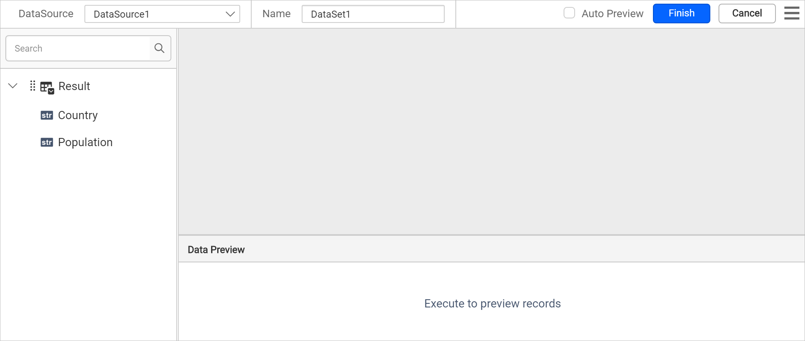
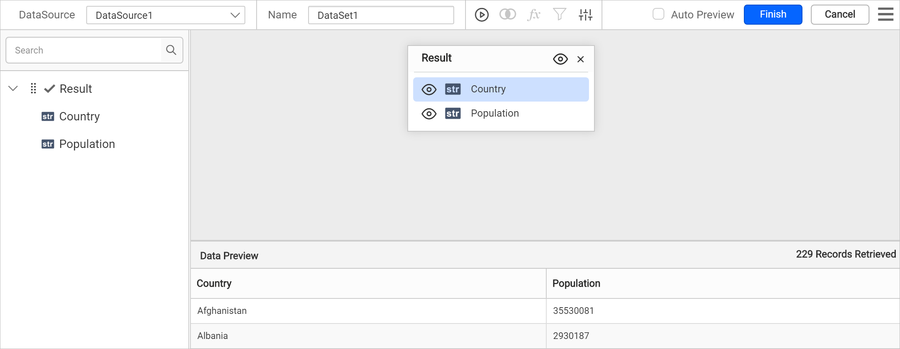
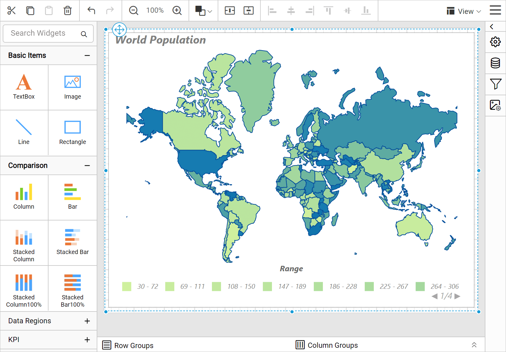
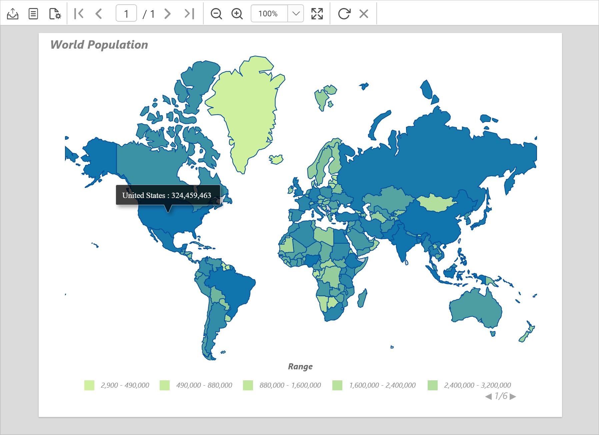

# Design a map using a color range rule in Bold Reports®

You can design a map in the Bold Reports® Web Report Designer with a color range rule and optimal distribution. The map groups countries by population ranges, similar to a heat map.

## How do I create the data set?

You create the data set for the map in the Bold Reports® Web Report Designer from a JSON file. Follow these steps:

1. In the data panel, click `New Data`.
   
2. Choose the `JSON` connection type.
   
3. Choose `File` as `Type`.
   
4. Click the upload button, then browse and upload the JSON file in the `File Path` field.
   
5. Click the `Connect` button.
6. In the query builder, the available fields in the JSON file are loaded under the default table name, `Result`.
   
7. Drag and drop the `Result` table and execute.
   
8. Modify the data set `Name` and click **Finish**.
   

> Note: The population data used here is an approximate measure. The live population data may vary from this. Download the [world population sample JSON file](https://www.syncfusion.com/downloads/support/directtrac/general/ze/World-population-JSON799813027).

## How do I add a map to the report design?

The `Map` report item in the Bold Reports® Web Report Designer is listed under the `Data Regions` category in the item panel.

To add a `Map` report item to the report, drag the map from the item panel into the design area.

The map item is rendered in the design area, and the map properties are listed in the properties panel.

> By default, map report item renders with world map shapes.

## How do I bind analytical and shape data?

You bind analytical and shape data in the Bold Reports® Web Report Designer from the **Basic Settings** category of the properties panel. Follow these steps:

1. Under the **Basic Settings** category, choose the data set in the **DataSet** property.

   

2. Click the edit icon for the [Binding Data](./../../../../report-items/map/binding-data/) property under **Basic Settings**.
   

3. Match the analytical and shape data as described in [Binding Data](./../../../../report-items/map/binding-data/). Choose **admin** in the **Field Name** drop-down and choose the **=Fields!Country.Value** expression in **Binding Expression**.

   

4. Click **Update**.

   

## How do I customize the map appearance?

You customize the map name, title, legend, color settings, and other properties in the Bold Reports® Web Report Designer properties panel.

### Name

The **Name** property in the Bold Reports® Web Report Designer gives a unique name to a specific map report item.

### Appearance

Under the **Appearance** category in the Bold Reports® Web Report Designer, set the border width and color properties as required.

### Title

Under the [Title](./../../../../report-items/map/properties/#title) category in the Bold Reports® Web Report Designer, set the title text, position, and font properties for the map title. First, enable the **Enable Title** check box. Then, add the title and position.

### Legend

Under the [Legend](./../../../../report-items/map/properties/#legend) category in the Bold Reports® Web Report Designer, enable the **Enable Legend** check box. Set the background color as **White**, the position as **BottomCenter**, and the `Range` as **Title**.

### Shape settings

Under the [Shape Settings](./../../../../report-items/map/shape-settings/) in the Bold Reports® Web Report Designer, set the following values:

* Border color as `#08519c` and width as `1.152px`.
* Tooltip as the `=Fields!Country.Value & " : " & FormatNumber(Fields!Population.Value,0)` expression.

### Shape color rule

Under the [Shape color rule](./../../../../report-items/map/shape-color-rule/) category in the Bold Reports® Web Report Designer, enable the **Enable Color Rule** check box. Then, set the following values:

* Set the `=CDec(Sum(Fields!Population.Value))` expression in Data Value.
* Choose **Color Range** as the Type.
* Set the start, middle, and end colors as **#CFF09E**, **#79BD9B**, **#1074AD**, respectively. The start color applies to the low end of the data range, and the end color applies to data at the high end of the data range.
* Choose **Equal Distribution** for **Distribution type**. This type creates unequally sized data intervals and adjusts the interval limits so that each range has an equal number of items.
* The bucket count property splits the available data into a required number of ranges. Specify the **Bucket Count** as 25. The legend splits into 25 ranges.

The shape color rule configuration looks like the following image.

The colors are now applied to the map shapes, but with sample data.

To see the actual data on the map surface, preview the report. Before that, resize the width and height of the map so you can view the information clearly in preview.

### Preview report

You can preview the report at design time using the built-in Bold Reports® Viewer to make sure the report design is as expected. In preview mode, hover over each shape on the map surface to see the country name and population. The following snapshot shows the color distribution applied based on the population range of countries.

> Download the [color range map report design (RDL) from GitHub](https://github.com/boldreports/resources/tree/master/docs/report-designer/map/design-map-using-color-range-rule.rdl).

## See also

* [Color range shape rule](./../../../../report-items/map/color-range-shape-rule/)
* [Map shape color rule](./../../../../report-items/map/shape-color-rule/)
* [Design a map using a color palette rule](./../../../../report-items/map/use-case/design-map-using-color-palette-rule/)
