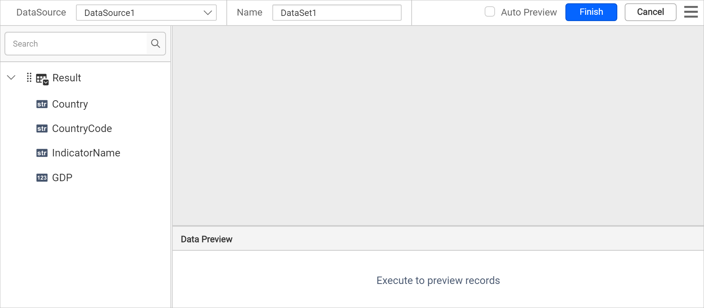
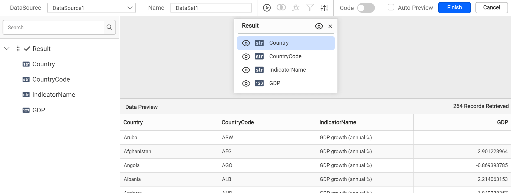
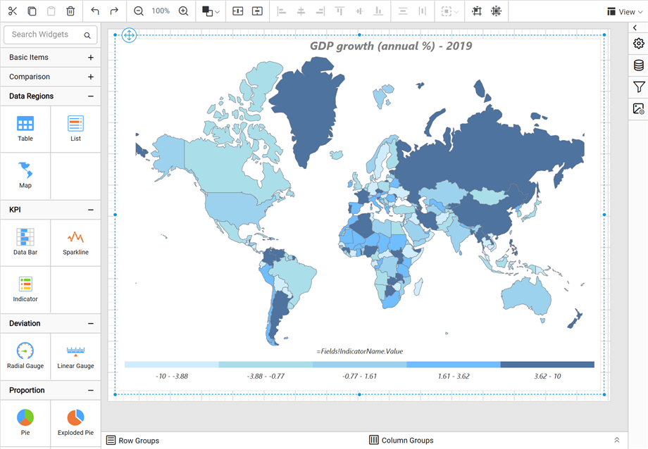
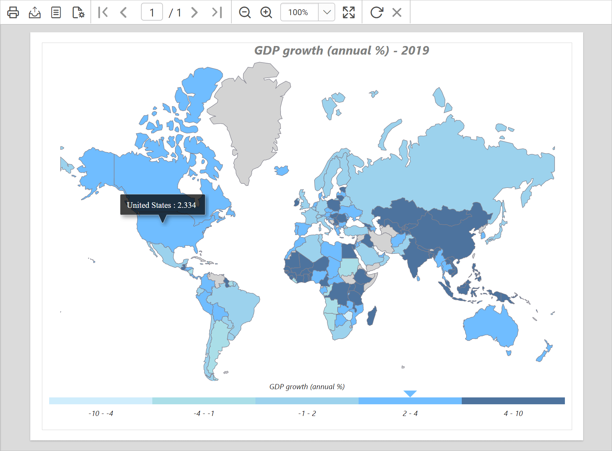

# Design a map using a custom rule in {{site.productNameTM}}

You can design a map in the {{site.productNameTM}} Web Report Designer with a custom color rule and custom distribution. The example map displays the annual gross domestic product (GDP) growth rate of each country for 2019, like a heat map.

## How do I create the data set?

You create the data set for the map in the {{site.productNameTM}} Web Report Designer from a JSON file. Follow these steps:

1. In the data panel, click `New Data`.
   
2. Choose the `JSON` connection type.
   
3. Choose `File` as `Type`.
   
4. Click the upload button, then browse and upload the JSON file in the `File Path` field.
   
5. Click the `Connect` button.
6. In the query builder, the available fields in the JSON file are loaded under the default table name, `Result`.
   
7. Drag and drop the `Result` table and execute.
   
8. Modify the data set `Name` and click **Finish**.
   

> Note: Download the [World GDP growth sample JSON file](https://www.syncfusion.com/downloads/support/directtrac/general/ze/World-GDP-Growth-JSON-185214165). This data is downloaded from [Data world bank](https://data.worldbank.org/indicator/NY.GDP.MKTP.KD.ZG).

## How do I add a map to the report design?

The `Map` report item in the {{site.productNameTM}} Web Report Designer is listed under the `Data Regions` category in the item panel.

To add a `Map` report item to the report, drag the map from the item panel into the design area.

The map item is rendered in the design area, and the map properties are listed in the properties panel.

> By default, map report item renders with world map shapes.

## How do I bind analytical and shape data?

You bind analytical and shape data in the {{site.productNameTM}} Web Report Designer from the **Basic Settings** category of the properties panel. Follow these steps:

1. Under the **Basic Settings** category, choose the data set in the **DataSet** property.

   

2. Click the edit icon for the [Binding Data](./../../../../report-items/map/binding-data/) property under **Basic Settings**.
   

3. Match the analytical and shape data as described in [Binding Data](./../../../../report-items/map/binding-data/). Choose **name** in the **Field Name** drop-down and choose the **=Fields!Country.Value** expression in **Binding Expression**.

   

4. Click **Update**.

## How do I customize the map appearance?

You customize the map title, legend, color settings, and other properties in the {{site.productNameTM}} Web Report Designer properties panel.

### Appearance

Under the **Appearance** category in the {{site.productNameTM}} Web Report Designer, set the border width and color properties as required.

### Title

Under the [Title](./../../properties/#title) category in the {{site.productNameTM}} Web Report Designer, set the title text, position, and font properties for the map title. First, enable the **Enable Title** check box. Then, add the title and position.

### Legend

Under the [Legend](./../../properties/#legend) category in the {{site.productNameTM}} Web Report Designer, enable the **Enable Legend** check box. Set the following values:

* Background color as **White**.
* Position as **BottomCenter**.
* Legend mode as **Interactive**.
* `=Fields!IndicatorName.Value` as the [expression](./../../../../compose-report/expressions/) for **Title**.

### Shape settings

Under the [Shape Settings](./../../shape-settings/) in the {{site.productNameTM}} Web Report Designer, set the following values:

* Border color as `#81808c` and width as `0.667px`.
* Tooltip as the `= Fields!Country.Value + " : "+ Round(Fields!GDP.Value, 3)` expression.

### Shape color rule

Under the [Shape color rule](./../../../../report-items/map/shape-color-rule/) category in the {{site.productNameTM}} Web Report Designer, enable the **Enable Color Rule** check box. Then, set the following values:

* Choose Sum(GDP) in **Data Value**.
* Choose **Custom** as the Type. Following the [Custom colors](./../../../../report-items/map/custom-color-shape-rule/) section, set these color codes in the custom colors panel: **#cfedfb**, **#aadee8**, **#9cd2ed**, **#70bdff**, and **#4d739e**.
* Choose **Custom** for **Distribution** type. Indicate your own number of data ranges to decide the distribution of values.
* Following the [Custom distribution](./../../../../report-items/map/custom-color-shape-rule/) section, define the custom range as follows:

The shape color rule configuration looks like the following image.

The colors are now applied to the map shapes, but with sample data.

To see the actual data on the map surface, preview the report. Before that, resize the width and height of the map so you can view the information clearly in preview.

### Preview report

You can preview the report at design time using the built-in {{site.productNameTM}} Viewer to make sure the report design is as expected. In preview mode, hover over each shape on the map surface to see the country name and GDP growth rate. The following snapshot shows the color distribution applied based on the GDP growth rate of countries.

> Download the [custom rule map report design (RDL)](https://github.com/boldreports/resources/tree/master/docs/report-designer/map/design-map-using-custom-rule.rdl).

## See also

* [Custom color shape rule](./../../../../report-items/map/custom-color-shape-rule/)
* [Custom distribution for map shapes](./../../../../report-items/map/custom-distribution-shape-rule/)
* [Map shape color rule](./../../../../report-items/map/shape-color-rule/)
