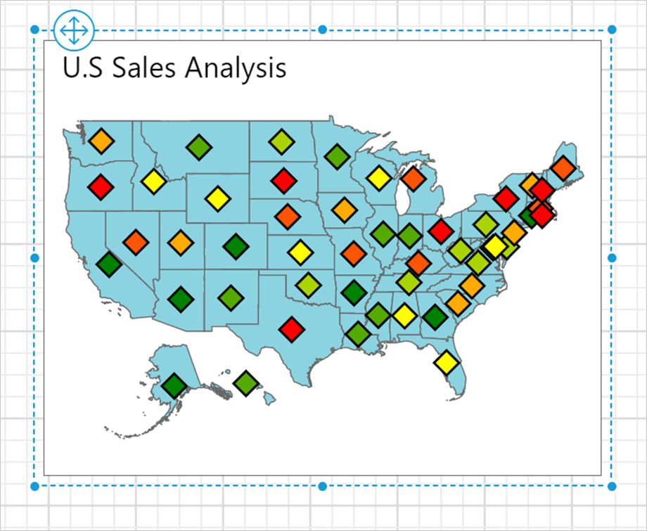
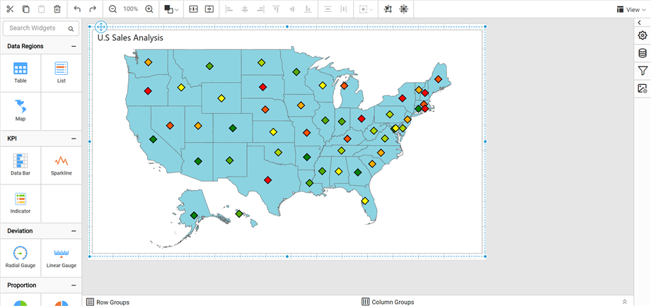
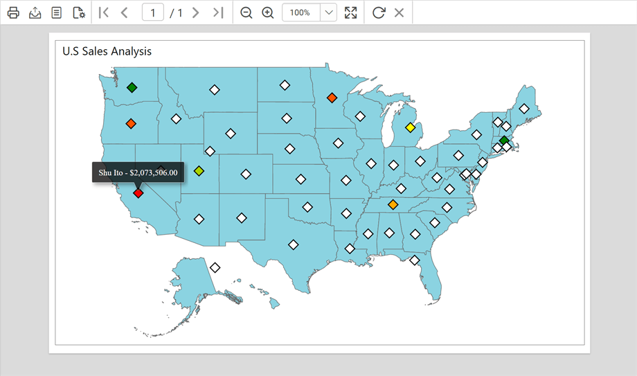

# Design a map using a marker color range rule in {{site.productNameTM}}

You can design a map in the {{site.productNameTM}} Web Report Designer with a marker color range rule and equal distribution. The example map displays the sales done by each sales person across USA states.

## How do I create the data?

You create the data set for this map in the {{site.productNameTM}} Web Report Designer with the following dataset query.

```sql
SELECT
  p.FirstName,
  p.LastName,
  p.City,
  RTRIM(sp.StateProvinceCode) AS StateCode,
  p.SalesLastYear
FROM
  Sales.vSalesPerson p
  INNER JOIN Person.BusinessEntityAddress ea
    ON p.BusinessEntityID = ea.BusinessEntityID
  INNER JOIN Person.Address a
    ON ea.AddressID = a.AddressID
  INNER JOIN Person.StateProvince sp
    ON a.StateProvinceID = sp.StateProvinceID
WHERE
CountryRegionName = 'United States'
```

> See [Create Data](./../../../../manage-data/dataset/create-an-embedded-dataset/) and create a dataset using the above query. The `AdventuresWorks2012` database is used here.

## How do I add a map to the report design?

The `Map` report item in the {{site.productNameTM}} Web Report Designer is listed under the `Data Regions` category in the item panel.


To add a `Map` report item to the report, drag the map from the item panel into the design area.


The map item is rendered in the design area, and the map properties are listed in the properties panel.


> By default, map report item renders with world map shapes.

## How do I bind analytical and shape data?

You bind analytical and shape data in the {{site.productNameTM}} Web Report Designer from the **Basic Settings** category of the properties panel. Follow these steps:

1. Under the **Basic Settings** category, set `USA` in the `Shapes` property and choose the data set in the **DataSet** property.

   

2. Click the edit icon for the [Binding Data](./../../../../report-items/map/binding-data/) property under **Basic Settings**.
   

3. Match the analytical and shape data as described in [Binding Data](./../../../../report-items/map/binding-data/). Choose `iso_3166_2` in the **Field Name** drop-down and choose the **=Fields!StateCode.Value** expression in **Binding Expression**.
   

4. Click **Update**.

## How do I customize the map appearance?

You customize the map title, color settings, and other properties in the {{site.productNameTM}} Web Report Designer properties panel.

### Appearance

Under the **Appearance** category in the {{site.productNameTM}} Web Report Designer, set the border width and color properties as required.


### Title

Under the [Title](./../../../../report-items/map/properties/#title) category in the {{site.productNameTM}} Web Report Designer, set the title text, position, and font properties for the map title. First, enable the **Enable Title** check box. Then, add the title and position.


### Shape settings

Under the [Shape Settings](./../../../../report-items/map/shape-settings/) in the {{site.productNameTM}} Web Report Designer, set the following values:

* Background color as `#8bd3e1`.
* Border color as `#676767` and border width as `0.667px`.
* Tooltip as `=Fields!StateCode.Value & " : "&Fields!City.Value`.


The map design looks like the following image.


## How do I define the marker color rule?

You define the marker color rule in the {{site.productNameTM}} Web Report Designer after you enable and style the markers.

1. Under the [Marker Settings](./../../../../report-items/map/marker-settings/) category, enable the **Enable Marker** checkbox. Set the following values:
   * Background color as `#ffffff`.
   * Border color as `#000000` and width as `1.333px`.
   * Marker style as `Diamond` and marker size as `14.333`.
   * Tooltip as the `=Fields!FirstName.Value + " " + Fields!LastName.Value + " - " + FormatCurrency(Fields!SalesLastYear.Value)` expression.

   

2. Under the [Marker color rule](./../../../../report-items/map/marker-color-rule/) category, enable the **Enable Color Rule** check box. Set the following values:
   * Choose Sum(SalesLastYear) in **Data Value**.
   * Choose `Type` as `Color Range`.
   * Set the start, middle, and end colors as **#008000**, **#ffff00**, **#ff0000**, respectively. The start color applies to the low end of the data range, and the end color applies to data at the high end of the data range.
   * Choose **Equal distribution** for **Distribution** type.
   * Set **Bucket Count** as seven.

The marker color rule configuration looks like the following image.


The markers are now applied to the map shapes, but with sample data.



To see the actual data on the map surface, preview the report. Before that, resize the width and height of the map so you can view the information clearly in preview.



### Preview report

You can preview the report at design time using the built-in {{site.productNameTM}} Viewer to make sure the report design is as expected. The following snapshot shows the marker background color distributed based on the sales amount done by each sales person in the respective state. Hover over each shape to see details such as the state code and the city where sales happened.


Hover over each marker filled with colors to see details such as the sales person name and sales amount.



> Download the [marker color range rule map report design (RDL)](https://github.com/boldreports/resources/tree/master/docs/report-designer/map/design-map-using-marker-color-range-rule.rdl).

## See also

* [Map marker color rule](./../../../../report-items/map/marker-color-rule/)
* [Color range marker rule](./../../../../report-items/map/color-range-marker-rule/)
* [Map marker settings](./../../../../report-items/map/marker-settings/)
