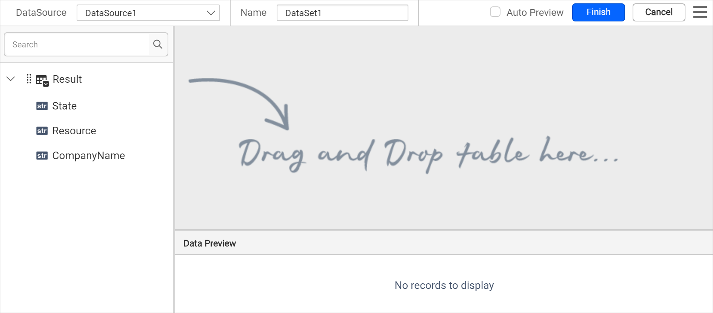
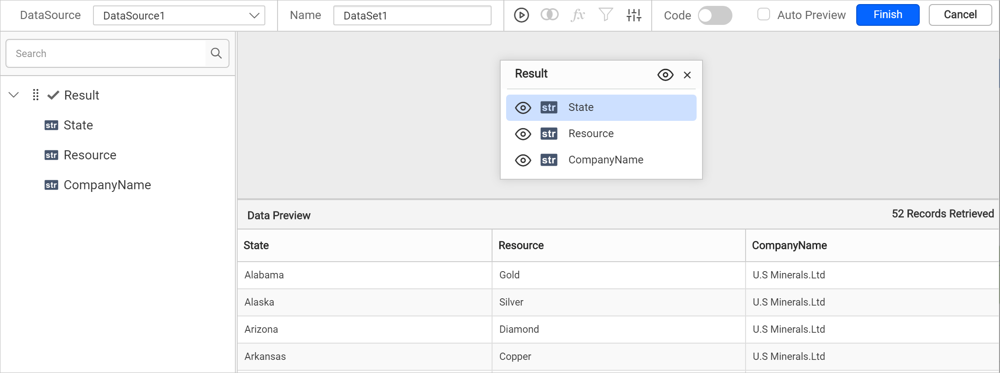
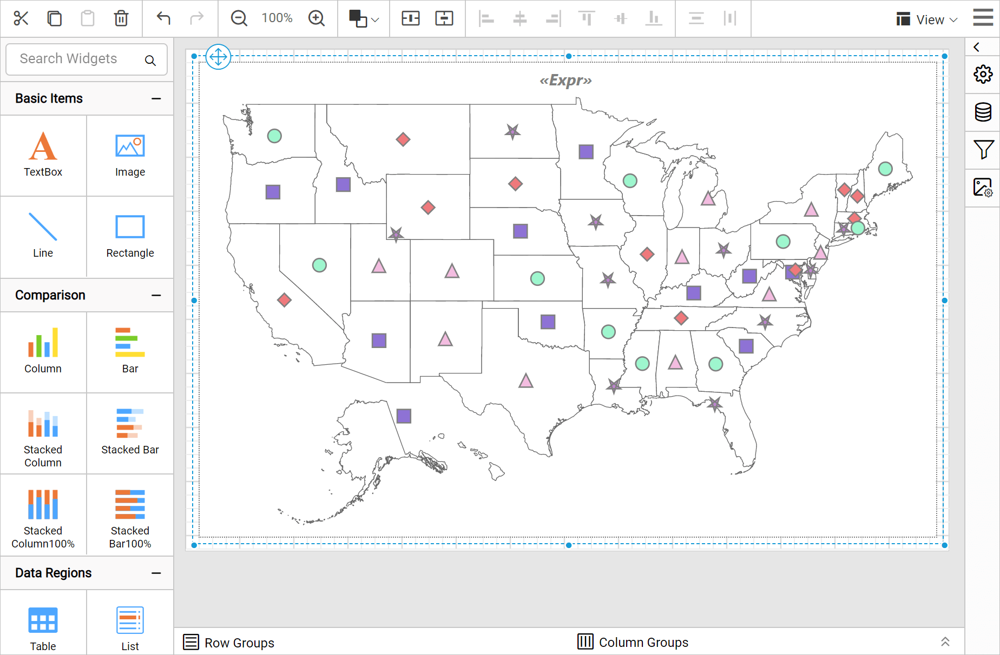
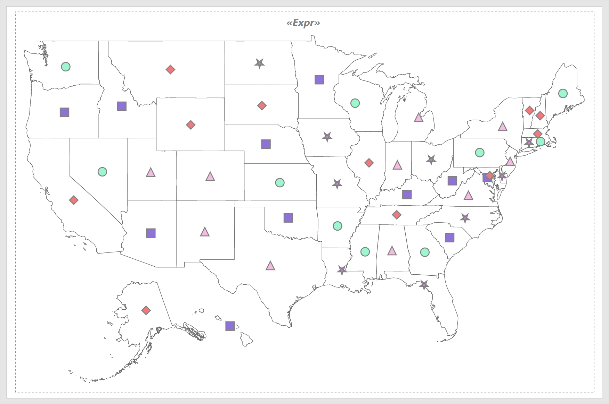

# Design a map using a marker rule in {{site.productNameTM}}

You can design a map in the {{site.productNameTM}} Web Report Designer with a marker rule and color rule. The example map displays the mineral resources production plants of a company in the USA.

## How do I create the data set?

You create the data set for the map in the {{site.productNameTM}} Web Report Designer from a JSON file. Follow these steps:

1. In the data panel, click `New Data`.
   
2. Choose the `JSON` connection type.
   
3. Choose `File` as `Type`.
   
4. Click the upload button, then browse and upload the JSON file in the `File Path` field.
   
5. Click the `Connect` button.
6. In the query builder, the available fields in the JSON file are loaded under the default table name, `Result`.
   
7. Drag and drop the `Result` table and execute.
   
8. Modify the data set `Name` and click **Finish**.
   

> Note: This data is created for demonstration purposes. Download the [mineral resources sample JSON file](https://www.syncfusion.com/downloads/support/directtrac/general/ze/mineralresources-1752410690).

## How do I add a map to the report design?

The `Map` report item in the {{site.productNameTM}} Web Report Designer is listed under the `Data Regions` category in the item panel.

To add a `Map` report item to the report, drag the map from the item panel into the design area.

The map item is rendered in the design area, and the map properties are listed in the properties panel.

> By default, map report item renders with world map shapes.

## How do I bind analytical and shape data?

You bind analytical and shape data in the {{site.productNameTM}} Web Report Designer from the **Basic Settings** category of the properties panel. Follow these steps:

1. Under the **Basic Settings** category, set `USA` in the `Shapes` property and choose the data set in the **DataSet** property.

   

2. Click the edit icon for the [Binding Data](./../../../../report-items/map/binding-data/) property under **Basic Settings**.
   

3. Match the analytical and shape data as described in [Binding Data](./../../../../report-items/map/binding-data/). Choose **name** in the **Field Name** drop-down and choose the **=Fields!Country.Value** expression in **Binding Expression**.
   

4. Click **Update**.

## How do I customize the map appearance?

You customize the map title, color settings, and other properties in the {{site.productNameTM}} Web Report Designer properties panel.

### Appearance

Under the **Appearance** category in the {{site.productNameTM}} Web Report Designer, set the border width and color properties as required.

### Title

Under the [Title](./../../../../report-items/map/properties/#title) category in the {{site.productNameTM}} Web Report Designer, set the title text, position, and font properties for the map title. First, enable the **Enable Title** check box. Then, set the title as `= "Mineral Production Plants of " & Fields!CompanyName.Value` and the position as `center`.

### Shape settings

Under the [Shape Settings](./../../../../report-items/map/shape-settings/) in the {{site.productNameTM}} Web Report Designer, set the following values:

* Background color as `#ffffff`.
* Border color as `#676767` and width as `0.672px`.
* Tooltip as `=Fields!State.Value`.

## How do I define the marker rule?

You define the marker rule in the {{site.productNameTM}} Web Report Designer after you enable the markers. Under the [Marker Settings](./../../../../report-items/map/marker-settings/) category, enable the **Enable Marker** checkbox. Set the marker size as `12.333` and the tooltip as the `=Fields!Resource.Value` expression, and leave the other values at their defaults.

### Marker rule

Under the [Marker rule](./../../../../report-items/map/marker-rule/) category in the {{site.productNameTM}} Web Report Designer, enable the **Enable Marker Rule** check box. Then, set the following values:

* Choose the `Resource` field in **Data Value**.
* Define custom marker styles as described in [Marker property](./../../../../report-items/map/marker-rule/#markers). Here, seven styles in total are defined to show the data on the map surface.
* Set **Bucket Count** as seven.

The marker rule configuration looks like the following image.

### Marker color rule

The marker color rule in the {{site.productNameTM}} Web Report Designer differentiates items that share the same marker style. The marker style configuration above defines seven marker styles, and `Diamond` is defined more than once. So, in preview, two items denote the `Diamond` shape. To differentiate these items, apply a marker color rule.

Under the [Marker color rule](./../../../../report-items/map/marker-color-rule/) category, enable the **Enable Color Rule** check box. Then, set the following values:

* Choose `Resource` in **Data Value**.
* Choose `Type` as `Color Palette`.
* Choose `Palette` as `Random`.
* Choose **Optimal** for **Distribution** type.
* Set **Bucket Count** as seven.

The marker color rule configuration looks like the following image.

The markers are now applied to the map shapes, but with sample data.

To see the actual data on the map surface, preview the report. Before that, resize the width and height of the map so you can view the information clearly in preview.

### Preview report

You can preview the report at design time using the built-in {{site.productNameTM}} Viewer to make sure the report design is as expected. In preview mode, you can see the different mineral resources production plants located in states of the USA. The following snapshot shows the marker style distributed based on the type of mineral resource plant.

> Download the [marker rule map report design (RDL)](https://github.com/boldreports/resources/tree/master/docs/report-designer/map/design-map-using-marker-rule.rdl).

## See also

* [Map marker rule](./../../../../report-items/map/marker-rule/)
* [Map marker color rule](./../../../../report-items/map/marker-color-rule/)
* [Design a map using a marker color range rule](./../../../../report-items/map/use-case/design-map-using-marker-color-range-rule/)
