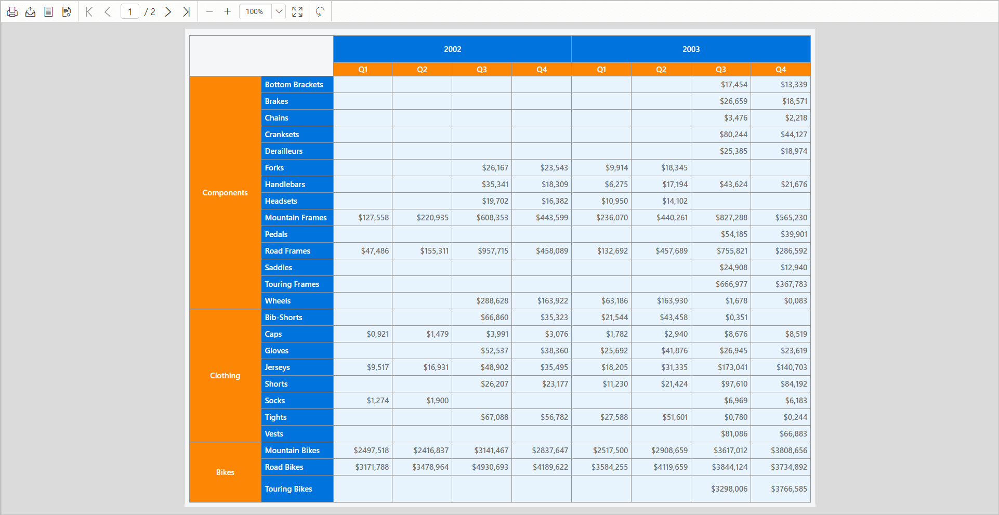

# Design an SSRS matrix report in Bold Reports<sup>®</sup> Web Report Designer

You can design a yearly sales report of a company in the Bold Reports<sup>®</sup> Web Report Designer by using the SSRS matrix report item with row and column groups.

## How do I create the dataset?

To present data in the matrix format in the Bold Reports<sup>®</sup> Web Report Designer, create a dataset and bind data to the matrix data region. This example uses the following dataset query for dataset creation:

```sql
SELECT PC.Name AS ProdCat, PS.Name AS SubCat, DATEPART(yy, SOH.OrderDate) AS OrderYear, 'Q' + DATENAME(qq, SOH.OrderDate) AS OrderQtr,SUM(SOD.UnitPrice * SOD.OrderQty) AS Sales
FROM Production.ProductSubcategory PS INNER JOIN
Sales.SalesOrderHeader SOH INNER JOIN
Sales.SalesOrderDetail SOD ON SOH.SalesOrderID = SOD.SalesOrderID INNER JOIN
Production.Product P ON SOD.ProductID = P.ProductID ON PS.ProductSubcategoryID = P.ProductSubcategoryID INNER JOIN
Production.ProductCategory PC ON PS.ProductCategoryID = PC.ProductCategoryID
WHERE (SOH.OrderDate BETWEEN '1/1/2002' AND '12/31/2003')
GROUP BY DATEPART(yy, SOH.OrderDate), PC.Name, PS.Name, 'Q' + DATENAME(qq, SOH.OrderDate), PS.ProductSubcategoryID
```

> See [Create Data](./../../../manage-data/dataset/create-an-embedded-dataset/) and create a dataset using the above query. The `AdventuresWorks` database is used here.

## How do I add a matrix to the report?

The matrix report item in the Bold Reports<sup>®</sup> Web Report Designer is listed in the item panel under the `Data Regions` category.


Drag and drop the matrix report item from the item panel into the design area. The properties of the matrix report item are listed in the properties panel. By default, it is named `Tablix1`.


The matrix initially has an empty default row group, column group, and data cell.


### How do I assign data to the matrix?

You assign data to the matrix in the Bold Reports<sup>®</sup> Web Report Designer through the `Dataset` property of the matrix report item. Assign the dataset to this property.


See [Assign fields](./../../../report-items/tablix/assign-data-to-tablix-data-region/) and assign the `ProdCat`, `OrderYear`, and `Sales` fields in the initial matrix design.
The first field you assign to the row group or column group replaces the initial empty default row group or column group. In this example, the `ProdCat` field is assigned to the row group. Notice the `Row Grouping pane`.

### Delete details group

The following image shows the `ProdCat` field replacing the default row group in the Bold Reports<sup>®</sup> Web Report Designer.


Similarly, assign `OrderYear` in the column grouping pane and the sales field in the data cell.


### How do I add a child row group?

You add a child row group in the Bold Reports<sup>®</sup> Web Report Designer from the group menu in the `Row Groups` pane. Follow these steps:

1. In the `Row Groups` pane, open the group menu in the `ProdCat1` group field.
   
2. From the context menu, click the `Child Group...` option under the `Add Group` category.
   
3. The `Tablix Group` dialog opens so you can configure the grouping.
   
4. Choose the `SubCat` field as the child row group in the tablix data region, and click the `OK` button.
   

The matrix design now looks like the following image.


### How do I add a child column group?

You add a child column group in the Bold Reports<sup>®</sup> Web Report Designer from the group menu in the `Column Groups` pane. Follow these steps:

1. In the `Column Groups` pane, open the group menu in the `OrderYear1` group field.
   
2. From the context menu, click the `Child Group...` option under the `Add Group` category.
   
3. The `Tablix Group` dialog opens so you can configure the grouping.
   
4. Choose the `OrderQtr` field as the child column group in the tablix data region, and click the `OK` button.
   

The matrix design now looks like the following image.


## How do I calculate a summary?

You calculate a summary in a Bold Reports<sup>®</sup> matrix by assigning an aggregate expression to a cell. To calculate the total sales amount for each product category, see [Assign expression in cell](./../../../report-items/tablix/assign-data-to-tablix-data-region/#assign-or-edit-expression-into-table-cell). Assign the `=Sum(Fields!Sales.Value)` expression to the last cell in the third row of the matrix design.


> To set an expression in a matrix cell, see [Assign or edit expression into table cell](./../../../report-items/tablix/assign-data-to-tablix-data-region/#assign-or-edit-expression-into-table-cell).

## How do I format the data?

You format matrix data in the Bold Reports<sup>®</sup> Web Report Designer with the `Format` property of a cell. By default, the summary data for the `Sales` field displays a general number. To display the number as currency, set the format for the `Sales` field cell using the `Format` property.


## How do I change the width or height?

The matrix report item in the Bold Reports<sup>®</sup> Web Report Designer expands both horizontally and vertically. You can resize rows and columns to display the data without wrapping. To resize rows and columns in the matrix data region, see [Resize tablix data region](./../../../report-items/tablix/resize-tablix-data-region/). Here, the columns in the matrix design are resized to the minimum required width.


## How do I merge matrix cells?

After you add row and column groups in the Bold Reports<sup>®</sup> Web Report Designer, the matrix design creates corner cells. Use a corner cell to display any label content or data. The number of corner cells depends on the number of row and column groups in the matrix.

The matrix design above has four corner cells, arranged in two rows and two columns. This report does not use these cells, so you can merge them into one. To merge the corner cells, see [Merge cells in corner area](./../../../report-items/tablix/merge-cells-in-tablix-data-region/#corner-area).


## How do I format the matrix design?

You format the matrix design in the Bold Reports<sup>®</sup> Web Report Designer by styling the matrix cells. In the following design, the background color and font styles of the matrix cells are changed to improve the report design.


> See the [Cell Properties](./../../../report-items/tablix/cell-properties/#cell-properties) to style the matrix cell.

## Report preview

On report preview in the Bold Reports<sup>®</sup> Web Report Designer, the yearly sales report of the company is displayed as shown in the following image.



> Download the [SSRS matrix report design (RDL)](https://github.com/boldreports/resources/tree/master/docs/report-designer/matrix/design-ssrs-matrix-report.rdl).

## Frequently asked questions

### What is the default name of a new matrix report item?

A new matrix report item is named `Tablix1` by default.

### What decides the number of corner cells in a matrix?

The number of corner cells depends on the number of row and column groups in the matrix.

## See also

* [Matrix report item](./../../../report-items/matrix/)
* [Assign data to a tablix data region](./../../../report-items/tablix/assign-data-to-tablix-data-region/)
* [Merge cells in a tablix data region](./../../../report-items/tablix/merge-cells-in-tablix-data-region/)
