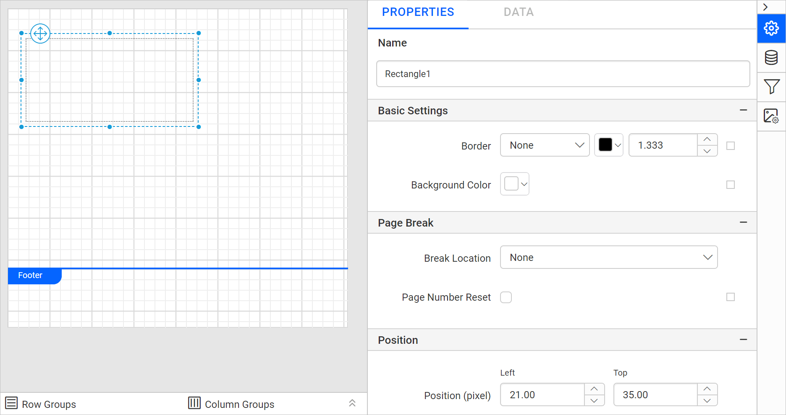

# Rectangle report item in {{site.productNameTM}}

The rectangle report item in the {{site.productNameTM}} Web Report Designer visually separates regions of a report and acts as a container for other report items.

## How do I add a rectangle to the report?

You add a rectangle in the {{site.productNameTM}} Web Report Designer from the item panel. Follow these steps:

1. Find the rectangle report item in the item panel under the `Basic Items` category.
   
2. Drag and drop the rectangle report item from the item panel into the design area.
   
3. After you drop the rectangle item into the design area, its properties are listed in the properties panel.
   

## Properties

The rectangle report item in the {{site.productNameTM}} Web Report Designer is configured through the properties panel. Before you set the following properties, see the [Properties panel](./../../compose-report/properties-panel/) section.

### Basic Settings

The Basic Settings properties style the rectangle and customize its appearance in the report design. They include border style, color, width, and background color. These properties are listed under the `Basic Settings` category in the properties panel.

#### Border

The Border properties add or customize the border around a rectangle item to visually separate items in the report design. To set border properties for the rectangle item in the properties panel, see [Border Properties](./../../compose-report/common-properties/#border-properties).

#### Background color

The Background color property colors the rectangle background. To set the background color in the properties panel, see [Background color](./../../compose-report/common-properties/#background-color).

### Background Image

The Background image property displays company logos, watermarks, or any other background image in the rectangle. To set a background image for the report, see [Background Image](./../../compose-report/background-image/).

### Page break

The Page break property controls the amount of information on each page when you preview the report. To apply the page break property to the rectangle item, follow these steps:

1. Choose any `Break Location` type in the drop-down.
   

2. To prevent predefined page breaks from being applied during report preview, enable the `Break Disabled` property checkbox. You can also control page breaks during report preview by using expressions. For details on setting and resetting page breaks dynamically, see the [Set Expression](./#set-expression) and [Reset Expression](./#reset-expression) sections.

   

3. To restart page numbering on each page, enable the `Page Number Reset` property checkbox.
   

### Position

The Position property sets the width, height, left, and top position of the rectangle in the report design. To handle these properties in the properties panel, see [Position](./../../compose-report/common-properties/#position).

### Data Element

The Data Element properties control the visibility of a report item when you export the report in XML format. The Data Element properties are listed in the properties panel under the `Data Element` category.

Name

You can assign a custom name for the rectangle element using the `Name` field. The rectangle is exported with the provided name.

> Note: The name cannot contain spaces, and it must begin with a letter followed by letters, numbers, or the underscore character (_).

Output

When you export the report, the `Output` property controls the visibility of the rectangle. The `Output` property options perform the following operations:

* **Auto** or **Output** - Exports the rectangle and its contents.
* **NoOutput** - Does not export the rectangle report item.
* **ContentsOnly** - Does not export the rectangle report item, only the contents of it are exported.

### Visibility

The Visibility property conditionally shows or hides the rectangle report item on report preview or export. To set the visibility of the rectangle item in the properties panel, see [Visibility](./../../compose-report/common-properties/#visibility).

### Miscellaneous

The Miscellaneous category of the rectangle report item holds the keep together, page name, custom attributes, tooltip, document map, bookmark, and custom style properties.

#### Keep together

The Keep together property displays the report item or a section of a report on a single page on report preview or export. Enable the checkbox to keep the content on a single page. Otherwise, it spans across multiple pages.

#### Page name

The Page name property names the first worksheet of the Excel workbook when you export the report to Excel format.

You can set static or dynamic text as the page name. To set and reset dynamic text, see [Set Expression](./../../compose-report/properties-panel/#set-expression) and [Reset Expression](./../../compose-report/properties-panel/#reset-expression).

#### Custom attributes

The Custom attributes property sets the values for rectangle custom properties. To create and assign values for custom properties in the properties panel, see [Custom Properties](./../../compose-report/common-properties/#custom-properties).

#### Tooltip

The Tooltip property displays informative text or a value when the user hovers over the report item in report preview. To set a tooltip for the rectangle report item in the properties panel, see [Tooltip](./../../compose-report/common-properties/#tooltip).

#### Document Map

A document map is a navigational feature that displays a separate side pane with a set of navigational links in a hierarchical structure when you view a report. A user can click the content in the list to navigate to the report page that displays that item. See [Document Map](./../../compose-report/document-map/) to configure a document map in the report design.

You can set static or dynamic text as the value for the document map property. To set and reset dynamic text, see [Set Expression](./../../compose-report/properties-panel/#set-expression) and [Reset Expression](./../../compose-report/properties-panel/#reset-expression).

#### Bookmark

Bookmark links let users navigate to different parts of an SSRS report. You can add bookmarks to each textbox, image, table, or chart, or to the unique group values displayed in a tablix. Bookmarks direct users to specified locations in the report. The value of the bookmark property can be your own string or an expression. See [Bookmark](./../../compose-report/bookmark/) to configure bookmarks in the report design.

#### Custom Style

The `Custom Style` property enables the use of external CSS for styling report items, providing enhanced flexibility beyond the built-in styling options. Use this property to meet specific design requirements and keep styling consistent across multiple reports. For a step-by-step guide on setting up custom styles in your report, check the **How To** section of this guide.

## Set expression

The {{site.productNameTM}} Web Report Designer lets you set an expression on a few properties of the rectangle report item, so the property values are processed based on expressions. To set expressions on the rectangle report item properties, see [Set Expression](./../../compose-report/properties-panel/#set-expression).

## Reset expression

To `Reset` the expression applied to a rectangle property in the {{site.productNameTM}} Web Report Designer, see [Reset Expression](./../../compose-report/properties-panel/#reset-expression).

## Advanced properties

A few properties of the rectangle report item in the {{site.productNameTM}} Web Report Designer contain nested properties. To open and handle nested properties, see [Advanced Properties](./../../compose-report/properties-panel/#advanced-properties).

## Frequently asked questions

### Which Output options does the rectangle support when exporting to XML?

The `Output` property supports **Auto** or **Output**, **NoOutput**, and **ContentsOnly**. **ContentsOnly** exports only the contents of the rectangle, not the rectangle itself.

### Where is the rectangle report item in the item panel?

The rectangle report item is listed in the item panel under the `Basic Items` category.

## See also

* [Line report item](./../../report-items/line/)
* [Image report item](./../../report-items/image/)
* [Background image](./../../compose-report/background-image/)
