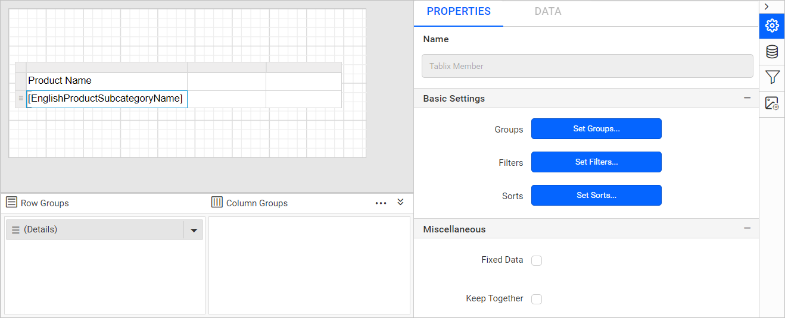
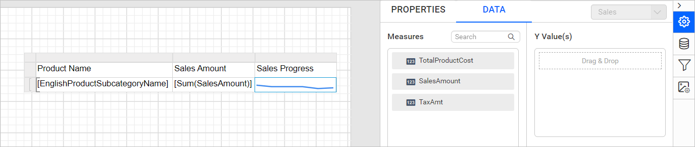

# Design an SSRS sparkline report using a table in {{site.productNameTM}}

To show trends in data over time inside table rows, add a `Sparkline` report item to an SSRS table in the {{site.productNameTM}} Web Report Designer. You create a dataset, add a table and sparkline, assign data, and format the series.

## How do I create the dataset?

The `Sparkline` report in the {{site.productNameTM}} Web Report Designer uses the following dataset query:

```sql
SELECT Prodcat.EnglishProductCategoryName,
              prodSubcat.EnglishProductSubcategoryName,
              prod.EnglishProductName,
              prod.Color,
              fact.[TotalProductCost],
              fact.SalesAmount,
              fact.TaxAmt,
              fact.[OrderDate],
              fact.[ShipDate]
FROM dbo.DimProduct as prod
   INNER JOIN  dbo.DimProductSubcategory AS prodSubcat ON
               prod.ProductSubcategoryKey = prodSubcat.ProductSubcategoryKey
   INNER JOIN  dbo.DimProductCategory AS Prodcat ON
                prodSubcat.ProductCategoryKey = Prodcat.ProductCategoryKey
   INNER JOIN  dbo.FactInternetSales AS fact ON
                 fact.ProductKey = prod.ProductKey
```

> Refer to the [Create Data](./../../../manage-data/dataset/create-an-embedded-dataset/) section and create a dataset using the above query. The `AdventureWorksDW2014` database is used here.

## How do I add the sparkline report item to a table?

You add a sparkline in the {{site.productNameTM}} Web Report Designer by placing a table, grouping its rows, and dropping the sparkline into the last cell.

1. Drag and drop the table report item to the design area.
   
2. Assign the [dataset](./../../../report-items/tablix/assign-data-to-tablix-data-region/#assign-dataset-from-properties-panel) to the table.
   
3. Assign the `EnglishProductSubcategoryName` field in the first cell.
   
4. Click `Details group` in the `Row Groups` pane. The tablix member properties are listed in the properties panel.
   
5. Click the `Set Groups...` button in the properties panel. The `Grouping` dialog opens, as shown in the following image.
   
6. Click the `Add` button, select `EnglishProductSubcategoryName`, and click OK.
   
7. Assign the `Sales` field in the second cell.
   
8. Select the `Sales` text box and [assign the following expression](./../../../report-items/tablix/assign-data-to-tablix-data-region/#edit-expression-using-data-assign-menu) `=Sum(Fields!SalesAmount.Value)` in the cell.
   
9. Drag and drop the sparkline report item into the last cell of the table.
   

The report design now looks like the following image.


> Cannot insert a sparkline into a detail cell. Detail members can only contain the static inner members.

## How do I assign data to the sparkline?

You assign data to a sparkline in the {{site.productNameTM}} Web Report Designer from the `DATA` tab of the properties panel.

1. Select the cell containing the sparkline report item and switch to the `DATA` tab in the properties panel.
   
2. Drag and drop the `TotalProductCost` field into the `Y-Values` section.
   
3. Drag and drop the `OrderDate` field into the `Column` section.
   

The report design now looks like the following image.


## How do I configure the sparkline properties?

You configure the sparkline series and data labels in the {{site.productNameTM}} Web Report Designer from the `PROPERTIES` tab.

1. Switch to the `PROPERTIES` tab in the properties panel.
2. Choose the `Sales` series in the  `Choose Series` dropdown.
   
3. Click the edit icon to open series properties.
   
4. Under the data label settings category, enable the [Data Label](./../../../report-items/chart/data-label/) property checkbox.
   
5. Format the numbers produced by the `Data labels` using the `Format` property. Set `'$'#,0;('$'#,0)` as the value of the format property field.
   
6. Change the background color and font styles of the table cells to improve the report design, as shown in the following design.
   

> Refer to the [Cell Properties](./../../../report-items/tablix/cell-properties/#cell-properties) to style the table cell.

## What does the report preview show?

The sparkline report preview in {{site.productNameTM}} shows the sales amount progress from the start year to the end.


> Download the [sparkline report design (RDL)](https://github.com/boldreports/resources/tree/master/docs/report-designer/sparkline/design-ssrs-sparkline-using-table.rdl)

## Frequently asked questions

### Can I insert a sparkline into a detail cell?

No. You cannot insert a sparkline into a detail cell, because detail members can only contain the static inner members.

### Which fields does the sample sparkline use?

The sample uses `TotalProductCost` in the `Y-Values` section and `OrderDate` in the `Column` section.

## See also

* [Sparkline report item overview](./../../../report-items/sparkline/)
* [Assign data to a tablix data region](./../../../report-items/tablix/assign-data-to-tablix-data-region/)
* [Tablix cell properties](./../../../report-items/tablix/cell-properties/)
