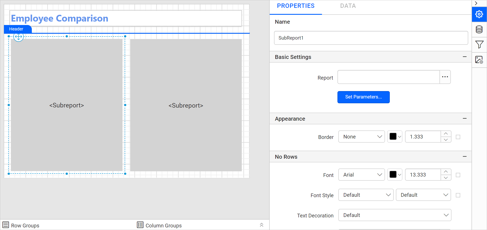
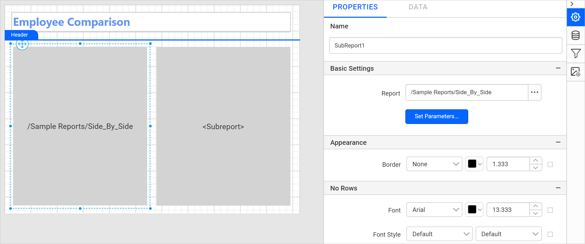
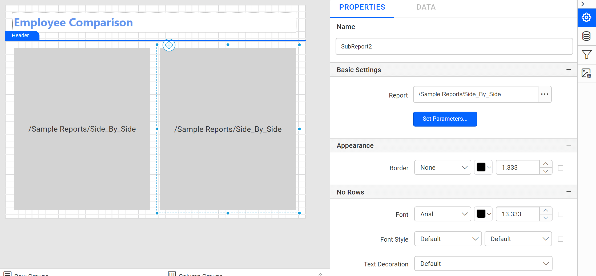
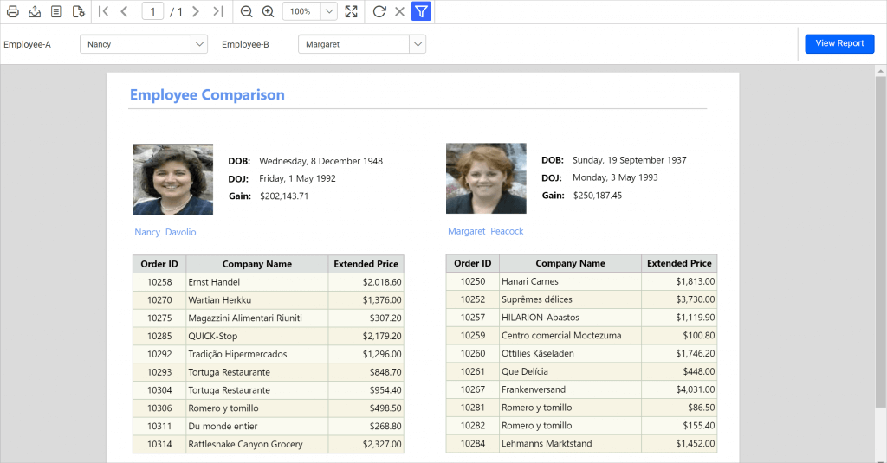

# Design an RDL report using a subreport in {{site.productNameTM}}

To compare the details of two employees side by side, create an SSRS RDL report with a subreport in the {{site.productNameTM}} Web Report Designer. You build a main report, build a subreport, link the two, and pass parameters.

## How do I create the main report?

The main report in the {{site.productNameTM}} Web Report Designer holds the employee parameters and the two subreport items.

1. Create a dataset with the following query, which the main report uses. Refer to the [Create Data](./../../../manage-data/dataset/create-an-embedded-dataset/) section for the steps.
      ```sql
      SELECT
      Employees.EmployeeID,
      Employees.FirstName
      FROM
      Employees
      ```
      
2. Create two parameters named `Employee-A` and `Employee-B` in the main report to compare the employee details. Assign the required dataset field value to the parameters as shown in the following images. Refer to the [Parameter](./../../../report-parameters/add/#create-parameter) and [Assign Value](./../../../report-parameters/define-available-values-for-parameter/#query-values) sections to create and assign values to the parameters.
   
   
3. Design a simple report using textbox and line report items.
   
   > Note: Refer to the [Textbox](./../../../report-items/textbox/) and [Line](./../../../report-items/line/) sections to create the above report design.

### How do I add the subreport items?

You add subreport items in the Web Report Designer from the `Sub Reports` category of the item panel.

1. Drag and drop the subreport item listed in the item panel under the `Sub Reports` category.
   
2. Drag and drop two subreport items side by side in the design area to compare the employee details.
   

## How do I create the subreport?

The subreport in the {{site.productNameTM}} Web Report Designer displays the employee details. You create its datasets, design its layout, and assign its fields.

### How do I create the subreport datasets?

The subreport uses three datasets from the `Northwind` database, each filtered by the `@SalesPersonID` query parameter.

1. Create a dataset with the following query to fetch the employee personal details, which is bound to the `Employees` table of the `Northwind` database. Refer to the [Create Data](./../../../manage-data/dataset/create-an-embedded-dataset/) section for the steps.
      ```sql
      SELECT Employees.EmployeeID,Employees.LastName,Employees.FirstName,Employees.Title,Employees.TitleOfCourtesy ,(DATENAME(WEEKDAY,Employees.BirthDate)+', '+ DATENAME (DAY,Employees.BirthDate)+'+DATENAME(MONTH,Employees.BirthDate)+'+DATENAME(YEAR,Employees.BirthDate)) as BirthDate
      ,(DATENAME(WEEKDAY,Employees.HireDate)+', '+DATENAME(DAY,Employees.HireDate)+'+DATENAME(MONTH,Employees.HireDate)+'+DATENAME(YEAR,Employees.HireDate))as HireDate
      ,Employees.HomePhone ,Employees.City,Employees.Region,Employees.PostalCode,Employees.Country ,SUM(o.Quantity * o.UnitPrice)  As TotalGain FROM
      Employees,[Order Details] as O,[Orders] as Ord  WHERE o.OrderID  = ord.OrderID and Employees.EmployeeID = ord.EmployeeID and Employees.EmployeeID = @SalesPersonID
      group by  Employees.EmployeeID ,Employees.LastName,Employees.FirstName,Employees.Title,Employees.TitleOfCourtesy,BirthDate,HireDate,Employees.City,Employees.HomePhone,Employees.Region
      ,Employees.PostalCode,Employees.Country
      ```

2. Create a dataset using the following query to present the employee sales order details in tabular format, and bind the data to the table report item:

      ```sql
      SELECT Top(10) o.OrderID,Cus.CompanyName,SUM(OD.UnitPrice * od.Quantity ) As ExPrice FROM [Orders] as O, [Customers] as Cus,[Order Details] as OD where  (O.EmployeeID = @SalesPersonID) and (cus.CustomerID=o.CustomerID) and od.OrderID = o.OrderID group by o.OrderID,o.CustomerID,cus.CompanyName
      ```

3. Create a dataset with the following query to retrieve the employee image details from the `Employees` table of the `Northwind` database:

      ```sql
      SELECT Employees.Photo FROM Employees
      WHERE (Employees.EmployeeID = @SalesPersonID)
      ```

      The datasets created in the report are now listed in the `Data panel`.
      
4. Check the report parameters. Based on the `@SalesPersonID` query parameter created in the dataset query, an equivalent report parameter is created automatically in the report.
   

### How do I design the subreport layout?

The sample subreport in the Web Report Designer is a simple design that uses image, textbox and table report items, as shown in the following image.

> Note: Refer to the [Image](./../../../report-items/image/), [Line](./../../../report-items/line/), and [Table](./../../../report-items/tablix/design-ssrs-rdl-report-using-table/) sections to design the above subreport.

### How do I assign fields in the subreport?

The subreport assigns fields in the Web Report Designer with the following expressions and datasets:

* To display the employee `DOB`, the `=First(Fields!BirthDate.Value,"EmployeePersonalDetails")` expression is used in the textbox report item.
* To display the employee `DOJ`, the `=First(Fields!HireDate.Value,"EmployeePersonalDetails")` expression is used in the textbox report item.
* To display the employee `GAIN`, the `=Sum(Fields!TotalGain.Value,"EmployeePersonalDetails")` expression is used in the textbox report item.
* To display the employee `First Name` and `Last Name`, the `=First(Fields!FirstName.Value, "EmployeePersonalDetails")+" "+" "+First(Fields!LastName.Value, "EmployeePersonalDetails")` expression is used in the textbox report item.
* To present the sales details of the respective employee, the `EmployeeSalesDetails` dataset is assigned to the table report item.
* To display the employee image in the report, the `=First(Fields!Photo.Value, "EmployeeImages")` expression is assigned to the image report item value property.


> Download the [side-by-side subreport design (RDL)](https://github.com/boldreports/resources/tree/master/docs/report-designer/subreport/side-by-side.rdl).

## How do I link the subreport into the main report?

You link a subreport in the {{site.productNameTM}} Web Report Designer from the **Report** option in the properties panel. After you drag and drop the subreport item into the design area, its item properties are listed in the properties panel.



Follow these steps to link the subreport into the main report:
1. Click the browse button in the **Report** option.

    

2. In the Browse dialog that opens, click the **Sample Reports** folder.

      

3. Select the already designed subreport and click **Open**.

      

4. Check that the selected report path is linked in the **Report** option and the subreport item in the design area.

      

Set the report path for the other subreport item by following the same steps.

## How do I set parameter values for the subreport?

You pass parameter values from the main report to the subreport in the {{site.productNameTM}} Web Report Designer with the **Set Parameters** option. Follow these steps:

1. Click the **Set Parameters** button and click the **ADD** icon.
   
2. Choose the parameter name in the `Parameters Name` drop-down, which lists the available parameters in the subreport, and assign values. Here, the expression `=Parameters!Employee-A.Value` is assigned to the `SalesPersonID` parameter of the subreport.
   
3. Set the parameter name and assign values for the other subreport item by following the same steps.

The report path and parameters are now set for both subreport items, as shown in the following image.


Preview the report, choose the required employee names in the `Left Side Employee` and `Right Side Employee` parameter drop-downs, and click view report. The report preview shows the comparison report for the two employees based on the values selected in the parameter drop-downs.



> Download the [main report design (RDL)](https://github.com/boldreports/resources/tree/master/docs/report-designer/subreport/main-report.rdl).

## Frequently asked questions

### Do I have to create the subreport parameter manually?

No. Based on the `@SalesPersonID` query parameter in the dataset query, an equivalent report parameter is created automatically in the report.

### How does the main report pass a value to the subreport?

The main report passes values through **Set Parameters**. In this sample, `=Parameters!Employee-A.Value` is assigned to the `SalesPersonID` parameter of the subreport.

## See also

* [Subreport report item overview](./../../../report-items/subreport/)
* [Design an SSRS RDL report using a table](./../../../report-items/tablix/design-ssrs-rdl-report-using-table/)
* [Textbox report item](./../../../report-items/textbox/)
