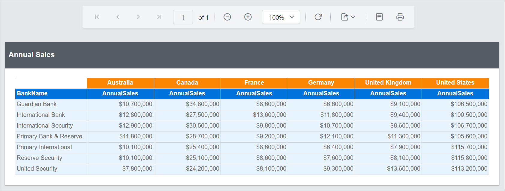

# Design an SSRS matrix report using the Tablix Wizard in {{site.productNameTM}}

To design an Annual Sales Report by Country and Bank in the {{site.productNameTM}} Web Report Designer, use the Tablix Wizard. You create a dataset, build the matrix in the wizard, format it, and preview it.

## How do I create the dataset?

To present data with the {{site.productNameTM}} tablix wizard, create a dataset and bind the required data within the tablix wizard. This design example uses the following dataset query for dataset creation:

```sql
SELECT [Sales].[vStoreWithDemographics].[CustomerID],
[Sales].[vStoreWithDemographics].[Name],
[Sales].[vStoreWithDemographics].[ContactType],
[Sales].[vStoreWithDemographics].[Title],
[Sales].[vStoreWithDemographics].[FirstName],
[Sales].[vStoreWithDemographics].[MiddleName],
[Sales].[vStoreWithDemographics].[LastName],
[Sales].[vStoreWithDemographics].[Suffix],
[Sales].[vStoreWithDemographics].[Phone],
[Sales].[vStoreWithDemographics].[EmailAddress],
[Sales].[vStoreWithDemographics].[EmailPromotion],
[Sales].[vStoreWithDemographics].[AddressType],
[Sales].[vStoreWithDemographics].[AddressLine1],
[Sales].[vStoreWithDemographics].[AddressLine2],
[Sales].[vStoreWithDemographics].[City],
[Sales].[vStoreWithDemographics].[StateProvinceName],
[Sales].[vStoreWithDemographics].[PostalCode],
[Sales].[vStoreWithDemographics].[CountryRegionName],
[Sales].[vStoreWithDemographics].[AnnualSales],
[Sales].[vStoreWithDemographics].[AnnualRevenue],
[Sales].[vStoreWithDemographics].[BankName],
[Sales].[vStoreWithDemographics].[BusinessType],
[Sales].[vStoreWithDemographics].[YearOpened],
[Sales].[vStoreWithDemographics].[Specialty],
[Sales].[vStoreWithDemographics].[SquareFeet],
[Sales].[vStoreWithDemographics].[Brands],
[Sales].[vStoreWithDemographics].[Internet],
[Sales].[vStoreWithDemographics].[NumberEmployees] FROM [Sales].[vStoreWithDemographics]
```

> Refer to the [Create Data](./../../../manage-data/dataset/create-an-embedded-dataset/) section and create a dataset using the above query. The `AdventuresWorks` database is used here.

## How do I add a matrix using the tablix wizard?

You add a matrix in the {{site.productNameTM}} Web Report Designer by dropping the tablix wizard into the design area and assigning values, columns, and rows.

1. Find the tablix wizard in the item panel under the `Data Regions` category.
   

2. Drag and drop the tablix wizard report item into the design area from the item panel.
   

3. Choose a dataset from the drop-down list, which lists the available datasets in the report.
   

4. Drag and drop `AnnualSales` into the `Values` section.
   

5. Hover on the `AnnualSales` field to enable the `Settings` icon, then click the `Settings` icon (highlighted below) to open the aggregation menu.
   

   Set the aggregation type used to compute the selected value.
   

6. Drag and drop `CountryRegionName` into the `Columns` group and `BankName` into the `Rows` group.
    

7. Click the `Ok` button. The matrix is rendered on the design surface.
    

## How do I format the matrix design?

You format the matrix in the {{site.productNameTM}} Web Report Designer by adding a report header and updating cell styles. In the following design, the report header has been added, and the background color and font styles in the matrix cells have been updated to enhance the report design.


> Refer to the [Cell Properties](./../../../report-items/tablix/cell-properties/#cell-properties) section to style the matrix cells and the [Show or hide header and footer](./../../../compose-report/show-or-hide-header-footer-in-report/) section to add or remove the header and footer in the report.

## What does the report preview show?

The {{site.productNameTM}} report preview displays the Annual Sales Report, as shown in the following image.


> Download the [tablix wizard matrix report design (RDL)](https://github.com/boldreports/resources/tree/master/docs/report-designer/tablix-wizard/design-ssrs-matrix-report-using-tablix-wizard.rdl).

## Frequently asked questions

### Where is the tablix wizard in the item panel?

The tablix wizard is listed in the item panel under the `Data Regions` category.

### Can I change how the values are aggregated?

Yes. Hover on the field in the `Values` section, click the `Settings` icon, and set the aggregation type used to compute the selected value.

## See also

* [Tablix wizard overview](./../../../report-items/tablix-wizard/)
* [Tablix cell properties](./../../../report-items/tablix/cell-properties/)
* [Show or hide header and footer](./../../../compose-report/show-or-hide-header-footer-in-report/)
