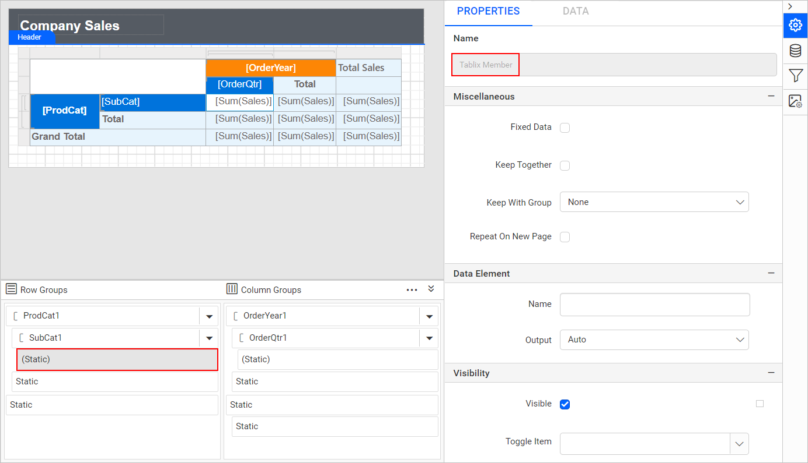

# Grouping panel in Bold Reports® Web Report Designer

In the Bold Reports® Web Report Designer, the grouping panel displays the row and column groups of the selected tablix data region in the design area. The highlighted area in the following image shows the grouping panel in the design area.

The row groups of a selected tablix are listed in the `Row Groups` section and column groups are listed in the `Column Groups` section of the grouping panel.

## How do I show or hide the grouping panel?

You expand or collapse the Bold Reports® grouping panel in the design area at design time using the expand/collapse icon in the right corner of the grouping panel header.

The following image shows the collapsed view of the grouping panel in the design area.

> Grouping panel will be visible in design area only if a tablix report item is selected in the design area.

## How do I resize the grouping panel?

You increase or decrease the height of the Bold Reports® grouping panel in the design area using the resizer.

## What modes does the grouping panel have?

The Bold Reports® grouping panel has a `Default` mode and an `Advanced` mode.

### Default Mode

In default mode, the grouping panel displays the hierarchical view of the parent, child and adjacent groups of the selected tablix item in the `Row Groups` and `Column Groups` panes.

### Advanced Mode

Advanced mode in the grouping panel lists all static and dynamic tablix members. By default, the grouping panel is displayed in `Default Mode`. To enable advanced mode, click the icon in the right corner of the grouping panel header.

Then, click the `Advanced` menu item. All groups, including static and dynamic tablix members, are listed in the `Row Groups` and `Column Groups` panes in a hierarchical view, as shown in the following image.

After you enable advanced mode, a tick mark appears in the `Advanced` menu, as shown in the following image.

## Visual Cues

The Bold Reports® grouping panel uses symbols and label conventions as visual cues for groups and tablix members.

### Groups

The row and column groups in the selected tablix data region are indicated in the grouping panel using the `[` symbol.

### Details Group

The grouping panel marks the details group on the row group hierarchy with the highlighted symbol in the following image.

### Label convention

The grouping panel labels static and group tablix members as follows.

#### Static tablix member

* A static member with a header cell is indicated with the `Static` label text.
   

* A static member with no header cell is indicated with the `(Static)` label text.
   

#### Group tablix member

The label text for a group member is surrounded by square brackets.

## Tablix member properties

You edit the static and dynamic tablix member properties in the Bold Reports® Web Report Designer by selecting the respective member in the Row or Column Groups pane and changing the property values in the `Properties` panel.

### Static member properties

Static member properties appear in the properties panel when you click the required static tablix member in the `Row Groups` or `Column Groups` pane.

To set and edit the properties of a static tablix member, refer to the [Static member properties](./../../../report-items/tablix/member-properties/#static-member-properties) section.

### Group member properties

Group member properties appear in the properties panel when you click the required group tablix member in the `Row Groups` or `Column Groups` pane.

To set and edit the properties of a group tablix member, refer to the [Group member properties](./../../../report-items/tablix/member-properties/#group-member-properties) section.

## How do I add groups or totals?

You add groups or totals to a tablix data region with the Bold Reports® grouping panel. To open the group menu, click the icon in the right corner of the row or column group member.

The group menu opens in the respective group, as shown in the following image.

### How do I add a parent group?

You add a parent group with the `Parent Group...` option in the grouping panel group menu.

1. Click the `Parent Group...` option under the `Add Group` category.
   
2. Review the `Tablix Group` dialog, which opens as shown in the following image.
   
3. Choose a field in the group dialog and click the `OK` button.
   
4. Check that a new parent group is added above the group in the grouping panel.
   

### Add child group

You add a child group with the `Child Group...` option in the grouping panel group menu.

1. Click the `Child Group...` option under the `Add Group` category.
   
2. Review the `Tablix Group` dialog, which opens as shown in the following image.
   
3. Choose a field in the group dialog and click the `OK` button.
   
4. Check that a new child group is added under the group in the grouping panel.
   

> You cannot add child group for `Details` group.

### Add adjacent group

You add an adjacent group with the `Adjacent Before` or `Adjacent After` option in the grouping panel group menu.

1. Click the `Adjacent Before` or `Adjacent After` option under the `Add Group` category.
   
2. Review the `Tablix Group` dialog, which opens as shown in the following image.
   
3. Choose a field in the group dialog and click the `OK` button.
   
4. Check that a new adjacent group is added above or below the group in the grouping panel.
    **Adjacent Before**
    
    **Adjacent After**
    

### How do I add a total?

You add a total above or below a group with the `Before` or `After` option under the `Add Total` menu of the grouping panel.

The total row or column is added in the tablix region for the respective group in the tablix report item in the design area.

## How do I delete a group?

You delete a group with the Bold Reports® grouping panel by clicking the icon in the right corner of the row or column group member and then clicking the `Delete Group` option in the menu.

The following confirmation dialog then opens.

* Choose the `Delete group and related rows and columns` option to delete all the rows and columns associated with the respective group.

* Choose the  `Delete group only` option to delete the group alone.

## Frequently asked questions

### Why is the grouping panel not visible?

The grouping panel is visible in the design area only when a tablix report item is selected in the design area.

### Can I add a child group to the Details group?

No. You cannot add a child group for the `Details` group.

## See also

* [Tablix groups](./../../../report-items/tablix/group/)
* [Tablix member properties](./../../../report-items/tablix/member-properties/)
* [Add a total in a tablix data region](./../../../report-items/tablix/add-total-in-tablix-data-region/)
