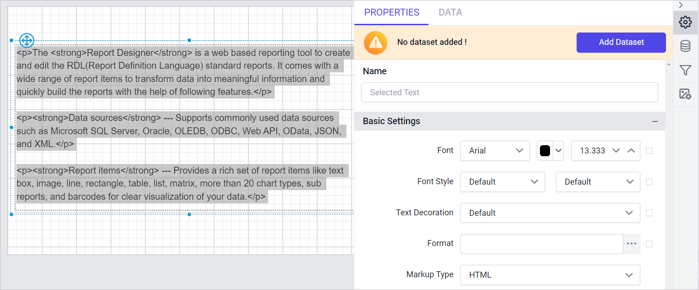

# Add HTML to a report with the {{site.productNameTM}} textbox

The text box report item in the {{site.productNameTM}} Web Report Designer lets you insert HTML-formatted text into a report. The text can be any simple or complex expression, or a value retrieved from a field in your dataset.

## How do I format plain text as HTML?

To render text as HTML in the {{site.productNameTM}} Web Report Designer, set the textbox `Markup Type` property to `HTML`. Follow these steps:

1. Drag and drop a textbox report item onto the design surface.

   

2. Enter the text in valid HTML format in the text area.

   

3. Select the text and set `HTML` in the `Markup Type` property.

   

You can also use the markup property to format a dataset field that returns HTML text from a database, or an expression that evaluates to text in HTML format.

On report preview, the text is rendered as HTML, as shown in the following image.

## Which HTML tags and CSS attributes are supported?

The {{site.productNameTM}} textbox ignores invalid HTML markup tags and cascading style sheet attributes and renders them as plain text. The following HTML tags and cascading style sheet attributes render as HTML when defined with the HTML markup type:

<ul>
  <li>
Hyperlinks: &lt;A HREF&gt;
</li>
  <li>
Fonts: &lt;FONT&gt;
</li>
  <li>
Header, style and block elements: &lt;H{n}&gt;, &lt;DIV&gt;, &lt;SPAN&gt;,&lt;P&gt;, &lt;DIV&gt;, &lt;LI&gt;, &lt;HN&gt;
</li>
  <li>
Text format: &lt;B&gt;, &lt;I&gt;, &lt;U&gt;, &lt;S&gt;
</li>
  <li>
List handling: &lt;UL&gt;, &lt;LI&gt;
</li>
  <li>
Break: &lt;BR&gt;
</li>
  <li>
text-align, text-indent
</li>
  <li>
font-family
</li>
  <li>
font-size
</li>
  <li>
color
</li>
  <li>
padding, padding-bottom, padding-top, padding-right, padding-left
</li>
  <li>
font-weight
</li>
</ul>

Download the [HTML in a report design (RDL)](https://github.com/boldreports/resources/tree/master/docs/report-designer/textbox/add-html-in-to-a-report.rdl)

## Frequently asked questions

### What happens to invalid HTML tags in a textbox?

The {{site.productNameTM}} textbox ignores invalid HTML markup tags and cascading style sheet attributes and renders them as plain text.

### Can a dataset field contain HTML?

Yes. You can use the markup property to format a dataset field that returns HTML text from a database, or an expression that evaluates to text in HTML format.

## See also

* [Textbox report item](./../../../report-items/textbox/)
* [Design RDL report using textbox](./../../../report-items/textbox/design-rdl-report-using-textbox/)
* [Format data](./../../../compose-report/format-data/)
