# Design an RDL report using a textbox in {{site.productNameTM}}

To design an RDL report with a textbox in the {{site.productNameTM}} Web Report Designer, add textboxes to the report header, body, and footer, then display static or dynamic text.

## How do I add a textbox to the report?

You can add a {{site.productNameTM}} textbox report item to the header, footer, and body area of the report.

1. See the [Add a textbox to the report](./../../../report-items/textbox/) section and add a textbox in the report header, body, and footer section.
2. In the following image, the textbox in the report header displays a title text. The textbox in the report body displays static fields, and the textbox in the report footer displays a label for the signature field.
   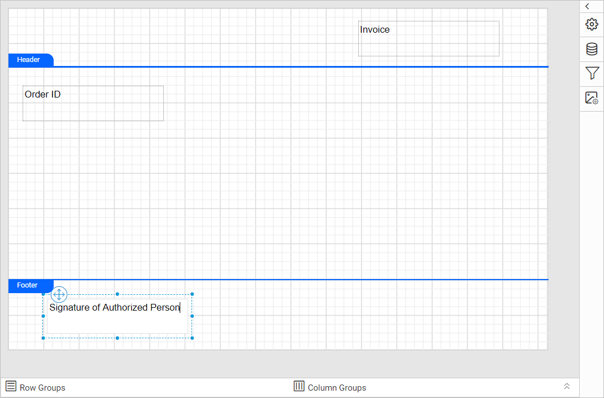

## Display dynamic text using expression

A {{site.productNameTM}} textbox displays dynamic values from parameters and dataset fields through expressions. In the following steps, you assign a report parameter in the textbox to display a dynamic value:

1. See the [Create Parameter](./../../../report-parameters/add/#create-parameter) section and create a new report parameter.
2. See the [Add a textbox to the report](./../../../report-items/textbox/) section and add a textbox to the report.
3. Focus the textbox and right-click in the text area. The textbox context menu appears.
   
4. Select the `Expression` option in the menu list. The expression editor opens.
   
5. Choose or specify the expression you need in the text area. In this example, an `InvoiceID` parameter appended with the `#` symbol is assigned as the expression.
   
   > To learn more about handling expressions in the report designer, see the [Expressions](./../../../compose-report/expressions/) section.
6. The expression is displayed in the text area at the cursor position.
   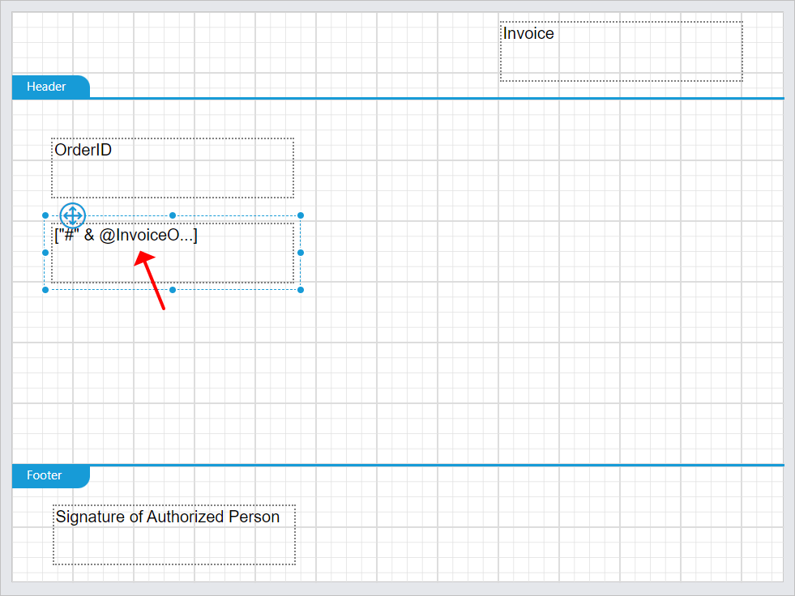
   > Note: If the expression's character length exceeds 18, it will be displayed in a shortened format.
7. When you hover over the expression tag, the actual expression is displayed in a tooltip.
   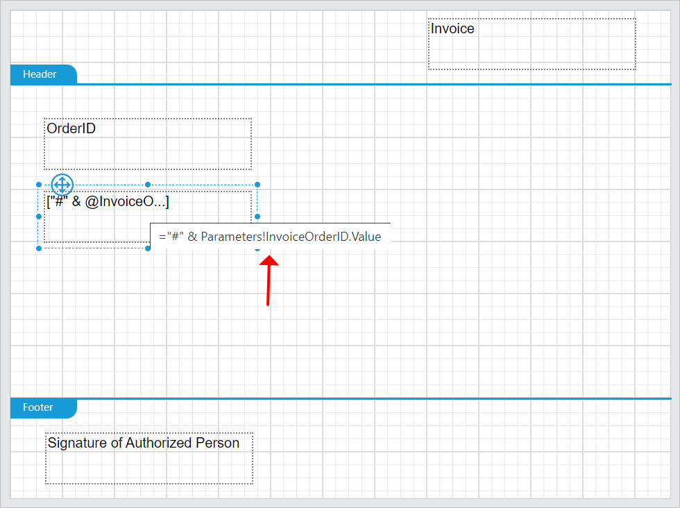

## How do I edit the expression?

To edit an expression in a {{site.productNameTM}} textbox, follow these steps:

1. Select the expression in the textbox that you want to edit.
   
2. Right-click the tag to open the context menu.
   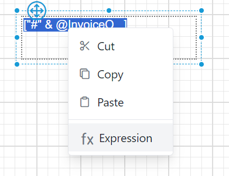
3. Select the `Expression` option in the menu list. The expression editor opens.
   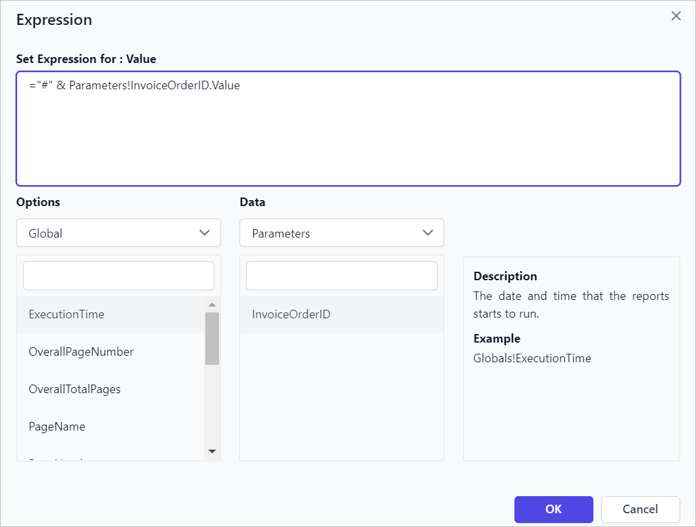
4. Modify the expression and click the `OK` button.

## How do I associate a textbox with a dataset?

You bind a {{site.productNameTM}} textbox to a dataset field by dragging the field from the `DATA` panel or by using the expression editor. To create a dataset in the Web Report Designer, see the [Create Data](./../../../manage-data/dataset/create-an-embedded-dataset/) section.

### Drag and drop dataset field

To add a dataset field as a textbox, follow these steps:

1. Open the `DATA` panel and expand the dataset fields you need.
   
2. Drag and drop the dataset field into the design area.
   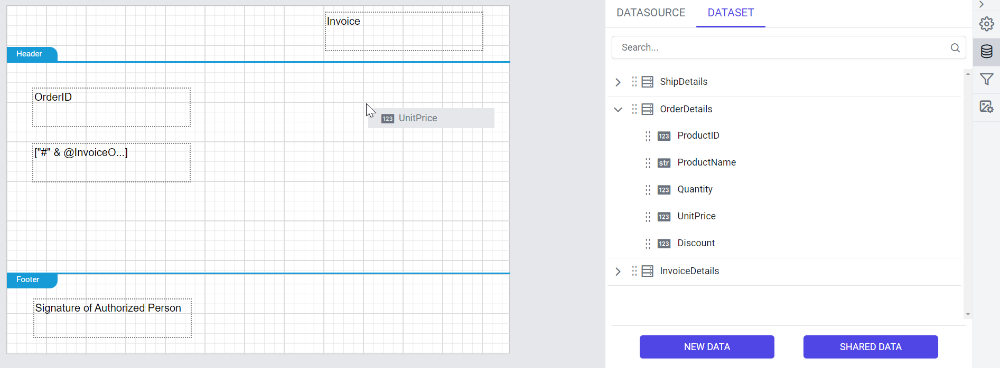
3. A new textbox is added to the design area, as shown in the following image.
   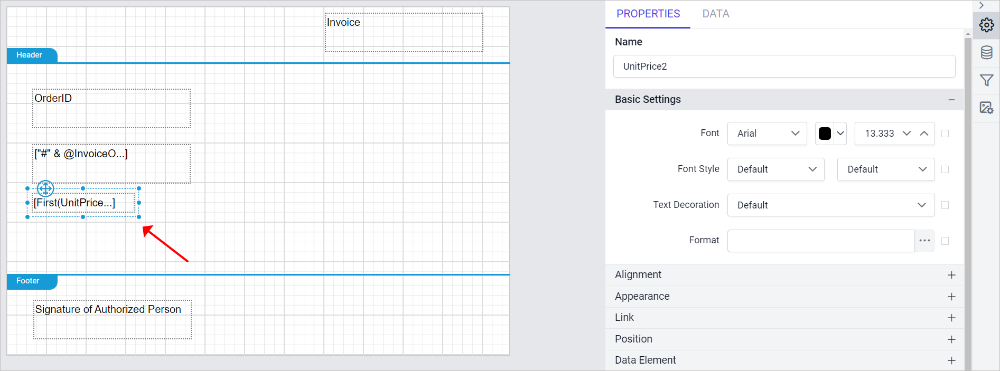

### Assign the field using expression editor

You can also associate a dataset field with a textbox in the Web Report Designer expression editor. See the [Dataset Fields in Expression](./../../../compose-report/expressions/using-dataset-fields/) section.

## How do I associate a textbox with a parameter?

You bind a {{site.productNameTM}} textbox to a report parameter by dragging the parameter from the `PARAMETERS` panel or by using the expression editor. To create a report parameter in the Web Report Designer, see the [Create Parameter](./../../../report-parameters/add/#create-parameter) section.

### Drag and drop parameter field

To add a parameter as a textbox, follow these steps:

1. Open the `PARAMETERS` panel. The panel lists the available parameters in the report.
   
2. Drag and drop the parameter into the design area.
   
3. A new textbox is added to the design area, as shown in the following image.
   

### Assign the parameter using expression editor

You can also associate a parameter with a textbox in the Web Report Designer expression editor. See the [Dataset Fields in Expression](./../../../compose-report/expressions/using-report-parameters/) section.

## How do I configure and format textbox content?

You configure a {{site.productNameTM}} textbox in two ways:

* Focus the overall textbox element to configure properties for whole textbox content.
* Select the specific text to configure properties for selected text.

### Position and Sizing

The textbox Position and Sizing properties improve report readability and design.

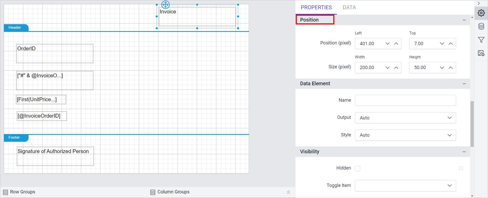

The following image shows the report design view after sizing the textboxes.

### How do I style textbox content?

You style a {{site.productNameTM}} textbox either as a whole or for selected text only.

#### Over all textbox

To style the whole textbox, select the textbox and open the properties panel. Set the font and alignment properties under the `Basic Settings` and `Appearance` categories.

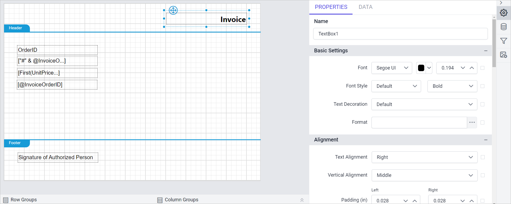

#### Selected text

To style part of the text, select the text in the textbox and open the properties panel. The properties panel displays the `Selected Text` properties.

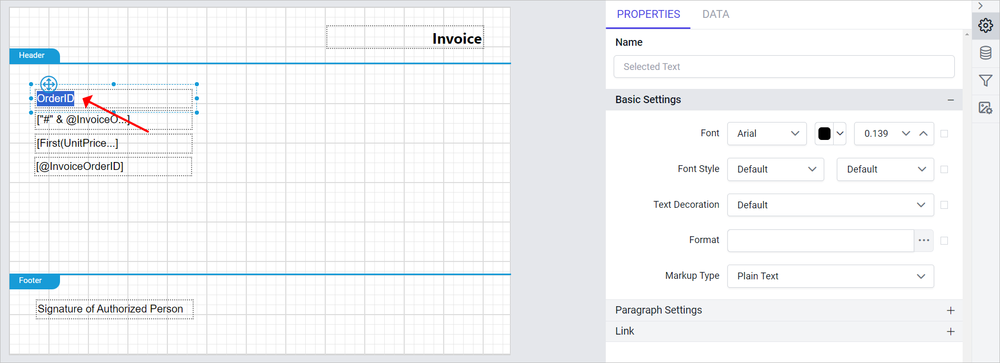

Set the font and alignment properties for the selected text under the `Basic Settings` and `Paragraph Settings` categories.

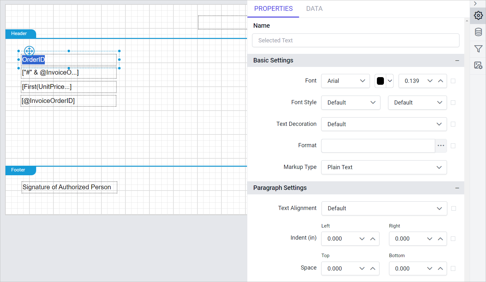

### How do I format a value in a textbox?

You can apply a format to the whole {{site.productNameTM}} textbox value or to selected text in a textbox.

#### Format overall textbox

To format the whole textbox value, follow these steps:

1. Select a textbox in the design area. In the following image, the textbox that contains the `UnitPrice` dataset field is selected.
   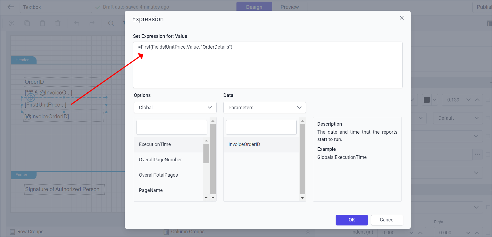
2. In the properties pane, click the highlighted button under the `Basic Settings` category to set the format.
   
3. The format dialog opens. See the [Format Data](./../../../compose-report/format-data/) section to set different formats on the data. In this example, the `Currency` format is applied to the `Unit Price` dataset field.
   
4. After you set the format, the properties panel shows it, as in the following image.
   
5. On report preview, the `Unit Price` field value is displayed as shown in the following image.
   

#### Format selected text

To format selected text in a textbox, follow these steps:

1. Select specific text in the textbox.
   
2. In the properties pane, click the highlighted button under the `Basic Settings` category to set the format.
   
3. The format dialog opens. See the [Format Data](./../../../compose-report/format-data/) section to set different formats on the data. In this example, the `Currency` format is applied to the `Unit Price` dataset field.
   
4. After you set the format, the properties panel shows it, as in the following image.
   
5. On report preview, the `Unit Price` field value is displayed as shown in the following image.
   

## How do I link a report from a textbox?

A {{site.productNameTM}} textbox can link to another report. When you click the linked text, the report viewer displays the target report.

### Over all textbox

To link the whole textbox to a report, follow these steps:

1. Select a textbox in the design area.
   
2. In the properties view, enable the `Enable Link` option under the `Link` category.
   
3. See the [Report Linking](./../../../compose-report/link-data/#report-linking) section and set the report path in the textbox.
   
4. On report preview, clicking anywhere in the textbox displays the `SalesOrderDetail` report in the report viewer.
   
5. After you click the textbox, the target report is displayed as shown in the following image.
   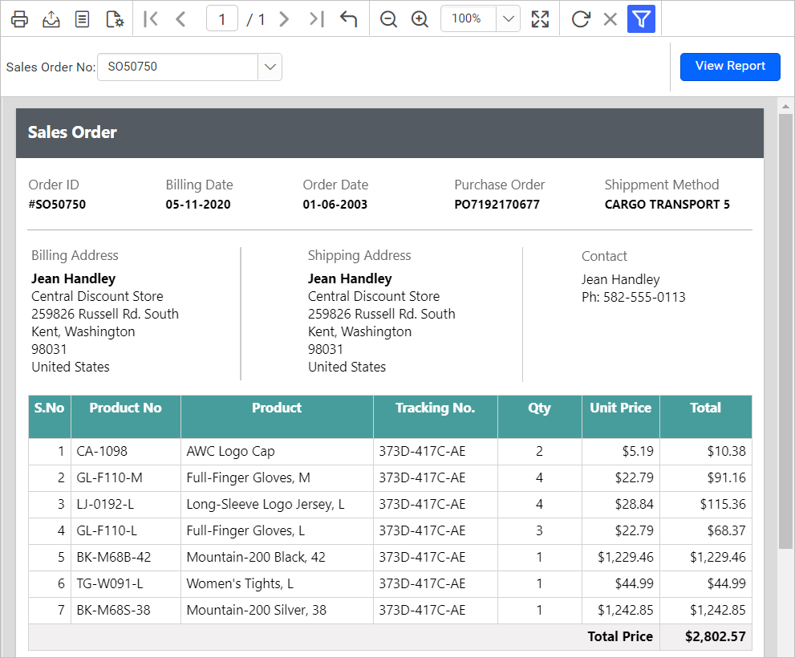

### Selected text

To link selected text in a textbox to a report, follow these steps:

1. Select specific text in the textbox.
   
2. In the properties view, enable the `Enable Link` option under the `Link` category.
   
3. See the [Report Linking](./../../../compose-report/link-data/#report-linking) section and set the report path in the textbox.
   
4. On report preview, clicking the `here` text in the textbox displays the `SalesOrderDetail` report in the report viewer.
   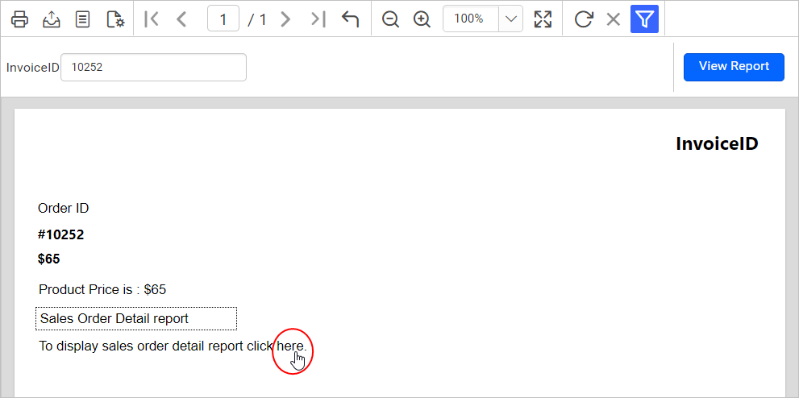
5. After you click the textbox, the target report is displayed as shown in the following image.
   

## How do I add a hyperlink to a textbox?

A {{site.productNameTM}} textbox hyperlink defines what happens when users click the text box or a certain area displayed on a report.

### Over all textbox

To add a hyperlink to the whole textbox, follow these steps:

1. Select a textbox in the design area.
   
2. In the properties view, enable the `Enable Link` option under the `Link` category.
   
3. See the [Hyperlink](./../../../compose-report/link-data/#hyperlink) section and set the URL in the textbox.
   
4. On report preview, clicking anywhere in the textbox displays the `SalesOrderDetail` report in the report viewer in a new browser tab.
   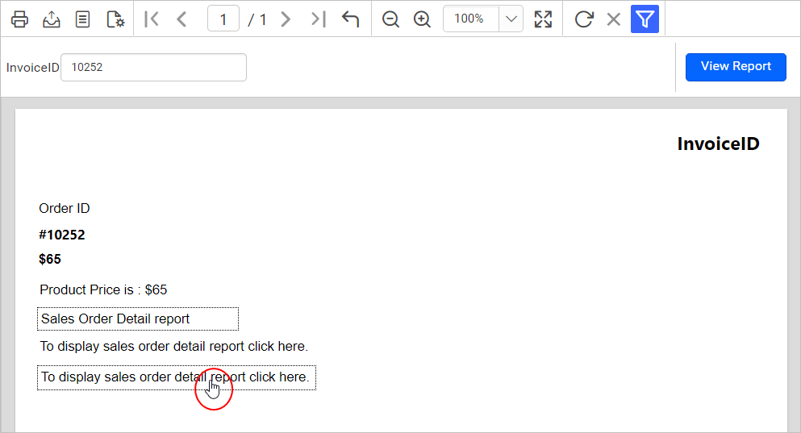

### Selected text

To add a hyperlink to selected text in a textbox, follow these steps:

1. Select specific text in the textbox.
   
2. In the properties view, enable the `Enable Link` option under the `Link` category.
   
3. See the [Hyperlink](./../../../compose-report/link-data/#hyperlink) section and set the URL in the textbox.
   
4. On report preview, clicking the `here` text in the textbox displays the `SalesOrderDetail` report in the report viewer in a new browser tab.
   

## Frequently asked questions

### Why is my expression shown in a shortened format?

In the {{site.productNameTM}} Web Report Designer, an expression longer than 18 characters is displayed in a shortened format. Hover over the expression tag to see the actual expression in a tooltip.

### Can I format only part of the text in a textbox?

Yes. Select the specific text in the textbox and set its format or style in the properties panel.

## See also

* [Textbox report item](./../../../report-items/textbox/)
* [Add HTML in to a report](./../../../report-items/textbox/add-html-in-to-a-report/)
* [Add a report parameter](./../../../report-parameters/add/)
