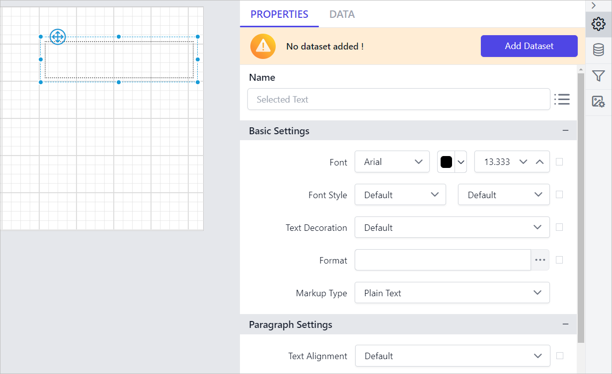
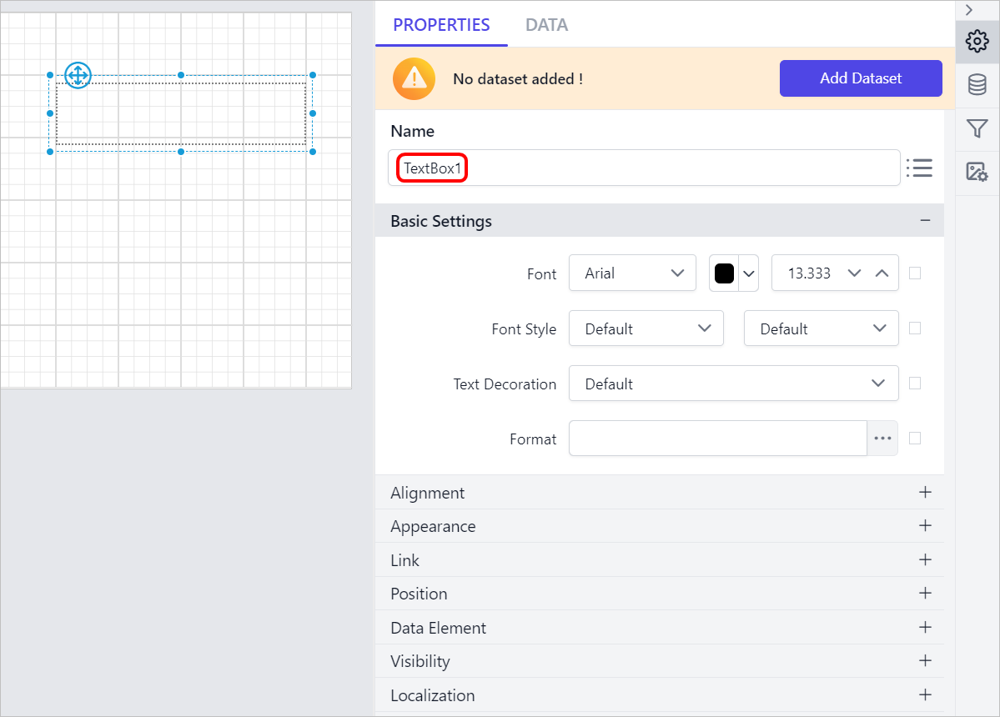
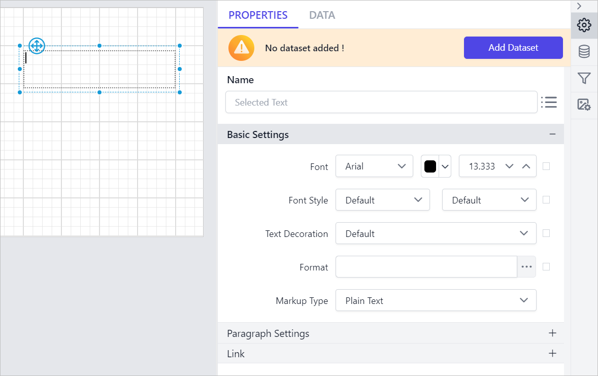

# TextBox report item in {{site.productNameTM}}

The {{site.productNameTM}} TextBox report item displays static text for titles, key information, descriptions, and labels. It also displays dynamic text set from expressions in the Web Report Designer.

## How do I add a textbox to the report?

To add a {{site.productNameTM}} textbox to your report in the Web Report Designer, follow these steps:

1. Find the textbox report item in the item panel under the `Basic Items` category.
   
2. Drag and drop the textbox report item from the item panel into the design area.
   
3. After you drop the textbox item into the design area, the properties panel lists its textbox properties.
   

## Properties

The {{site.productNameTM}} textbox report item lets you view and set properties for the whole textbox and for each piece of content in it (the paragraph).

To view and edit the overall textbox properties, select the textbox report item in the design area. The properties panel lists the textbox properties, as shown in the following image.

To view and edit the selected text properties, focus inside the text area. The properties panel lists the selected text properties, as shown in the following image.

Before you set the following properties, read the [Properties panel](./../../compose-report/properties-panel/) section.

### Common properties

The textbox common properties apply to both the whole textbox and selected text. They are listed in the following sections.

#### Basic Settings

The textbox Basic Settings category holds the font, text decoration, and format properties.

Font

The font family, font size, font color, font style, and font weight properties style the content in the textbox. You can apply these font properties to the whole textbox content or to specific content in a textbox.

Font Family

The `Font Family` property sets the font of the textbox. The dropdown under the `Basic Settings` category lists the supported font family names. Choose the font family you need from the dropdown list.

Font Color

The Font Color property sets the color of the content in the textbox. Click the color palette icon and choose the color you need in the `Color Palette`.

Font Size

The Font size property increases the size of the text in the textbox. You can increase the font size with the numeric dropdown highlighted in the following image.

Font Styles

The `Font Style` property changes the font style of the content in the textbox. Choose the font style you need in the `Font Style` dropdown list. The supported font styles are:

* Default
* Normal
* Italic

Font Weight

The Font Weight property changes the font weight of the content in the textbox. Choose the font weight type you need from the dropdown list.

Text Decoration 

The Text decoration property sets the appearance of decorative lines on text.

* **None** - Produces no text decoration.
* **Underline** - Each line of text is underlined.
* **Overline** - Each line of text has a line above it.
* **Line-through** - Each line of text has a line through the middle.

Underline and Overline decorations are positioned under the text, line-through over it.

Format 

The Format property formats an entire text box or specific text, numbers, expressions, or fields within the text box. To open the format dialog, click the icon highlighted in the following image, or type the format directly in the textbox.

To apply **Number**, **Currency**, **Date**, **Time**, **Scientific**, **Percentage**, or **Custom** formats with the format dialog, follow the steps in the [Format](./../../compose-report/format-data/) section.

#### Link

The textbox Link property sets a hyperlink inside the textbox content to link another report. Select the `Enable  Link` checkbox to enable the sub properties.

To set the hyperlink on selected text or on the whole textbox, follow the steps in the [Linking](./../../compose-report/link-data/#report-linking) section.

### Textbox properties

The following {{site.productNameTM}} properties apply only to the whole textbox item.

#### Alignment

The textbox Alignment category holds the text alignment, vertical alignment, line height, and writing mode properties.

Text Alignment 

The `Text Alignment` property aligns the textbox content or specific content in a textbox. Choose the text alignment option from the dropdown list to align the text in the `Left`, `Right`, or `Center` position.

Vertical alignment

The Vertical alignment property aligns the textbox content or specific content in a textbox in the `Top`, `Middle`, or `Bottom` position. Choose the vertical alignment option you need from the dropdown list.

Line height

The Line height property increases the space between lines of a textbox. Increase or decrease the value in the numeric dropdown to set the line height.

Writing Mode

The Writing mode property controls the direction of the text content in the textbox: `Horizontal`, `Vertical`, or `Rotate270`. Choose the writing mode you need from the dropdown.

**Horizontal**: Text is displayed horizontally, read from left to right.

**Vertical**: Text is displayed vertically, read from top to bottom.

**Rotate 270**: Text is displayed vertically, read from bottom to top.

All the customizations are applied to the textbox when you preview the report.

#### Appearance

The textbox Appearance properties (border style, color, width, and background color) style the textbox and customize its look in the report design. You find these properties under the `Appearance` category in the properties panel.

Background color

The Background color property colors the textbox background. To set the background color in the properties panel, see the [Background color](./../../compose-report/common-properties/#background-color) section.

Border

The Border properties add or customize the border around a textbox item to separate items visually in the report design. To set border properties in the properties panel, see the [Border Properties](./../../compose-report/common-properties/#border-properties) section.

#### Position

The textbox Position property sets the width, height, left, and top position of the textbox in the report design. To set these properties in the properties panel, see the [Position](./../../compose-report/common-properties/#position) section.

#### Data Element

The textbox Data element properties control the visibility of a report item when you export the report in XML format. The properties panel lists them under the `Data Element` category.

Name

The `Name` field assigns a custom name to the textbox element. The textbox is exported with the name you provide.

> Note: The name cannot contain spaces, and it must begin with a letter followed by letters, numbers, or the underscore character (_).

Output

The `Output` property controls the visibility of the textbox when you export the report. Each option for the `Output` property performs the following operation:

* **Auto** or **Output** - Exports the textbox report item.
* **NoOutput** - Does not export the textbox report item.

Style

The `Style` property sets the export type of the textbox report item. Choosing **Auto** or **Element** style exports the textbox as an XML element. The **Attribute** style exports the textbox as an XML attribute.

#### Visibility

The textbox Visibility property conditionally shows or hides the textbox report item on report preview or export. To set the visibility of the textbox item in the properties panel, see the [Visibility](./../../compose-report/common-properties/#visibility) section.

#### Miscellaneous

The textbox Miscellaneous category holds the Can Grow, Can Shrink, Custom Attributes, Tooltip, Document Map, Bookmark, and Custom Style properties, as shown in the following image.

Can Grow

Enable this property to expand the Textbox height vertically based on its content when you preview the text.

Can Shrink

Enable this property to shrink the Textbox height vertically based on its content when you preview the text.

Custom Attributes

The Custom Attributes property sets the values for textbox custom properties. To create and assign values for custom properties in the properties panel, see the [Custom Properties](./../../compose-report/common-properties/#custom-properties) section.

Tooltip

The Tooltip property displays informative text or a value when the user hovers over the report item in report preview. To set a tooltip for the textbox report item in the properties panel, see the [Tooltip](./../../compose-report/common-properties/#tooltip) section.

Document Map

A document map is a navigational feature that displays a separate side pane with a set of navigational links in a hierarchical structure when you view a report. You click an item in the list to go to the report page that displays that item. To configure a document map in the report design, see the [Document Map](./../../compose-report/document-map/) section.

You can set static or dynamic text as the value of the document map property. To set and reset dynamic text, see the [Set Expression](./../../compose-report/properties-panel/#set-expression) and [Reset Expression](./../../compose-report/properties-panel/#reset-expression) sections.

Bookmark

Bookmark links let users navigate to different parts of an SSRS report. You can add bookmarks to each textbox, image, table, or chart, or to the unique group values displayed in a tablix, to direct users to specified locations in the report. The bookmark value can be your own string or an expression. To configure a bookmark in the report design, see the [Bookmark](./../../compose-report/bookmark/) section.

Custom Style

The `Custom Style` property lets you use external CSS to style report items, giving more flexibility than the built-in styling options. Use this property to meet specific design requirements and keep styling consistent across multiple reports. For a step-by-step guide to setting up custom styles in your report, see the **How To** section of this guide.

#### Localization

The textbox Localization category holds the Direction and Language properties.

Direction

The **Direction** property configures the content rendering direction of the textbox report item. On preview, the textbox content renders in the direction you set. You can set either Right-To-Left or Left-To-Right direction.

By default, content renders in Left-To-Right direction.

**Left-To-Right** report preview:

**Right-To-Left** report preview:

Language

The **Language** property sets the locale of a textbox, which determines the default formats for displaying report data in the textbox. Select the language you need in the **Language** property dropdown.

> The language property on a text box overrides the language property on the report.

### Selected Text properties

The following {{site.productNameTM}} properties apply only to the selected text in a textbox.

### Markup Type

The Markup type property renders the selected text as plain text or HTML-formatted text. Select the text and choose the type in the `Markup Type` property dropdown.

**Plain Text** - Displays the selected text as simple text and the HTML will be treated as literal text.

**HTML** - Displays the selected text as HTML. If the expression value or values from dataset field contains a valid  HTML tags, these tags will be rendered as HTML. See the [Add HTML in to a report](./../../report-items/textbox/add-html-in-to-a-report/) section to import HTML with a textbox.

#### Paragraph Settings

The selected text Paragraph Settings category holds the Text Alignment, Indent, and Space properties, as shown in the following image.

Text Alignment

The `Text Alignment` property aligns the textbox content or specific content in a textbox. Choose the text alignment option you need from the dropdown list.

Indent

The Indent property indents the text in the paragraph. Increase or decrease the left and right indent in the text box with the numeric dropdown.

Space

The Space property adds space before and after the paragraphs in the textbox.

## How do I set an expression on a textbox property?

You can set an expression on some properties of the {{site.productNameTM}} textbox report item so that their values are processed from expressions. To set expressions on textbox properties, see the [Set Expression](./../../compose-report/properties-panel/#set-expression) section.

## How do I reset an expression?

To `Reset` an expression applied to a textbox property in the Web Report Designer, see the [Reset Expression](./../../compose-report/properties-panel/#reset-expression) section.

## How do I use advanced properties?

Some properties of the {{site.productNameTM}} textbox report item contain nested properties. To open and handle nested properties, see the [Advanced Properties](./../../compose-report/properties-panel/#advanced-properties) section.

## How do I design an RDL report using a textbox?

To learn how to position, style, and format a textbox, link a report, and add a hyperlink in the Web Report Designer, see the [Design RDL report using textbox](./../../report-items/textbox/design-rdl-report-using-textbox/) section.

## What are the textbox limitations?

The {{site.productNameTM}} textbox report item has the following limitations:

1. Pasting multiline text content from one TextBox report item into another TextBox report item will insert additional line breaks between each line of text.
2. In the designer, vertical text alignment won't be applied while editing text; it will only take effect after the text field loses focus. The alignment will function as usual in preview.

## Frequently asked questions

### Does the textbox language override the report language?

Yes. In {{site.productNameTM}}, the language property on a text box overrides the language property on the report.

### What is the default text direction of a textbox?

By default, textbox content renders in Left-To-Right direction.

## See also

* [Design RDL report using textbox](./../../report-items/textbox/design-rdl-report-using-textbox/)
* [Add HTML in to a report](./../../report-items/textbox/add-html-in-to-a-report/)
* [Format data](./../../compose-report/format-data/)
* [Tablix report item](./../../report-items/tablix/)
