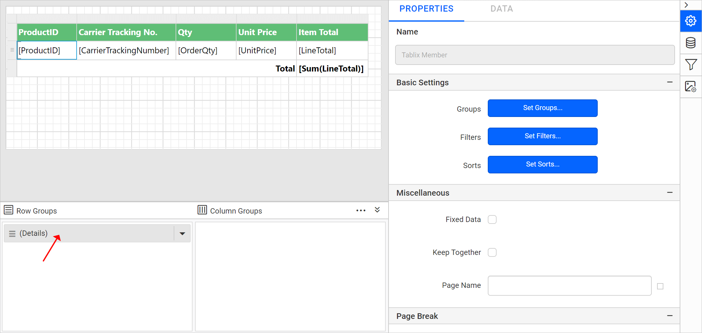

# Add a report parameter to a report in the {{site.productNameTM}} Web Report Designer

In the {{site.productNameTM}} Web Report Designer, report parameters filter the report data or associate related reports together. Follow the steps in this guide to add a report parameter to your report.

Prefer watching over reading? Watch this video about report parameters:

`youtube: https://www.youtube.com/watch?v=vs_YrhJJ_I0`

## Create parameter

You create a {{site.productNameTM}} report parameter from the `PARAMETERS` panel of the Web Report Designer. Follow these steps:

1. Click the `Parameter` icon in the `Data Configuration` panel. The `PARAMETERS` panel opens.
   
2. Click the `NEW PARAMETER` button in the `PARAMETERS` panel.
   
3. The following wizard is displayed.
   

   * In the **Name** field, type the name of the parameter or use the default name. By default, manually created parameter names are similar to `ReportParameter1`.
   * In the **Prompt** field, type the text that appears next to the parameter when the user previews the report.
   * In the **Data type** field, select the data type of the parameter value. The supported data types are `Boolean`,  `DateTime`, `Integer`, `Float` and `Text`.
   * Select **Allow blank value** if the parameter value needs to be set as an empty string or a blank value.
     > Note: If you specify valid values for a parameter, and you want a blank value to be one of the valid values, you must include it as one of the values that you specify. Selecting this option does not automatically include a blank value for available values.

   * Select **Allow null value** if the value of the parameter needs to be set as null.
     > Note: If you specify valid values for a parameter, and you want null to be one of the valid values, you must include null as one of the values that you specify. Selecting this option does not automatically include the null value for available values.

   * Select **Allow multiple values** if the parameter should accept multiple values. Null values are not allowed.
   * Set the `visibility` option.
     1. Select **Visible** to display the report parameter at the top of the report while running the report. Use this option to select parameter values at run time.
     2. Select **Hidden** to hide the report parameter in the published report. The report parameter values can still be set on a report URL, in a subscription definition, or on the {{site.productNameTM}} Report Server.
     3. Select **Internal** to hide the report parameter. In the published report, the report parameter can only be viewed in the report definition.
        
4. Click the `Save` button. The parameter is listed under the `PARAMETERS` pane, as shown in the following image.
   

## How do I filter table data based on a report parameter?

A {{site.productNameTM}} report parameter can filter table data at run time. In this example, the `ProductID` parameter filters the `ProductID` field values.

1. Select the table report item to enable the grouping panel in the designer.
   
2. Click the `(Details)` member field in the grouping panel to open the tablix member properties.
   
3. In the `Tablix Member` properties, click the `Set Filters...` button.
   
4. See the [Set filters](./../../compose-report/filter-data/) section to create a new filter expression.
   
5. Choose the `Equal` operator and assign the `ProductID` parameter in the **Value** field. Save the filter.
   
6. Preview the report. The following view is displayed.
   
7. Enter a valid `ProductID` in the textbox and click `View Report`.
   

> Download this report design from the [filter table data based on report parameter RDL sample](https://github.com/boldreports/resources/tree/master/docs/report-designer/report-parameters/filter-table-data-based-on-report-parameter.rdl).

## Frequently asked questions

### Which data types can a report parameter use?

A {{site.productNameTM}} report parameter supports the `Boolean`, `DateTime`, `Integer`, `Float`, and `Text` data types.

### What is the difference between Hidden and Internal visibility?

A **Hidden** parameter is hidden in the published report, but its values can still be set on a report URL, in a subscription definition, or on the Report Server. An **Internal** parameter can only be viewed in the report definition.

## See also

* [Create a multi-value parameter](./../../report-parameters/create-multi-value-parameter/)
* [Create a cascading parameter](./../../report-parameters/create-cascading-parameter/)
* [Define available values for a parameter](./../../report-parameters/define-available-values-for-parameter/)
* [Define default values for a parameter](./../../report-parameters/define-default-values-for-parameter/)
