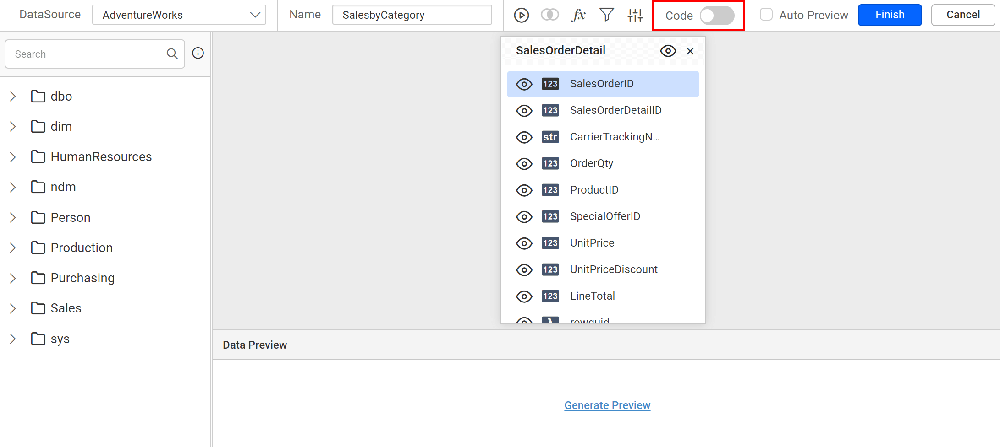
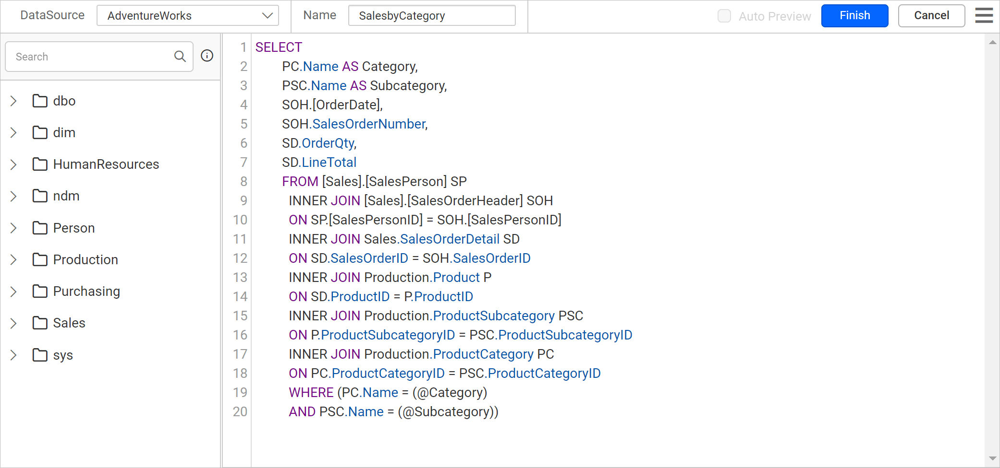
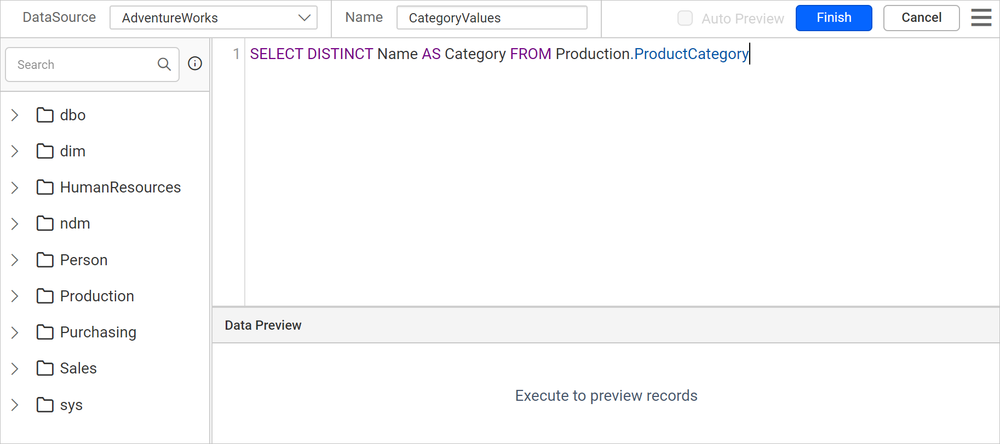
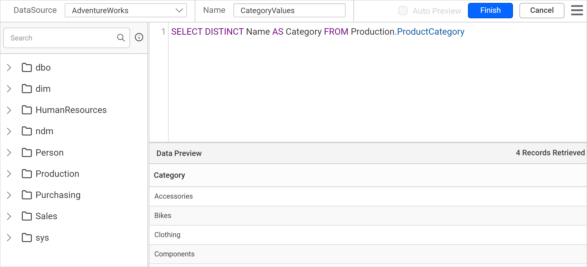
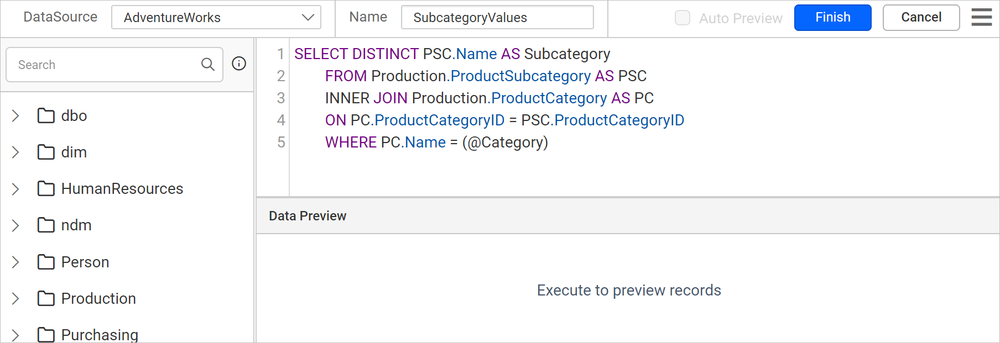
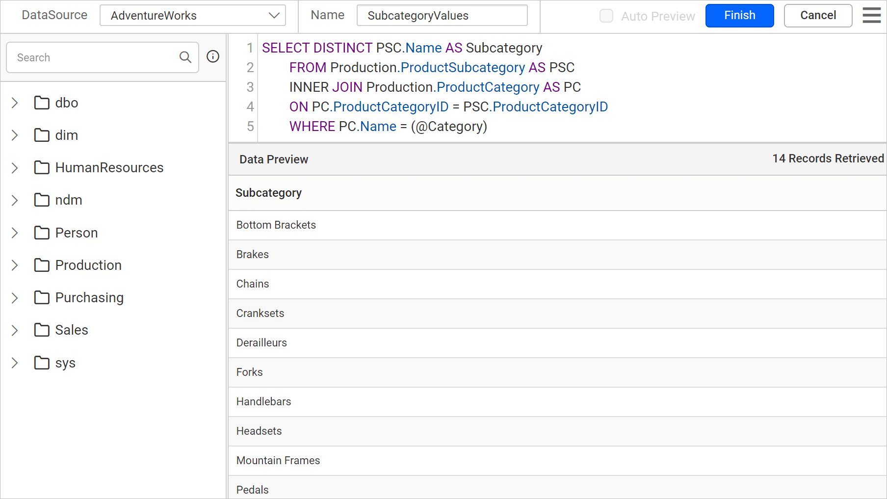
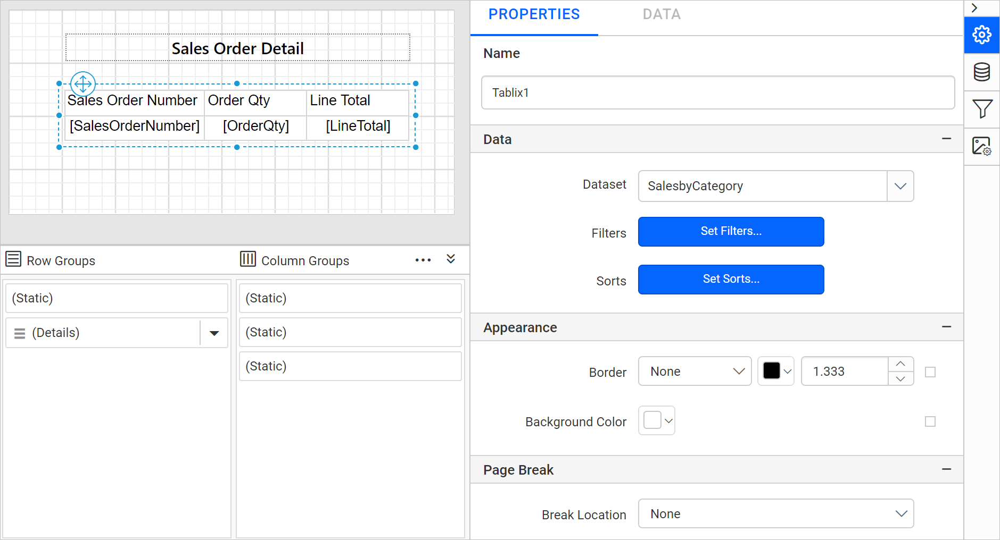

# Create cascading parameters in the Bold Reports<sup>®</sup> Web Report Designer

In the Bold Reports<sup>®</sup> Web Report Designer, a cascading parameter is a parameter whose list of values depends on the value chosen in another parameter. Use this type of parameter when a parameter has a long list of values.

## How do I create cascading parameters?

You create Bold Reports<sup>®</sup> cascading parameters in five stages: create the main dataset, create and assign a dataset for the independent parameter, then create and assign a dataset for the dependent parameter. The following sections walk through each stage in the Web Report Designer.

### How do I create the main dataset?

The main dataset holds the report data and one query parameter for each cascading parameter. Create a new dataset by following the steps in the [Create Data](./../../manage-data/dataset/create-an-embedded-dataset/#design-query-data) section, then continue with these steps:
1. In the **Name** field, type the name of the dataset. This example uses **SalesbyCategory** as the dataset name.
2. Click the `switcher` in the query designer toolbar to switch to query mode.
    
3. Make sure the query has the following parts:
    * A list of column fields in `SELECT` statement to fetch from any specific table.
    * One query parameter for each cascading parameter.
       For example, the following query uses the tables **SalesPerson**, **SalesOrderHeader**, **SalesOrderDetail**, **Product**, **ProductSubcategory**, and **ProductCategory** from the `AdventureWorks` database, with the query parameters @Category and @Subcategory:

       ```js
       SELECT
       PC.Name AS Category,
       PSC.Name AS Subcategory,
       SOH.[OrderDate],
       SOH.SalesOrderNumber,
       SD.OrderQty,
       SD.LineTotal
       FROM [Sales].[SalesPerson] SP
           INNER JOIN [Sales].[SalesOrderHeader] SOH
           ON SP.[SalesPersonID] = SOH.[SalesPersonID]
           INNER JOIN Sales.SalesOrderDetail SD
           ON SD.SalesOrderID = SOH.SalesOrderID
           INNER JOIN Production.Product P
           ON SD.ProductID = P.ProductID
           INNER JOIN Production.ProductSubcategory PSC
           ON P.ProductSubcategoryID = PSC.ProductSubcategoryID
           INNER JOIN Production.ProductCategory PC
           ON PC.ProductCategoryID = PSC.ProductCategoryID
           WHERE (PC.Name = (@Category)
           AND PSC.Name = (@Subcategory))
       ```

        Paste the preceding query in the query editor.
          

4. Click the `Run` icon in the toolbar. The **Parameters** dialog opens automatically. Type the value you want for each query parameter in the parameter value column.
   For example:
     * In the **@Category** parameter, type `Components` as the value.
     * In the **@Subcategory** parameter, type `Brakes` as the value.

       

5. Click the `Finish` button. The `SalesbyCategory` dataset is listed under the `DATA` pane.

After you save the dataset, equivalent report parameters are created under the `PARAMETERS` panel, as shown in the following image.

   

### How do I create a dataset for the independent parameter?

The independent parameter dataset supplies the list of values for the first parameter (`Category`). Follow these steps in the Web Report Designer:

1. Create a new dataset by following the steps in the [Create Data](./../../manage-data/dataset/create-an-embedded-dataset/#design-query-data) section, then continue with these steps.
2. In the **Name** field, type the name of the dataset. This example uses **CategoryValues** as the dataset name.
3. Paste the following query text in the query editor:

   ```js
      SELECT DISTINCT Name AS Category FROM Production.ProductCategory
   ```

   The preceding query uses the column **Name** and the table **ProductCategory** to create the dataset for the independent parameter `Category`.
    
4. Click the `Run` icon in the toolbar to see the result.
    
5. Click the `Finish` button. The `CategoryValues` dataset is listed under the `DATA` pane.

### How do I set available values for the independent parameter?

You assign the `CategoryValues` dataset as the available values of the Bold Reports<sup>®</sup> **Category** parameter. Follow these steps:

1. Click the `Parameter` icon in the configuration panel to open the `PARAMETERS` panel.
    
2. Edit the **Category** parameter. In the name field, verify that the name is **Category**.
    See the [Edit Report Parameter](./../../report-parameters/edit/) section.
3. Click `Assign Value >>` to open the `Parameter Assign` dialog.
4. Select the `Query Value` option under the `Available Value` tab.
5. Select `CategoryValues` in the dataset field, and `Category` in the value and label fields.
    
6. Click the `Ok` button and `Save` the parameter.

### How do I create a dataset for the dependent parameter?

The dependent parameter dataset returns values filtered by the independent parameter. In this example, `@Subcategory` is the dependent parameter.

1. Create a new dataset by following the steps in the [Create Data](./../../manage-data/dataset/create-an-embedded-dataset/#design-query-data) section, then continue with these steps.
2. In the **Name** field, type the name of the dataset. This example uses **SubcategoryValues** as the dataset name.
3. Switch to query editor mode and paste the following query text in the query editor:

    ```js
    SELECT DISTINCT PSC.Name AS Subcategory
    FROM Production.ProductSubcategory AS PSC
    INNER JOIN Production.ProductCategory AS PC
    ON PC.ProductCategoryID = PSC.ProductCategoryID
    WHERE PC.Name = (@Category)
    ```

    The preceding query joins the **Name** column of the **ProductSubCategory** table with the **ProductCategory** table. It includes a condition on the independent parameter `Category` to create the dataset for the dependent parameter `SubCategory`.
    
4. Click the `Run` icon in the toolbar. The **Parameters** dialog opens automatically. For example, in the **@Category** parameter, type `Components` as the value.
    
5. Click the `OK` button. The result set displays 14 rows.
    
6. Click the `Finish` button. The `SubcategoryValues` dataset is listed under the `DATA` pane.

### How do I set available values for the dependent parameter?

You assign the `SubcategoryValues` dataset as the available values of the Bold Reports<sup>®</sup> **Subcategory** parameter. Follow these steps:

1. Click the `Parameter` icon in the configuration panel to open the `Parameter` configuration panel.
2. Edit the **Subcategory** parameter. In the name field, verify that the name is **Subcategory**.
3. Click `Assign Value>>` to open the `Parameter Assign` dialog.
4. Select the `Query Value` option under the `Available Value` tab.
5. Select `SubcategoryValues` in the dataset field, and `Subcategory` in the value and label fields.
    
6. Click the `Ok` button and `Save` the `Subcategory` parameter.

## How do I filter table data based on cascading parameters?

You filter a Bold Reports<sup>®</sup> table with cascading parameters by assigning the main dataset to the table and choosing values at preview. Follow these steps:

1. Design a simple table report and assign the `SalesbyCategory` dataset to the table.
    
   > To create a table report in the Web Report Designer, see the [Design a simple table report](./../../design-rdl-report-in-web-report-designer/#add-table-report-item) section.
2. Click the `Preview` button in the report header.
3. Choose `Accessories` in the `Category` parameter dropdown. The `SubCategory` dropdown is populated with values based on the `Accessories` category.
    
4. Choose `Bike Racks` in the `Subcategory` dropdown and click the `View Report` button.
    

> Download this report design from the [create cascading parameter RDL sample](https://github.com/boldreports/resources/tree/master/docs/report-designer/report-parameters/create-cascading-parameter.rdl).

## Frequently asked questions

### When should I use a cascading parameter?

Use a Bold Reports<sup>®</sup> cascading parameter when a parameter has a long list of values. The values of the dependent parameter change based on the value chosen in another parameter.

### How many query parameters does the main dataset need?

The main dataset query needs one query parameter for each cascading parameter.

## See also

* [Add a report parameter](./../../report-parameters/add/)
* [Edit a report parameter](./../../report-parameters/edit/)
* [Define available values for a parameter](./../../report-parameters/define-available-values-for-parameter/)
* [Create a multi-value parameter](./../../report-parameters/create-multi-value-parameter/)
