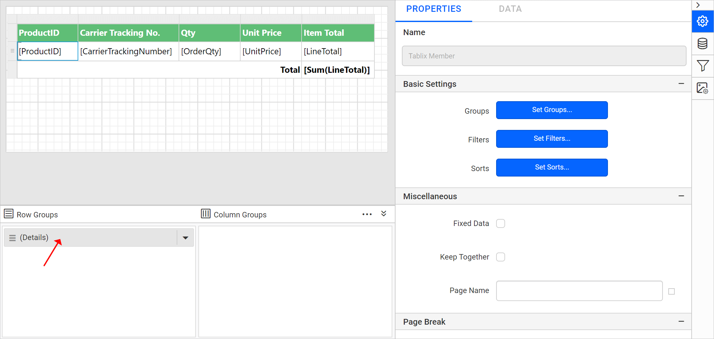

# Define available values for a parameter

In the {{site.productNameTM}} Web Report Designer, you can specify available values for a report parameter so users select only valid values when they preview the report. The available values you define for the parameter appear in the drop-down list when you preview the report.

## How do I open the parameter assign dialog?

The Web Report Designer sets available values in the parameter assign dialog. To follow the steps below, first read the [Create Parameter](./../../report-parameters/add/#create-parameter) section.

The following image shows the new parameter panel.

Click `Assign Value >>` to open the parameter assign dialog.

## Manual values

Manual values in the Web Report Designer are values and labels you type yourself. Follow these steps to add available values for the parameter:

1. Select the `Specify` option under the `Available Value` tab.
   
2. Click the **Add** icon. A list appears in which you can type values and labels.
   
3. Enter the value in the **Value** text box. Optionally, enter the label in the **Label** text box.
   > If you do not provide the label, the value is used.

   
4. Click `OK` and `Save` the parameter.
   

On report preview, the drop-down list shows the available values defined for the parameter, as in the following image.

## Query values

Query values in the Web Report Designer fill the parameter drop-down from a dataset field. Follow these steps to use them:

1. Select the `Query Value` option under the `Available Value` tab.
   
2. In the **Dataset** drop-down, choose the name of the dataset. You can define datasets using the data view.
3. In **Value field**, choose the name of the field that provides parameter values.
   > Note: These fields are retrieved from the list of column or field names in the dataset.
4. In **Label field**, choose the name of the field that provides the parameter names. If there is no separate field for names, choose the same field as in **Value field**.
5. Click `OK`.
   
6. Save the parameter.

On report preview, the `ProductID` parameter lists the values of the `ProductID` field from the query data.

## How do I remove available values?

To remove the available values from a parameter in the Web Report Designer, set the `Available Values` tab to `None`. Follow these steps:

1. Read the [Edit Parameter](./../../report-parameters/edit/) section and open the parameter properties.
2. Click `Assign Value >>` to open the parameter assign dialog.
3. Under the `Available Values` tab, choose the `None` option.
   
4. Click `OK` and save the parameter.

## How do I filter table data based on a report parameter?

In the Web Report Designer, you can use the `ProductID` parameter to filter the `ProductID` field values at runtime. Follow these steps:

1. Select the table report item to enable the grouping panel in the designer.
   
2. Click the `(Details)` member field in the grouping panel to open the tablix member properties.
   
3. In the `Tablix Member` properties, click the `Set Filters...` button.
   
4. Read the [Set filters](./../../compose-report/filter-data/) section to create a new filter expression.
   
5. Choose the `Equal` operator and assign the `ProductID` parameter in the **Value** field. Save the filter.
   
6. Preview the report. The following view appears.
   
7. The drop-down lists the manually created values. Choose any value from the drop-down list.
   
8. Click `View Report`.
   

## Frequently asked questions

### What happens if I do not provide a label for an available value?

If you do not provide the label, the Web Report Designer uses the value as the label.

### Where do query-based available values come from?

Query values come from a dataset you choose. The value and label fields are retrieved from the list of column or field names in that dataset.

## See also

* [Define default values for a parameter](./../../report-parameters/define-default-values-for-parameter/)
* [Edit a report parameter](./../../report-parameters/edit/)
* [Create a report parameter](./../../report-parameters/add/)
