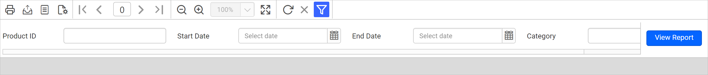
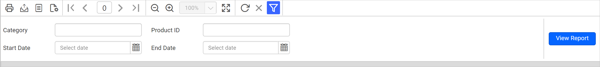

# Parameters layout in the Web Report Designer

In the Bold Reports® Web Report Designer, the parameters layout is a grid where you arrange the order of report parameters. When you preview the report, the order of the parameters in the parameters layout and parameters pane sets the order shown on the parameters pane. Parameter order is important when you design reports with cascading parameters.

## How do I open the parameters layout?

You open the parameters layout in the Web Report Designer with the `Edit Layout` option in the `Parameters Pane`. Follow these steps:

1. Open the parameters pane in the navigation panel.
   
2. Click the `Edit Layout >` option in the parameters pane.
   
3. The parameters layout dialog opens.
   

By default, the layout opens with four columns and two rows. In the parameters layout dialog, you can manually reorder parameters and insert or delete rows and columns.

> The parameter layout supported for reports created from RDL XML schema version 2016 onward.

## How do I order parameters in the layout?

In the Web Report Designer parameters layout grid, you move a parameter by dragging it to the desired cell. If a parameter is already in that cell, the two parameters swap positions. Changing the position of a parameter also changes the order of the parameter list in the parameters pane.

In this example, the parameters layout has four parameters in a row with four columns. In report preview, the parameter pane looks like this:

To arrange the parameter positions, drag a parameter from a cell and drop it into the required cell position.

Then, click OK. The order of parameters in the parameters pane list also changes.

The following image shows the parameters after arranging them.

The parameters list in the parameters pane is also reordered based on the parameter layout.

After ordering, the parameter pane looks like this at report preview:

## How do I insert a row or column?

The Web Report Designer parameters layout lets you add or remove columns and rows, as in any grid. You can add a maximum of 8 columns, but the number of rows appears not to have a limit. To insert a row or column, right-click a cell next to where you want the new row or column. The context menu shows the `Insert Column` and `Insert Row` options.

You can add a column to the `Left` or `Right` of the target row.

Similarly, you can add a row `Above` or `Below` the target row.

## How do I delete a row, column, or parameter?

The Web Report Designer parameters layout lets you delete a parameter, a row, or a column. Deleting a row or column also deletes all associated parameters in that row or column. The delete action in the parameters layout also deletes the respective parameters from the parameters pane.

To delete a row or column, right-click any cell in that row or column. The context menu shows the `Delete Column` and `Delete Row` options.

If the row or column is empty, the delete action removes it from the layout automatically. If the row or column contains one or more parameters, an alert confirmation appears, as in the following image.

You can also delete a specific parameter from a row or column using the `Delete` option in the context menu. Right-click the cell that holds the parameter and select the `Delete` option from the menu.

After you click OK, the respective parameter is also deleted from the parameters pane.

## Frequently asked questions

### How many columns can the parameters layout have?

The Web Report Designer parameters layout supports a maximum of 8 columns. It opens with four columns and two rows by default.

### Which reports support the parameters layout?

The parameter layout is supported for reports created from RDL XML schema version 2016 onward.

## See also

* [Reorder report parameters](./../../report-parameters/reorder-parameters/)
* [Create a cascading parameter](./../../report-parameters/create-cascading-parameter/)
* [Report parameters overview](./../../report-parameters/)
