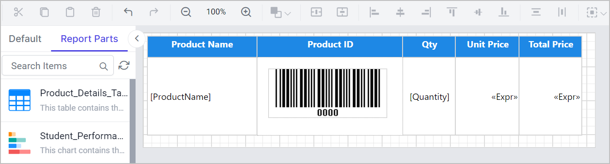

# Report parts in the Bold Reports® Web Report Designer

In the Bold Reports® Web Report Designer, report parts let you create and publish report item templates that you can reuse across multiple reports. You can publish tables, charts, maps, indicators, and other report items as report parts and reuse them in different reports.

## What does the report part example use?

The Web Report Designer example on this page uses a new table called `Product_Details_Table` that displays the product details.

Consider this scenario: you need the Product Details table in several reports. Creating this table for each report is a tedious process. To solve this, you publish the Product Details table as a report part and reuse it in multiple reports.

## Publishing the Product Details Table as a Report Part

To publish a report part in the Web Report Designer, use the `Publish Report Part` dialog. Follow these steps:

1. Click the `Publish Report Part` option from the drop-down in the top-right corner of the Web Report Designer page.
    
2. The `Publish Report Part` dialog opens.
    
3. The Report part drop-down lists the report items on the designer surface.
    
4. Select the `Product_Details_Table` report item from the drop-down.
5. Name the report part `Product_Details_Table` in the `Name` field and add a description if you want.
6. Click the `Publish` button to publish the `Product_Details_Table` report part.
    

> `Note:` Only the data source, dataset, and query parameters associated with the report items are published with the report part. Datasets bound to the scope of expressions and report parameters are not published with the report part.

## Reusing the Published Report Part in other Reports

To reuse a published report part in the Web Report Designer, drag it from the `Report Parts` tab into a new report. This example creates a new report that uses the `Product_Details_Table` report part.

1. Find the `Product_Details_Table` report part under the `Report Parts` tab on the left side of the Designer surface.
    
2. Drag and drop the `Product_Details_Table` report part into the Designer surface.
    
3. The dataset and query parameters associated with the `Product_Details_Table` report part are populated in this report.
    
4. The following image shows a new report that uses the `Product_Details_Table` report part to showcase the Product Details.
    

## Update Report Part

To apply changes from a republished report part in the Web Report Designer, use the **Update Report Part** option in the report that uses it. Suppose you changed the `Product_Details_Table` report part and published it. To reflect those changes in another report, right-click the `Product_Details_Table` in that report. The **Update Report Part** option appears.

Click the **Update Report Part** option. The updated changes in the `Product_Details_Table` report part are reflected in your report.

### When does a size confirmation alert appear?

The Web Report Designer shows a confirmation alert when you update a report part that has a Tablix or Rectangle with child report items. This happens if the width or height of those items changed in the current report design or the downloaded report part.

> For other report items, the downloaded report part will be updated to match the current report part layout.

Here's what to expect:

If the current size of a Tablix or Rectangle with child items is smaller than the downloaded report part, the following alert appears:

If the current size of a Tablix or Rectangle with child items is larger than the downloaded report part, the following alert appears:

Selecting **Yes** updates the width and height of the Tablix or Rectangle with child items based on the downloaded report part. It may affect the layout of these report parts and the report design.

If you choose **No**, the downloaded report part tries to fit into the current layout of report parts that have a Tablix or Rectangle with child items. It may affect the layout of these report parts and the report design.

> Download the above report design from the [report part use case RDL sample](https://github.com/boldreports/resources/blob/master/docs/report-designer/design-report-part-use-case-report.rdl).

## Frequently asked questions

### Which report items can I publish as report parts?

You can publish tables, charts, maps, indicators, and other report items as report parts in the Web Report Designer.

### Are report parameters published with a report part?

No. Only the data source, dataset, and query parameters associated with the report items are published. Datasets bound to the scope of expressions and report parameters are not published.

## See also

* [Publish a report](./../publish-report/)
* [Preview a report](./../preview-report/)
* [Supported and unsupported items in the Web Report Designer](./../supported-unsupported-features/)
