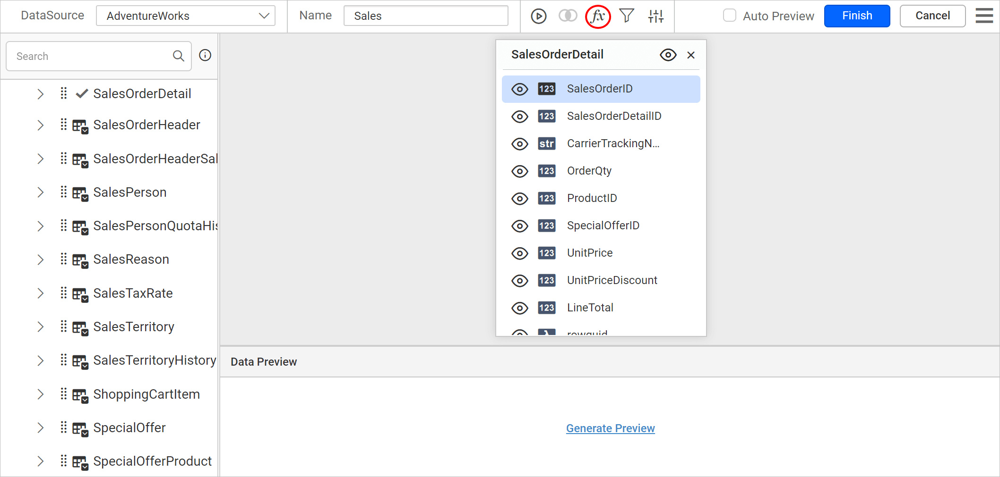

# Configure query expression columns in the query designer

In the Bold Reports® query designer, an expression column combines data columns, operators, and built-in functions into one expression. The expression column acts as a calculated measure. You can configure it to a report item like other numeric columns as a quantitative measure.

Prefer watching over reading? Watch this video on configuring an expression column:

`youtube: https://www.youtube.com/watch?v=-NagmJcztXQ`

## How do I open the Query Expressions dialog?

To open the `Query Expressions` dialog in the Bold Reports® query designer, click the `Expression` icon in the query designer toolbar.

The `Query Expressions` dialog opens, as in the following image.

> Note: The expression icon in the tools pane will be in disabled state, if there is no table found dropped in table design view.

## How do I create an expression column?

You create an expression column in the query designer from the `Query Expressions` dialog. Follow these steps:

1. Click the `Add` button in the `Query Expressions` dialog.
2. In the **Name** field, type the name for the expression column or use the default name. By default, manually created expression column names are similar to `Expression1`.
   
3. Define an expression in the **Expression** text area. The syntax for a simple expression is:

   `{function name(}[columnname]{operator[columnname])…}`

      Content within curly braces is optional.

      Some expressions for reference:

      1. YEAR([Order Date]) computes the year of the order date.

      2. [Freight]+100 computes the total with 100 added to Freight.
4. To add function names and column names to the `Expression` text area, double-click the function or column name in the Functions or Column Settings list view.
   
5. After you design the expression in the text area, click the `Save` button.
   
6. To create multiple expression columns, repeat these steps.
   
7. The `Column Settings` list view lists the new expressions, as in the following image.
   

> Read the [Supported Built-in functions](./../../transforming-data/supported-functions-in-query-expression/) section to learn more about supported built-in functions.

## How do I edit an expression column?

You edit an expression column in the query designer by changing its fields in the `Query Expressions` dialog. Follow these steps:

1. Select the expression column you want to update in the left pane.
2. Edit the `Name` and `Expression` fields as required.
3. Click the `Save` button to save the changes.

## How do I delete an expression column?

To delete an expression column in the query designer, click the `delete` icon in the expression field.

## How do I close the Query Expressions dialog?

To close the query designer `Query Expressions` dialog, click the `Cancel` button in the dialog footer or the `Close` icon in the dialog header.

## Frequently asked questions

### Why is the Expression icon disabled?

The expression icon in the tools pane is disabled if no table is dropped in the table design view.

### What is the default name of a new expression column?

By default, manually created expression column names are similar to `Expression1`.

## See also

* [Supported functions in query expressions](./../../transforming-data/supported-functions-in-query-expression/)
* [Query filter](./../../transforming-data/query-filter/)
* [Formatting columns](./../../transforming-data/formatting-columns/)
