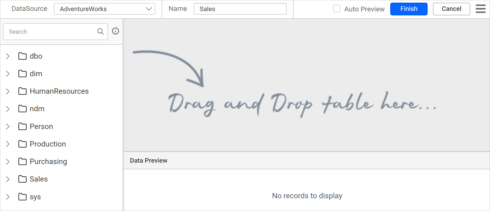
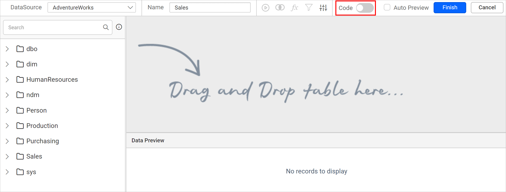
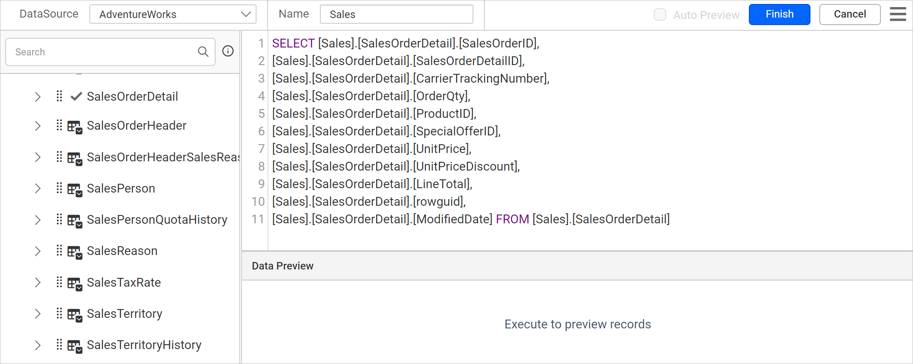
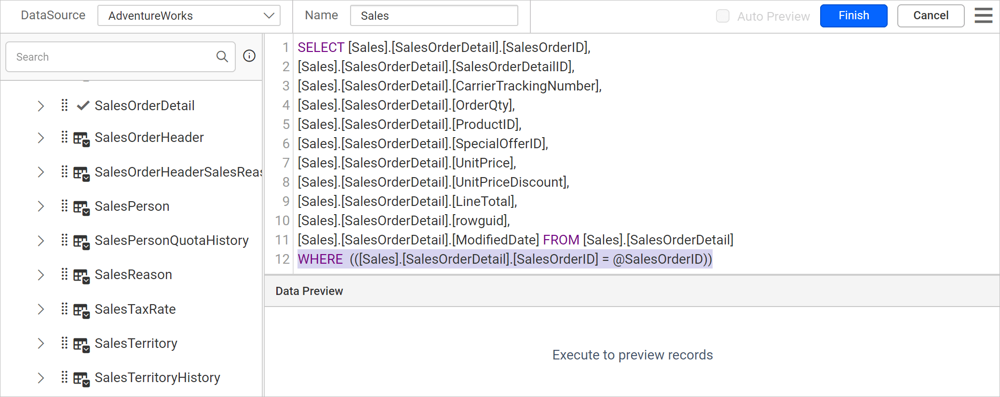

# Define query parameters in the query designer

In the {{site.productNameTM}} Web Report Designer query designer, you can create query parameters in both design mode and query mode. The following sections give the steps for each mode.

## What do I need before I define query parameters?

You define query parameters in the Web Report Designer while you create or edit a dataset. To follow the steps below, first read the [Create Data](./../../manage-data/dataset/create-an-embedded-dataset/) section. The following image shows the initial view of the query designer.



## Create query parameter in design mode

In design mode, the Web Report Designer creates a query parameter from a query filter. Follow these steps:

1. Drag and drop a table into the design area and open the `Query Filters` dialog in the query designer.
   
   > Read the [Query filters](./../../transforming-data/query-filter/) section to learn more about query filters.
2. Click the **Add** icon to create a new filter.
3. Choose any dataset field in the first drop-down list.
4. Choose any **Operator** in the second drop-down list.
5. In the **Value** field, provide a value to filter the data.
6. Select the checkbox next to the value field to create a new `query parameter`.
7. Click the `OK` button.
   

When you save the dataset, the Web Report Designer creates equivalent report parameters under the `PARAMETERS` panel, as in the following image.


## Create query parameter in code mode

In code mode, you create a Web Report Designer query parameter by adding a parameter to the query text. Follow these steps:

1. Click the `switcher` in the query designer toolbar to switch to query mode.
   
2. Specify the query in the text area. The query in the following image returns the list of data from the `AdventureWorks` database, `SalesOrderDetail` table for the `Sales` schema.
   
3. Add the following `WHERE` clause at the end of the query to create a query parameter:
    ```js
    WHERE  (([Sales].[SalesOrderDetail].[SalesOrderID] = @SalesOrderID))
    ```
   
4. Click the `Finish` button. The `Parameters` dialog opens.
   
5. Enter the value for the parameter in the value field and click `OK`.
   

When you save the dataset, the Web Report Designer creates equivalent report parameters under the `PARAMETERS` panel, as in the following image.


## Frequently asked questions

### Does a query parameter create a report parameter?

Yes. When you save the dataset, the Web Report Designer creates equivalent report parameters under the `PARAMETERS` panel.

### Which modes support query parameters?

You can create query parameters in both design mode and query (code) mode of the query designer.

## See also

* [Link a query parameter with a report parameter](./../../transforming-data/link-a-query-parameter-with-a-report-parameter/)
* [Query filter](./../../transforming-data/query-filter/)
* [Create an embedded dataset](./../../manage-data/dataset/create-an-embedded-dataset/)
