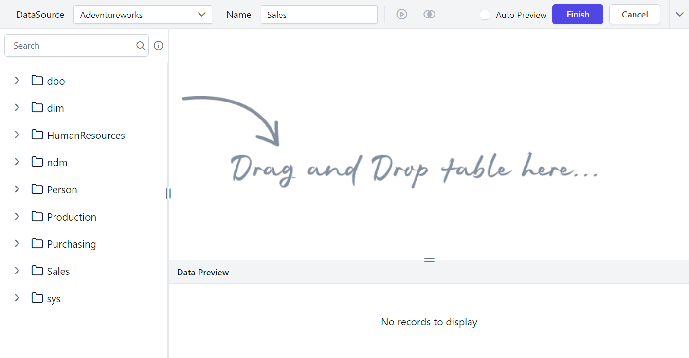
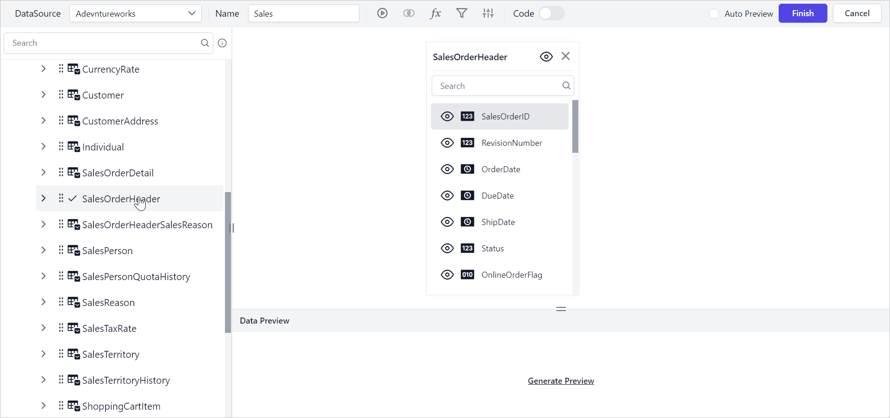

# Formatting columns in the query designer

In the Bold Reports® Web Report Designer query designer, you can rename, exclude, and include data table columns to match your dataset design.

Prefer watching over reading? Watch this video on formatting columns:

`youtube: https://www.youtube.com/watch?v=HSpWBV56Z0k`

## What do I need before I format columns?

You format columns in the Web Report Designer query designer while you create a dataset. To follow the steps below, first read the [Create Data](./../../manage-data/dataset/create-an-embedded-dataset/) section.

The following image shows the initial view of the query designer.

## How do I rename a column?

You can rename data table columns in the Web Report Designer query designer after you retrieve the data from the data source.

> The column rename action will not affect the actual data in the data source.

Follow these steps to rename a column in the data table:

1. Drag a table or view from the left pane and drop it into the center pane labeled `Drag and Drop tables here`, as in the following image.
   
2. Execute the query. The data displays in the preview grid as follows.
   
3. Double-click the column name in the table to rename that column.
   
4. Edit mode is enabled, as in the following image.
   
5. Modify the column name and press the Enter key to commit the change.
   
6. Execute the query. The renamed column displays in the preview grid as follows.
   

## How do I exclude columns?

The `Exclude` option in the Web Report Designer query designer removes unwanted columns from the query design after you retrieve the data from the data source.

> Excluding the columns from data table will not affect the actual data in the data source.

Follow these steps to exclude and include a column in the data table:

1. Exclude the column you want by clicking the icon at the left corner of its column name.
   
2. The table design marks the excluded column, as in the following image.
   
3. Execute the query. The `SalesOrderID` column is removed from the data preview.
   

You can also exclude all the columns in a single click by clicking the icon in the table header.

Clicking the same icon again includes all the columns.

> Minimum of one column must be in enabled state to create dataset.

## How do I search columns?

The column search option in the Web Report Designer query designer lets you locate fields by name quickly, especially in large tables.

* The search bar is enabled for tables with more than 14 columns.
   
* Enter a field name to list the matching fields.
   
* Click the clear icon to reset the search.  
   
* After you click the clear icon, all the table fields are restored.
   

## Frequently asked questions

### Does renaming or excluding a column change my source data?

No. Renaming or excluding columns in the query designer does not affect the actual data in the data source.

### When does the column search bar appear?

The search bar is enabled for tables with more than 14 columns.

### Can I exclude every column?

No. At least one column must be in the enabled state to create a dataset.

## See also

* [Configure expression columns](./../../transforming-data/configure-expression-columns/)
* [Query filter](./../../transforming-data/query-filter/)
* [Join tables](./../../transforming-data/join-table/)
