# Join tables in the query designer

In the Bold Reports® Web Report Designer query designer, you join tables when the dataset query needs data from more than one table. The following sections give the steps to create and edit the relationships between tables.

Prefer watching over reading? Watch this video on joining tables:

`youtube: https://www.youtube.com/watch?v=hscYA0rjqTM`

To follow the steps below, first read the [Create Data](./../../manage-data/dataset/create-an-embedded-dataset/) section.

## How do I open the Query Joiner dialog?

To open the `Query Joiner` dialog in the Web Report Designer query designer, click the `Join` icon in the query designer toolbar.

The `Join` icon in the query designer toolbar is **disabled** if only one table is dropped in the table design view, as in the following image:

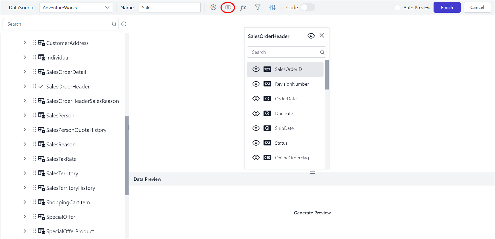

The `Join` icon is **enabled** after a second table is dropped in the table design view, as in the following image:

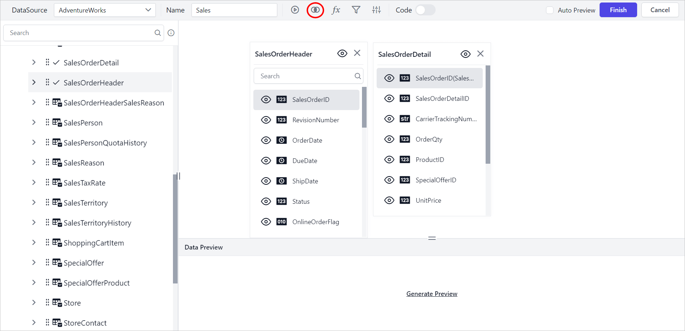

## How do I create a table relation?

The Web Report Designer creates a table relation when you drop a second table into the design area. Follow these steps:

1. Drag a table or view from the left pane and drop it into the center pane labeled `Drag and Drop tables here`, as in the following image.
   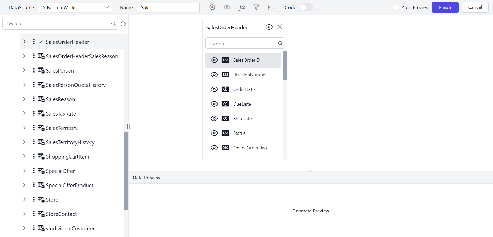
2. Drag and drop another table into the design area.
   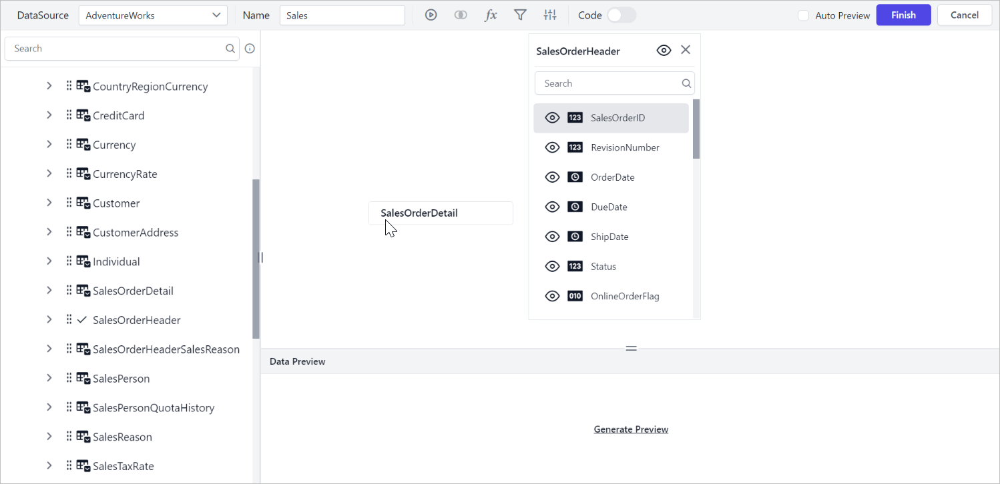
3. If any column of the new table is a foreign key in an already dropped table, the join takes place automatically. Otherwise, the join editor opens so you can define the keys (columns) that join this table with one of the already dropped tables.
   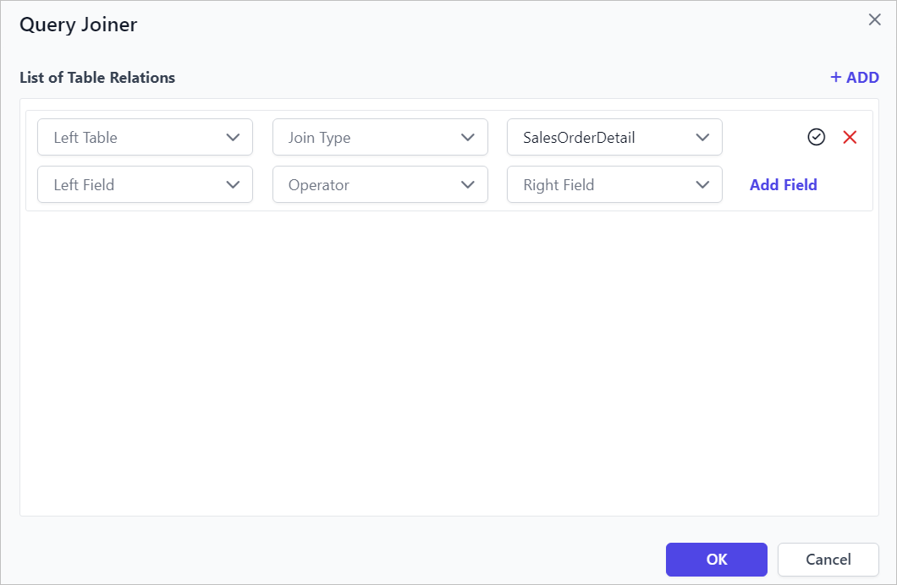

### Table drop-down list

The Web Report Designer `Query Joiner` dialog has two table drop-down lists:

* **Left Table**: The `Left Table` drop-down list shows the tables dropped in the design area.
   

* **Right Table**: The `Right Table` drop-down list shows the tables dropped in the design area. By default, this field selects the table that you dropped last.
   

In the following image, a new relationship starts between the `SalesOrderHeader` and `SalesOrderDetail` tables.

### Join Types

Joins in the Web Report Designer retrieve data from two or more data tables based on a join condition.

**Types**:
1. Inner Join
2. Left Outer
3. Right Outer
4. Full Outer.

Read the [Supported join types](./../../transforming-data/supported-join-types/) section to learn the purpose of each join type.

In the following image, an `inner join` is created between the `SalesOrderHeader` and `SalesOrderDetail` tables.

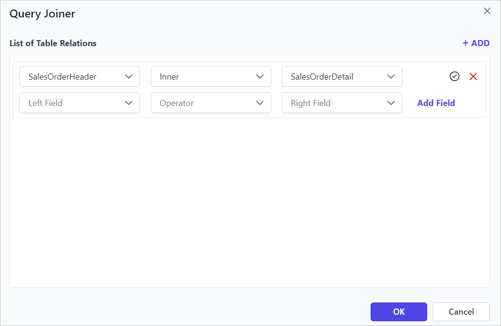

### Table fields

The Web Report Designer `Query Joiner` dialog lists the columns of each selected table:

* **Left field**: Lists the available columns of the table selected in the **Left Table** drop-down list.
   

* **Right field**: Lists the available columns of the table selected in the **Right Table** drop-down list.
   

In the following image, the join field is created for the `SalesOrderID` column in both tables.

### Operator

The Web Report Designer join operator compares the values of two columns, one from each table. Use any of the operators shown in the following image.

In the following image, the `Equal` operator is applied between the `SalesOrderID` column of both tables.

## How do I create multiple join conditions?

The Web Report Designer lets a single table relation have multiple join conditions. Follow these steps:

1. Click the `Add Field` button to create multiple join conditions for a single table relation.
   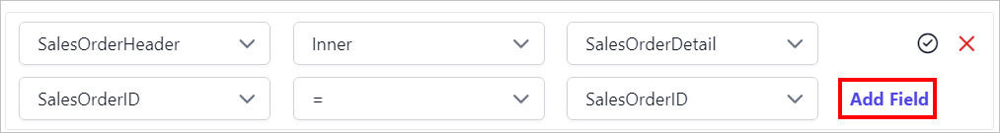
2. Choose the new column field in the **Left Field** and **Right Field** drop-down lists.
3. Choose the operator condition.
   
4. A new join condition is created, as in the following image.
   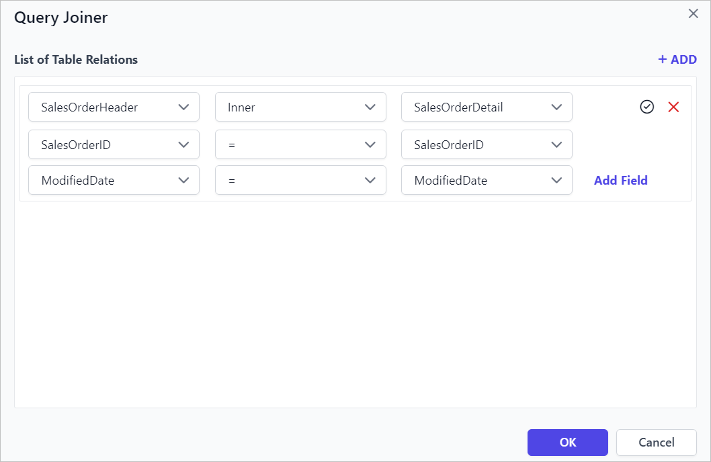

## How do I save a table relation?

You save a table relation in the Web Report Designer `Query Joiner` dialog. Follow these steps:

1. Click the tick icon in the first row of the table relation.
   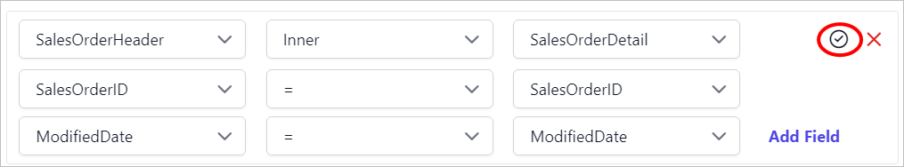
2. Click the `OK` button.
   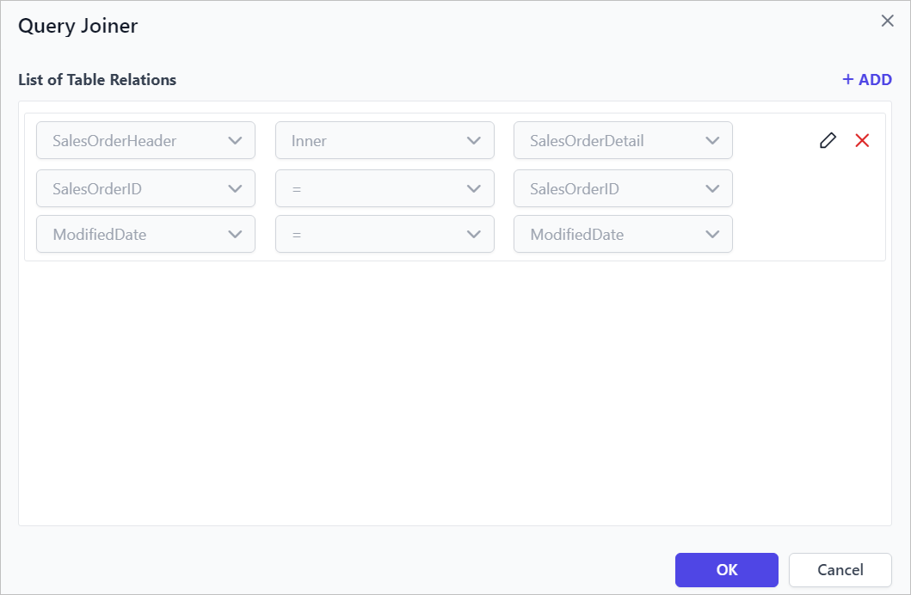
3. The second table is dropped in the design area, as in the following image.
   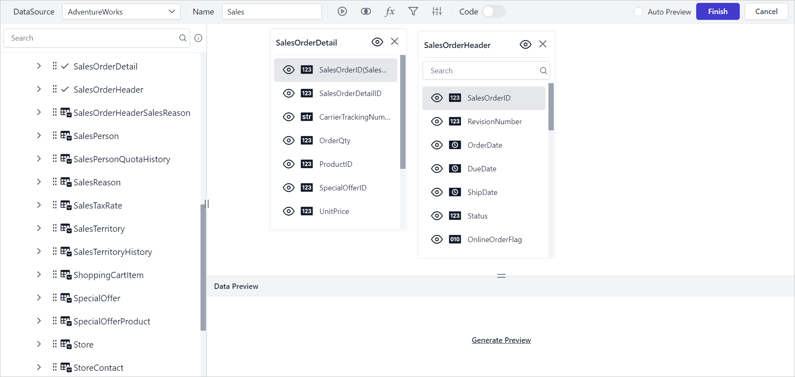

## How do I edit a table relation?

You edit a table relation in the Web Report Designer by reopening the `Query Joiner` dialog. Follow these steps:

1. Click the `Join` icon in the toolbar to open the `Query Joiner` dialog.
   
2. To edit an existing join condition in a table relation, click the `Edit` icon in that field.
   
3. The icon enables the join fields for editing.
   
4. Edit the join condition as required and click the `tick` icon to update the edited join condition.
5. Click the `Ok` button to save the modified join relationship.

## How do I delete a join condition?

You delete a join condition from a table relation in the Web Report Designer `Query Joiner` dialog. Follow these steps:

1. Open the `Query Joiner` dialog.
2. Hover the mouse over the join field to enable the delete option.
   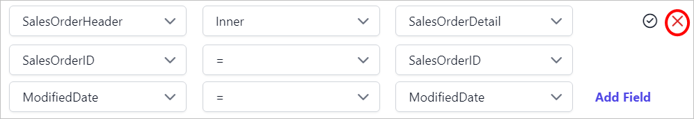
3. Click the highlighted icon to remove the join condition.
   
4. Click the `tick` icon to update the join condition.
5. Click the `Ok` button to save the table relation.

> A table relation must have atleast one join condition.

## How do I delete a table relation?

You delete a whole table relation in the Web Report Designer `Query Joiner` dialog. Follow these steps:

1. Open the `Query Joiner` dialog.
2. Click the close icon at the right corner of the first row of the table relation.
   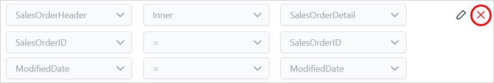
3. Click the `Ok` button to save the joiner state.

## How do I create multiple table relations?

The Web Report Designer supports several table relations when you drop three or more tables. Follow these steps:

1. Drag and drop at least three tables into the design area.
2. Open the `Query Joiner` dialog and click the `ADD` icon to create a new table relation.
   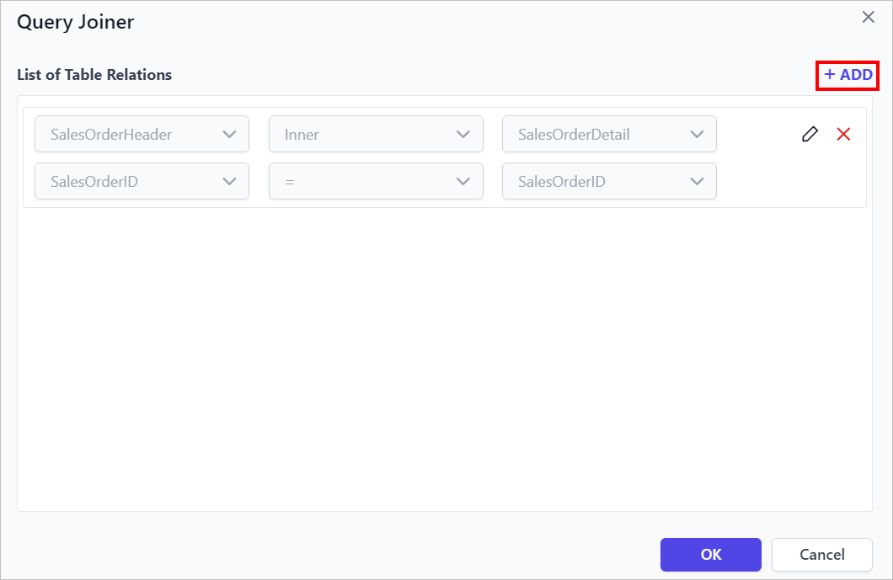
3. Choose the new tables and join information in the fields and click the tick icon.
   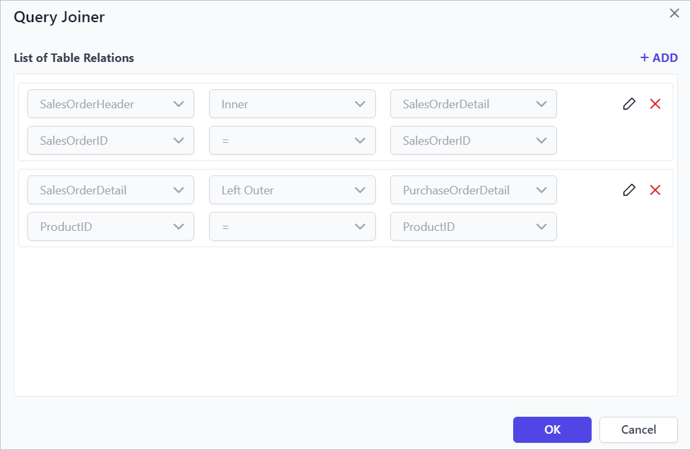
4. Click the `OK` button to save the joiner state.

## Frequently asked questions

### Why is the Join icon disabled?

The `Join` icon is disabled when only one table is dropped in the table design view. It is enabled after you drop a second table.

### Which join types can I use?

You can use Inner Join, Left Outer, Right Outer, and Full Outer joins.

### Can I delete every join condition in a relation?

No. A table relation must have at least one join condition.

## See also

* [Supported join types](./../../transforming-data/supported-join-types/)
* [Formatting columns](./../../transforming-data/formatting-columns/)
* [Create an embedded dataset](./../../manage-data/dataset/create-an-embedded-dataset/)
