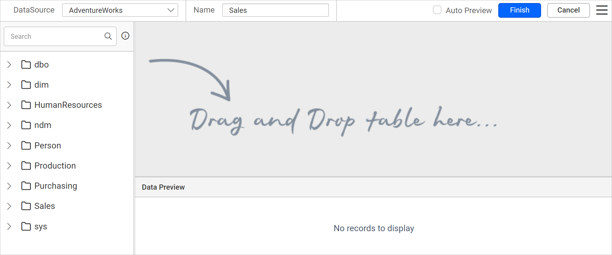
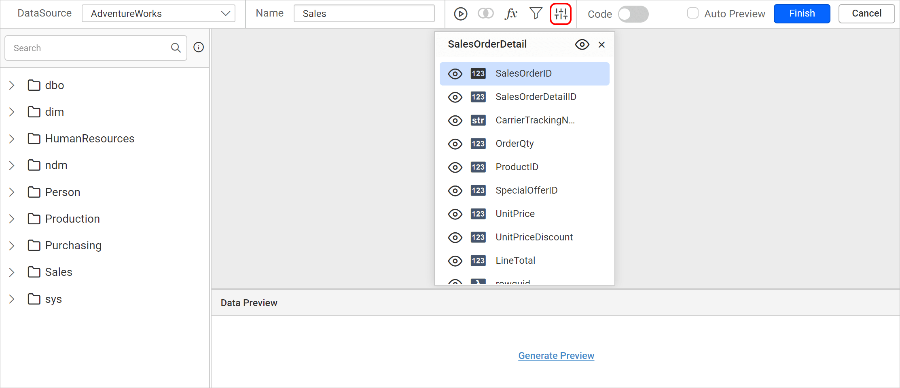
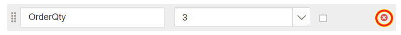

# Create or link dataset parameters

In the {{site.productNameTM}} Web Report Designer, dataset parameters are created from the query parameters in the dataset query, with an equivalent report parameter for each query variable. The link between a dataset parameter and a report parameter happens automatically. If you rename a report parameter, you must link it manually.

## What do I need before I work with dataset parameters?

You work with dataset parameters in the Web Report Designer while you create or edit a dataset. To follow the steps below, first read the [Create Data](./../../manage-data/dataset/create-an-embedded-dataset/) section. The following image shows the initial view of the query designer.

## How do I open the Parameters dialog?

To open the dataset `Parameters` dialog in the Web Report Designer, drag and drop a table into the design area. Then, click the **Parameter** icon in the query designer toolbar.

The `Parameters` dialog opens.

## How do I create a new dataset parameter?

You create a dataset parameter in the Web Report Designer `Parameters` dialog. Follow these steps:

1. Click the `Add` icon to add a new dataset parameter.
   
2. **Parameter Name**: In the **Parameter Name** text box, provide the name for the parameter.
3. **Value**: In the **Value** field, provide the value in the `=Parameters!SalesOrderID.Value` format.
4. Click `OK` to save the dataset parameter.
   

Repeat these steps to create multiple dataset parameters.

When you save the dataset, the Web Report Designer creates equivalent report parameters under the `PARAMETERS` panel, as in the following image.

> The report parameter name is created using the value provided in **Value** field. If the value field is left empty when creating the dataset parameter, then the report parameter name is created using the value provided in **Parameter Name** field.

### Set Expression

The **Value** field of a Web Report Designer dataset parameter can contain an expression that evaluates to a value to pass to the query parameter. Follow these steps:

1. Click the square icon and select `Expression`.
   
2. The expression dialog opens, as in the following image.
   
3. Read the [Expression](./../../compose-report/expressions/) section to learn more about handling expressions in the Web Report Designer. Here, the `SalesOrderID` field is assigned as the expression for the `SalesOrderID` parameter.
   
4. The icon turns `Black color` when an expression is applied to the value field.
   

### Reset Expression

You can remove an expression from a Web Report Designer dataset parameter **Value** field. Follow these steps:

1. Click the square icon and select `Reset`.
   
2. The icon turns `White color` after the reset action.
   

## How do I reorder dataset parameters?

Dataset parameter order matters in the Web Report Designer because the query retrieves results from the database based on the order of the parameters in the query.

The following image shows the parameter list before reordering the parameters.

To change the order of the dataset parameters after creating them, follow these steps:

1. Click and hold the icon in the left corner of the **Parameter Name** field.
   
2. Drag the dataset parameter field to a higher or lower position in the list.
   
3. Drop the dataset parameter field in the desired position.
   

The following image shows the parameter list after reordering the parameters.

## How do I remove a dataset parameter?

To remove a dataset parameter in the Web Report Designer, click the `Delete` icon in the right corner of the parameter in the list.

## How do I link parameters manually?

Manual linking in the Web Report Designer applies to the following scenarios:

* To link a query variable with an existing report parameter.

* To relink a report parameter with a query parameter, if the report parameter is renamed.

### Create query and report parameters

Before you link parameters in the Web Report Designer, create both kinds of parameters. Read the [Create report parameter](./../../report-parameters/add/) section and create the required report parameters in your report. Read the [Create query parameter](./../../transforming-data/define-query-parameters/) section and create the required query parameters.

### Steps to link parameters

Follow these steps to link a query parameter with a report parameter in the Web Report Designer:

1. Open the dataset `Parameters` dialog. The dialog automatically lists the query parameters in the dataset query.
   
2. In the list, find the parameter name you want to link to a report parameter.
3. **Value** Field: The **Value** field drop-down lists the report parameters in the report. Choose the report parameter to link with the query parameter.
   
4. Click the `OK` button to save the parameter linking state.

In the following image, the `SalesOrderID` report parameter is linked with the `SalesOrderID` query parameter.

## Frequently asked questions

### When do I need to link parameters manually?

You link manually when you want to link a query variable with an existing report parameter, or when a report parameter was renamed.

### How is the report parameter name chosen?

The report parameter name comes from the **Value** field. If the **Value** field is empty, the name comes from the **Parameter Name** field.

## See also

* [Define query parameters](./../../transforming-data/define-query-parameters/)
* [Create a report parameter](./../../report-parameters/add/)
* [Query filter](./../../transforming-data/query-filter/)
