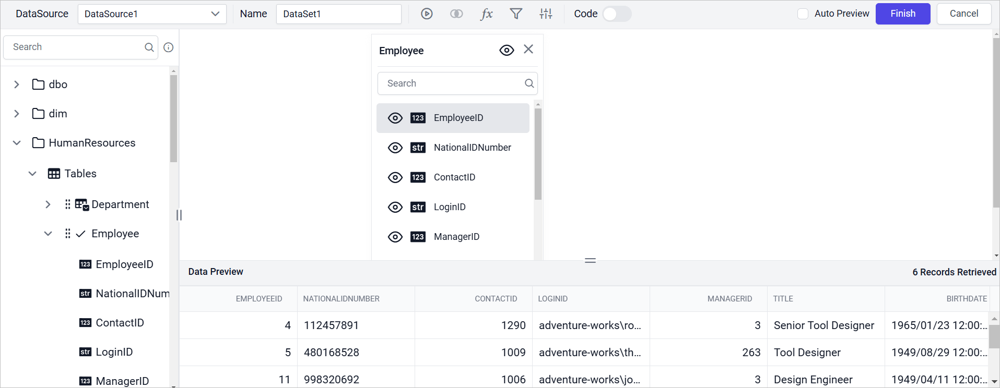
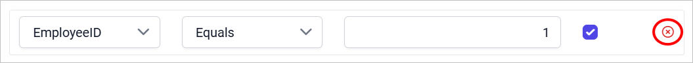

# Query filters in the Web Report Designer

In the Bold Reports® Web Report Designer, query filters limit a dataset to the specific data you need from a database. You filter the data by adding and deleting filters.

The following image shows the query filters dialog.

Prefer watching over reading? Watch this video on adding query filters to a dataset:

`youtube: https://www.youtube.com/watch?v=vyjkswrL56g`

## How do I add query filters?

You add query filters in the Web Report Designer query filters dialog. Follow these steps:

1. Click the **Add** icon to add a filter.

   

2. The first drop-down list shows the dataset fields. Choose the field you need.

   

3. The second drop-down list shows the **Operator** types. Choose an operator.

   

4. In **Value**, enter the value to filter in the dataset fields.

    

5. Select the **Include as parameter** checkbox to include the query parameters.

    

6. Click the **Add** icon again to add a second row. A drop-down appears at the top of the second row.

    

7. Choose the **AND** or **OR** condition from the drop-down to filter data based on the query condition.

    

8. To add multiple filters, follow steps 1 to 5.

    

9. Click **OK** and select the **Execute** icon to view the filtered data in the data preview.

    

10. When you save the dataset, the query parameter is automatically included as a report parameter.

    

## How do I remove query filters?

To remove a query filter in the Web Report Designer, click the **Delete** icon in the right corner of that filter.

## Frequently asked questions

### How do I combine several query filters?

Add a second filter row and choose the **AND** or **OR** condition from the drop-down at the top of that row.

### Does a query filter create a report parameter?

Yes, if you select **Include as parameter**. When you save the dataset, the query parameter is automatically included as a report parameter.

## See also

* [Define query parameters](./../../transforming-data/define-query-parameters/)
* [Join tables](./../../transforming-data/join-table/)
* [Configure expression columns](./../../transforming-data/configure-expression-columns/)
