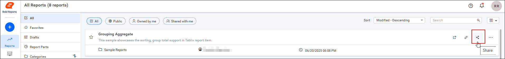
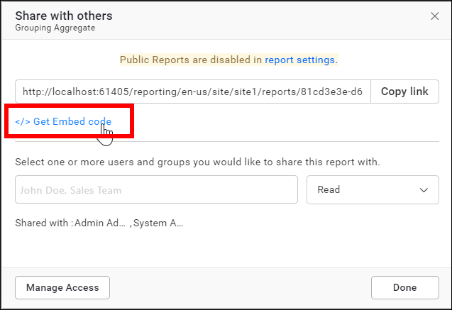
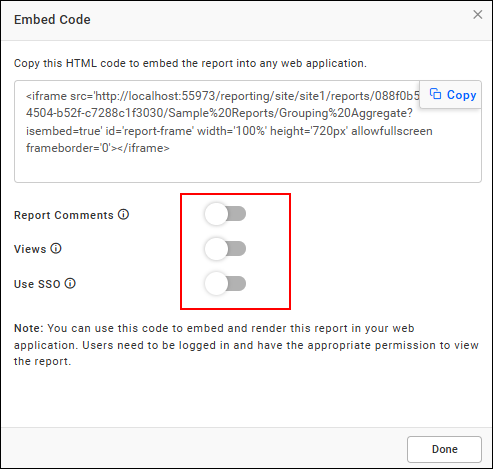
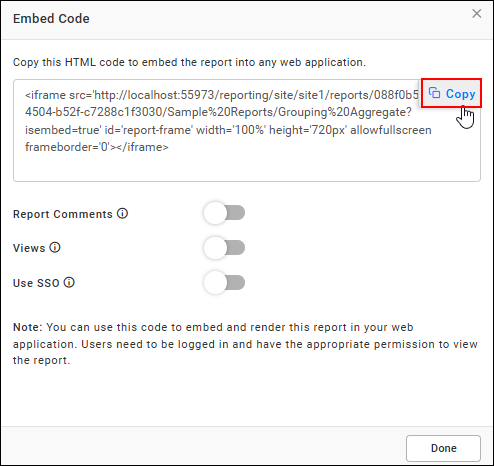
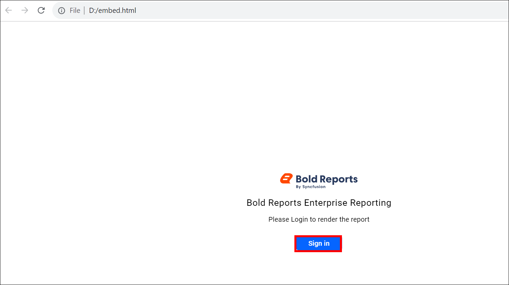
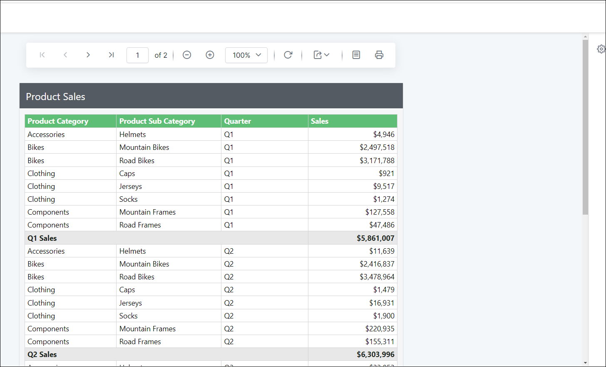
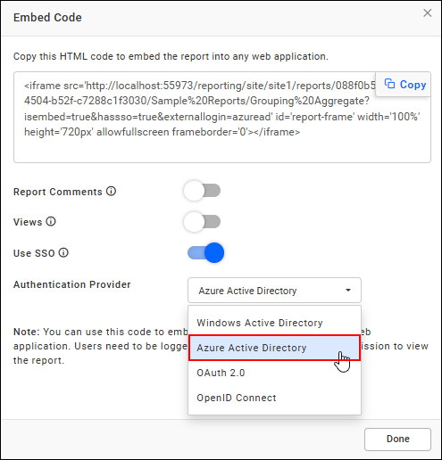
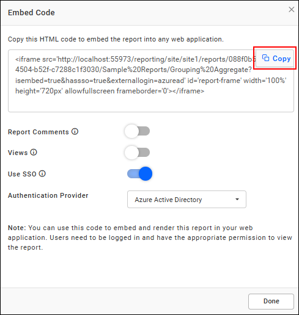
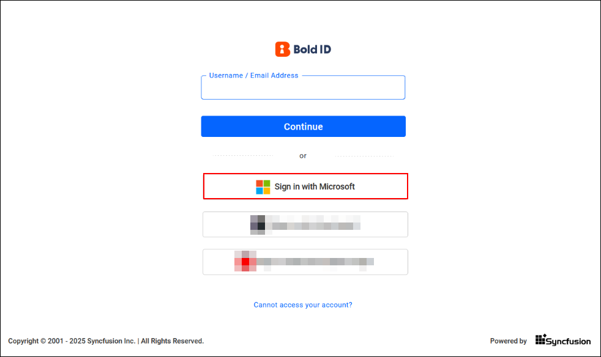
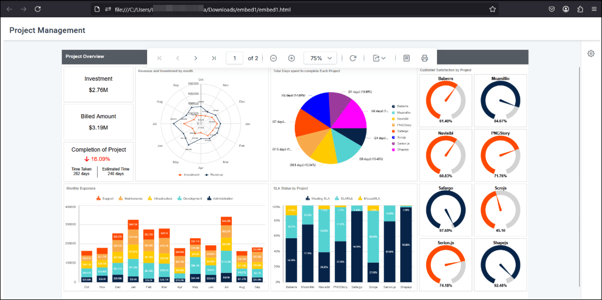

# Get an embed code of report

To get the embed code for a report in Bold Reports<sup>®</sup> Report Server, click the report's `Share icon` and select `Get Embed Code`. Embedded server reports let you render reports in other web applications. Follow these steps to embed server reports in other web applications.

## Getting an embed URL

You get the embed URL of a Report Server report from the `Share` dialog box. Follow these steps:

1. Click the `Share icon` of the report.

   

2. Click the `Get Embed Code` link in the `Share` dialog box.

    

3. By default, the `Reports Comments`, `Views`, and `Use SSO` options are disabled. You can enable these options by sliding the button in the `Embed` dialog box.

    

    The following table describes what each option shows in the embedded view.

    <table>
    <tr>
      <td>
       Report Comments
      </td>
      <td>
       The report comment panel will be shown in the embedded view if this parameter is enabled.
      </td>
    </tr>
    <tr>
      <td>
       Views
      </td>
      <td>
       The report views panel will be shown in the embedded view if the parameter is enabled.
      </td>
    </tr>
</table>

## Steps to embed report using the embed URL

You embed a Report Server report by placing its embed URL in an iframe in your web application. Follow these steps:

1. Copy the embed URL by clicking the copy icon in the `Embed Code` dialog box.
    

2. Embed the copied URL into the other web application using the following code snippet:

    ```html
    <html>
    <head>
      <meta content="text/html;charset=utf-8" http-equiv="Content-Type">
      <meta content="utf-8" http-equiv="encoding">
    </head>
    <body>
      <div id="report">
    <iframe src='http://<your-report-server-domain>/reporting/en-us/site/site1/reports/81cd3e3e-d611-4ef8-9762-8012bae416be/Sample%20Reports/Grouping%20Aggregate?isembed=true' id='report-frame' width='100%' height='720px' allowfullscreen frameborder='0'></iframe>
    </div>
    </body>
    </html>
    ```

3. Run the web application. It displays either the login window or the report, depending on the type of the report.
4. Click `login` and enter valid user credentials. The report then renders automatically.

The following images show the embed login page and the loaded report.

  

  

### How do I embed reports using external SSO authentication?

Bold Reports<sup>®</sup> supports embedding reports into other web applications using external Single Sign-On (SSO) authentication with iframe-based embedding. You can configure the Bold Reports<sup>®</sup> application to support authentication through Windows Active Directory, Microsoft Entra ID (formerly Azure AD), OAuth 2.0, and OpenID Connect. Follow these steps to get the embed code with the appropriate authentication provider:

1. In the Embed Code dialog box, enable SSO and select the authentication provider, as shown in the following image.
  

2. Copy the embed URL by clicking the copy icon in the Embed Code dialog box, and paste it into your web application.
  

3. Run the web application and sign in with your credentials. After you sign in, the report displays automatically based on the permissions assigned to your account.
  
  

### Public embedding

Public embedding in Bold Reports<sup>®</sup> Report Server shows a report without user authentication. To use it, make the report public and embed it. The public report renders automatically without requiring credentials. You cannot enable the comments panel for public report embedding.

> Embedding the public report will not work when the public report setting is disabled. Learn more about the report settings in the <a href="./../../../../administrator-guide/manage-app-settings/report-settings/">Report Settings Guide</a>.

### Private embedding

Private embedding in Bold Reports<sup>®</sup> Report Server makes a report accessible only to users who have read permission. These users must log in to the Bold Reports<sup>®</sup> server before the report renders. The embedded report shows the login page whenever a private report is embedded and the user is not yet authenticated.

> By default, report access mode is set to private until it is changed to public by the owner of the report.

## Frequently asked questions

### Which options are disabled by default in the embed code?

The `Reports Comments`, `Views`, and `Use SSO` options are disabled by default. You enable them by sliding the button in the `Embed` dialog box.

### Can I show comments in a public embedded report?

No. You cannot enable the comments panel for public report embedding.

## See also

* [Embed report using embed secret key](./../embed-secret-key/)
* [Embed reports using an iframe](./../)
