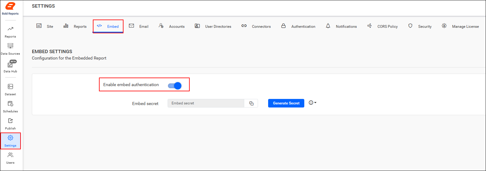
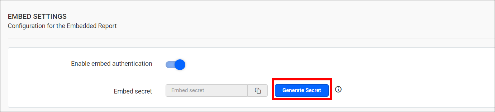
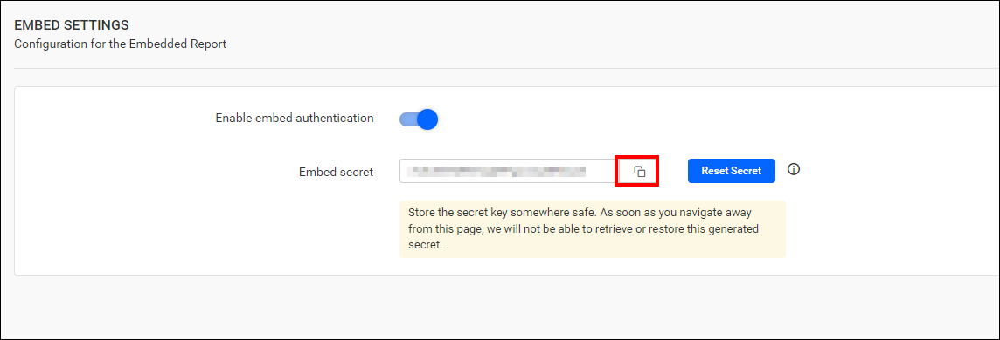
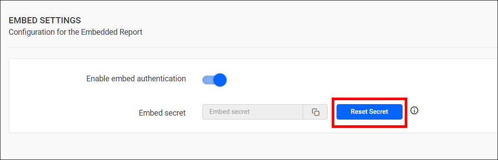

# Embed report using embed secret key

To render a Bold Reports<sup>®</sup> report in your web application with single sign-on (SSO), you frame the embed URL using the embed secret key.

## How do I get the embed secret key?

You generate the embed secret key on the Bold Reports<sup>®</sup> Report Server `Embed` settings page. Follow these steps:

1. Go to the settings page and click `Embed`.
2. On that page, enable the **Enable embed authentication** option.
    
3. Click the `Generate Secret` button.
    
4. The secret key is generated. Save the secret key safely, because you cannot retrieve or restore the generated secret after it is created.
    
5. After the secret key is generated, you can reset it by clicking the `Reset Secret` button.
    
    > Resetting this code will break the previously functioning embedded reports.

## What is the embed URL format?

A Bold Reports<sup>®</sup> embed URL signed with the secret key uses the following format:
`{report URL}?{embed parameters}&embed_signature={signature}`

<table>
<tr>
<td>

Example: `http://localhost:51778/reporting/en-us/site/site1/reports/5ff24040-cd74-42cf-a168-57f8cb7dafed/Sample%20Reports/Invoice?embed_nonce=3e253410-1a82-4fb3-a337-122a8007dafc&embed_user_email=test@syncfusion.com&embed_report_views_edit=true&embed_report_views=true`
`&embed_report_export=true&embed_report_comments=true&embed_timestamp=1583928213&embed_expirationtime=100`
`&embed_signature=W1oqFY6MvJ2lxCwCwLHWihSd19jPfzr`

</td>
</tr>
</table>

The following table describes the parts of the URL.
<table>
<tr>
<th>
Parameter
</th>
<th>
Description
</th>
</tr>
<tr>
<td>
report URL
</td>
<td>
URL of the report to be embedded.
</td>
</tr>
<tr>
<td>
embed parameters
</td>
<td>
Parameters required to embedding the report with SSO.
</td>
</tr>
<tr>
<td>
signature
</td>
<td>
Authorized key for the report to be embedded.
</td>
</tr>
</table>

## Parameters to generate the signature in the embed URL

Bold Reports<sup>®</sup> Report Server needs the following values to form the embed signature.

<table>
<tr>
<th>
Parameter
</th>
<th>
Mandatory
</th>
<th>
Description
</th>
<th>
Example
</th>
</tr>
<tr>
<td>

`embed_nonce`

</td>
<td>
Yes
</td>
<td>
A random string serves to restrict the URL reconstruction or attacks from the hackers.
</td>
<td>

`5ff24040-cd74-42cf-a168-57f8cb7dafed`

</td>
</tr>
<tr>
<td>

`embed_user_email`

</td>
<td>
Yes
</td>
<td>
The email address of the user.
</td>
<td>

`test@syncfusion.com`

</td>
</tr>
<tr>
<td>

`embed_report_views`

</td>
<td>
No
</td>
<td>
Use this value to check the views in the embedded report.
</td>
<td>
true
</td>
</tr>
<tr>
<td>

`embed_report_views_edit`

</td>
<td>
No
</td>
<td>
This value enables you to perform actions such as saving a view, updating a view, and deleting views in the embedded report.
</td>
<td>
true
</td>
</tr>
<tr>
<td>

`embed_report_export`

</td>
<td>
No
</td>
<td>
The export option for various formats of the report in the embedded report is displayed based on this value.
</td>
<td>
true
</td>
</tr>
<tr>
<td>

`embed_report_comments`

</td>
<td>
No
</td>
<td>
Actions related to comments, such as post, edit, delete, reply, watch, unwatch, posting the image and user mention list options can be performed in report based on this value.
</td>
<td>
true
</td>
</tr>
<tr>
<td>

`embed_timestamp`

</td>
<td>
Yes
</td>
<td>
The current time is represented as a UNIX timestamp. The embedded URL that is formed will be valid for 5 minutes from this embed timestamp.
</td>
<td>

`1583934776`

</td>
</tr>
<tr>
<td>

`embed_expirationtime`

</td>
<td>
No
</td>
<td>
Set the duration for the token to remain active. It must be represented in seconds. The default time is 86400 seconds, and the maximum is 604800 seconds.
</td>
<td>

`604800`

</td>
</tr>

<tr>
<td>

`extended_attribute`

</td>
<td>
No
</td>
<td>
Passes custom attributes to the report. The value must be a Base64-encoded JSON object. Custom attributes can be accessed in report expressions at runtime.
</td>
<td>

Custom Attribute JSON (Base64 Encoded)

</td>
</tr>

<tr>
<td>

`parameter`

</td>
<td>
No
</td>
<td>
Passes report parameter values to the report. The value must be a Base64-encoded JSON array containing the report parameter definitions and values.
</td>
<td>

Report Parameter JSON (Base64 Encoded)

</td>
</tr>
</table>

### Extended Attribute Example

The `extended_attribute` value in a Bold Reports<sup>®</sup> embed URL is a Base64-encoded JSON object, as in this example.

JSON:

```json
{"AttributeName":"value1","attributeName2":"value2"}
```

Equivalent Base64 value:

```text
eyJBdHRyaWJ1dGVOYW1lIjoidmFsdWUxIiwiYXR0cmlidXRlTmFtZTIiOiJ2YWx1ZTIifQ==
```

### Parameter Example

The `parameter` value in a Bold Reports<sup>®</sup> embed URL is a Base64-encoded JSON array of report parameter definitions and values, as in this example.

JSON:

```json
[{"name": "SalesOrderNumber","labels": ["SO50752"],"prompt": "Sales Order No:","values": ["SO50752"],"nullable": false}]
```

Equivalent Base64 value:

```text
W3sibmFtZSI6ICJTYWxlc09yZGVyTnVtYmVyIiwibGFiZWxzIjogWyJTTzUwNzUyIl0sInByb21wdCI6ICJTYWxlcyBPcmRlciBObzoiLCJ2YWx1ZXMiOiBbIlNPNTA3NTIiXSwibnVsbGFibGUiOiBmYWxzZX1d
```

## Generating the signature for the embed URL

Bold Reports<sup>®</sup> Report Server authenticates the embedded URL with the `embed_signature` value, described in the following table.

<table>
<td>

`embed_signature`

</td>
<td>
Yes
</td>
<td>
A signature is generated using the secret code to authenticate the embedded URL.
</td>
<td>

`W1oqFY6MvJ2lxCwCwLHWihSd`
`19jPfzr`

</td>
</tr>
</table>

Form the embed parameter in the following format.

<table>
<tr>
<td>

`embed_nonce=5ff24040-cd74-42cf-a168-57f8cb7dafed&embed_user_email=test@syncfusion.com&embed_report_views_edit=true&embed_report_views=true&embed_report _export=true`
`&embed_report _comments=true& &embed_timestamp=1583935418&embed_expirationtime=100`

</td>
</tr>
</table>

The embed parameter formed above is signed with the secret code generated on the Bold Reports<sup>®</sup> server using the HMACSHA256 algorithm. The resulting signed key is appended to the embed URL as `embed_signature`.

### Sample to Embed Report Using SSO Authentication

You can download a Bold Reports<sup>®</sup> sample that embeds a report using SSO authentication from the <a href="https://www.syncfusion.com/downloads/support/directtrac/general/ze/Embedreportusingsso1343889418">Syncfusion<sup>®</sup> download page</a>.

## Frequently asked questions

### Can I recover a lost embed secret key?

No. You cannot retrieve or restore the generated secret after it is created. You can reset it with the `Reset Secret` button, but resetting breaks previously functioning embedded reports.

### How long is a signed embed URL valid?

The embedded URL is valid for 5 minutes from the `embed_timestamp` value.

### Which algorithm signs the embed parameters?

The embed parameters are signed with the secret code using the HMACSHA256 algorithm.

## See also

* [Get the embed code of a report](./../embed-code-of-report/)
* [Embed reports using an iframe](./../)
