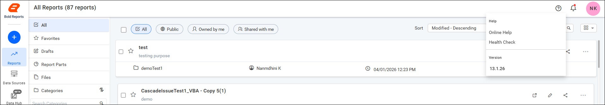
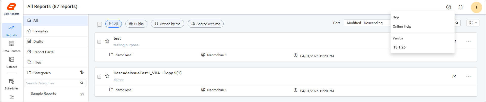

# How to access the Health Check option for Admin users

The Health Check option in Bold Reports® Report Server is available only to users with Admin privileges. Non-admin users do not see this option in the application UI.

## Steps to access the Health Check option

You open the Report Server Health Check page from the `Help` menu with an Admin account. Follow these steps:

1. Log in to the Report Server using an Admin account.

2. Click the `Help` icon in the top-right corner of the application.

3. Select the `Health Check` option from the Help menu.

   The Health Check page displays the system health details.

   

## Access behavior for non-admin users

When a non-admin user logs in to Report Server, the Help menu does not include Health Check:

* The `Health Check` option is not displayed in the Help menu.
* Only general options such as `Online Help` and `Version` are available.

   

## Frequently asked questions

### Why can't I see the Health Check option?

The Health Check option is available only to users with Admin privileges. Non-admin users see only general options such as `Online Help` and `Version`.

### What does the Health Check page show?

The Health Check page displays the system health details of Report Server.
