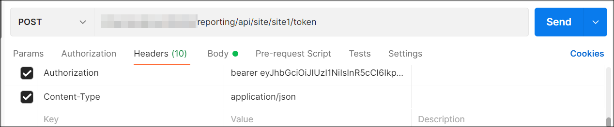
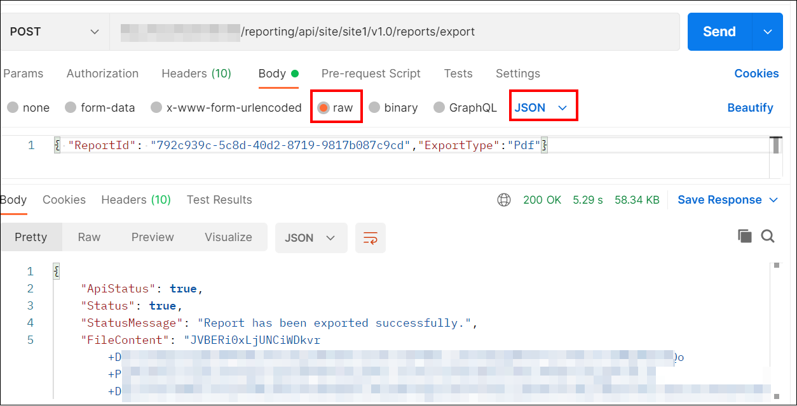

# How to export the Report using API from the postman

In Bold Reports® Report Server, users with read access for reports can export them through the API. You send the report details and export type (Microsoft Excel, PDF, HTML, PPT, CSV, XML, or Word) in the request body. The response is an array of bytes.

## How do I export a report from Postman?

You export a Report Server report from Postman with a `POST` request to the export endpoint. Follow these steps:

1. Open the `Postman` application and create a new `POST` Http request.

2. Generate the [Report Server authentication token using the API](../generate-authentication-token-for-bold-reports-server-using-api/).

3. In the request URL, provide your Report Server URL and append `reporting/api/site/{tenant-name}/v1.0/reports/export` for the <a href="https://help.boldreports.com/enterprise-reporting/rest-api-reference/v1.0/server-api-reference/#operation/Items_ExportReport" target="_blank">export report</a> API.

4. In the headers section, add `Authorization` as the key, `bearer` as the value, and include the generated token.
  

5. In the body section, choose `raw` and select `Json`.

6. Pass the report ID and export type values in JSON.

7. Click `Send`. The response is an array of bytes.
    

## Frequently asked questions

### Who can export a report through the API?

Users with read access for reports can export them through the Report Server API.

### What does the export API return?

The response is an array of bytes.

## See also

* [Export a report with filter parameters using the API](./../export-the-report-with-filter-parameter-using-api/)
* [Export a report with the Export Report API](./../export-report-from-bold-reports-server/)
